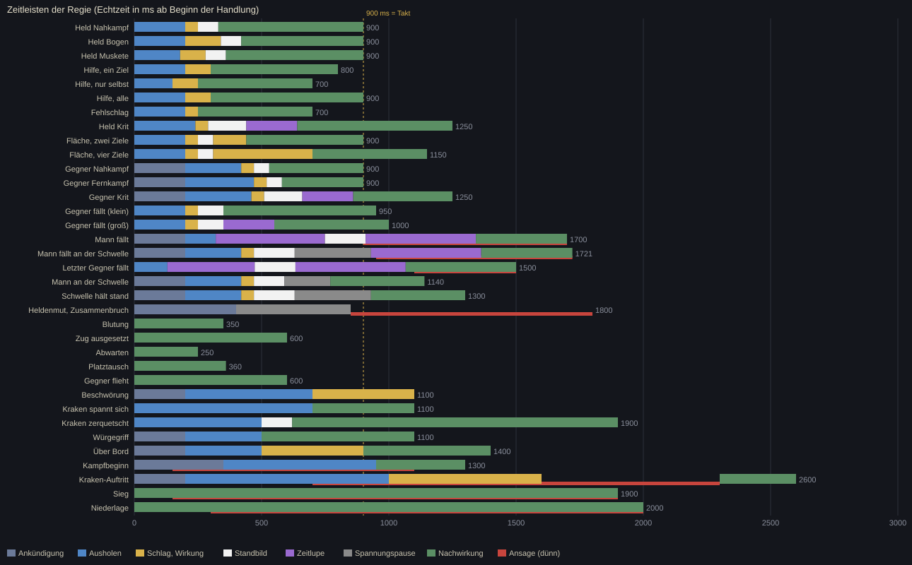

# D1: Regie (Fokusführung und Dramaturgie des Deckkampfs)

Stand: 4. November 2026. Entwurf, gebaut auf den Berichten `R1_ablauf.md` bis `R5_oberflaeche.md`. Es wurde **keine Spieldatei** angefasst. Zwei Hilfsdateien liegen bei:
`D1_zeitleisten.py` (prüft jede Summe der Zeitleisten unten und zeichnet `img/D1_zeitleisten.svg`; Lauf: 0 Abweichungen bei 35 Fällen) und das daraus erzeugte Bild.
Zahlen aus R4 sind dort als [E] (Empfehlung, nicht belegt) gekennzeichnet; ich übernehme sie als Ausgangswerte und **ändere sie, wo die Geometrie von R5 oder die Zeitbilanz von R1 es verlangt**. Jede Änderung ist begründet.

---

## Leitidee

**Wer handelt, bekommt die Bühne; alles andere tritt zurück. Das Ergebnis ist der Anzeige schon bekannt, also darf sie davor Spannung aufbauen und danach Wucht halten, ohne den Takt zu verlängern.**

Fünf Entscheidungen tragen das Ganze:

1. **Beats statt Ereignishaufen.** Die Regeln rechnen eine Handlung sofort durch (R1, Befund 1). Ein neuer **FightDirector** schneidet `Combat.events` an der Handlungsnummer `act` in *Beats* (eine Handlung = ein Beat), plant jeden Beat als Zeitleiste und spielt die Beats **hintereinander** ab. Der Zustand der Regeln eilt der Anzeige voraus, der Director führt deshalb **eigene Anzeigewerte** (gezeigte Kraft, gezeigte Reihe, gezeigter Fokus). Rampenlicht und Kamera folgen dem Beat, nie `c.actor` (R1, Befund 2).
2. **Eine Uhr, drei Rollen.** Bühnenzeit für Figuren, Wirkungen, Klänge und Beat-Zeitleiste (mit Zeitlupe und Standbild); Echtzeit für Kamera, Licht, Wackeln und Schilder (laufen im Standbild weiter, sonst sähe es nach Hänger aus). Klänge hängen an der Bühnenzeit und eilen der Zeitlupe nicht mehr voraus (R1, Befund 3).
3. **Fokus kostet kein Tempo.** Ein gewöhnlicher Beat dauert genau den Takt (900 ms). Nur Krit, Tod, Schwelle, Heldenmut, Kraken und Flächenangriffe dürfen länger sein, und jede Überlänge steht in der Tabelle (Abschnitt „Zeitbudget“). Der Takt wird **gedehnt, nicht umgangen**: `Voyage.stage_t` (R1, 4.4) hält den nächsten Gegnerzug, bis der Beat zu Ende ist.
4. **Eskalationsleiter.** Fünf Stufen, in *allen* Kanälen gleichzeitig (Zoom, Standbild, Wackeln, Zeitlupe, Blitz, Klang). Der gewöhnliche Treffer (20 bis 30 je Kampf, R1 1.6) bleibt schnell und kräftig; Zeitlupe und Ansagen bleiben den seltenen Augenblicken vorbehalten.
5. **Gegnerzüge werden aus Sicht des Getroffenen erzählt.** Beim Gegnerzug sitzt die Kamera zu 65 % beim Opfer, das Opfer ist am hellsten, der Gegner kündigt sich 200 ms vorher kalt an (das Ziel ist schon bekannt, R1 3.2), und alles Wuchtige (Standbild, Zittern, Rückstoß, Rotrand) trifft das Opfer.

Reihenfolge der Wirkung (R4, Rang 1 bis 6): **Licht und Dimmung > Ausholen und Halten > gehaltene Kamera > Übergabe statt Rückfahrt > Schild parallel zur Aktion > Standbild.** Kamerazoom ist von der Figurengröße begrenzt (Abschnitt 3); Licht, Haltung und Schild tragen das Gefühl auch bei Zoom 1,0.

---

## Ablauf und Zahlen

### 1 Zeitmodell, Takt, Betriebsarten

**Begriffe.** *Beat* = die Anzeige einer Handlung (ein `act`). *Bühnenzeit* = Zeit der Figuren, Wirkungen, Klänge und der Zeitleiste; sie läuft mit Faktor `f` (1,0 normal, 0,3 bis 0,5 Zeitlupe, 0,05 im Standbild). *Echtzeit* = Uhr der Kamera, des Lichts, des Wackelns, der Schilder und Ansagen. Alle Zeitleisten unten sind in **Echtzeit-ms ab Beginn des Beats** angegeben und bei Zeitlupe/Standbild nachgerechnet (`D1_zeitleisten.py`: Echtzeit = Bühnen-ms + Standbilder + Summe (Fensterlänge / f − Fensterlänge)).

**Ablauf je Bild** (`Hud._process`, nicht `_draw`; R1, Risiko R7):

1. `dir.feed(combat)`: neue Ereignisse (Id über dem letzten gesehenen) einsammeln, an `act` in Beats schneiden, jeden Beat mit `BeatPlanner.plan()` zu Schritten und Zeiten machen, in die Warteschlange legen.
2. `dir.tick(real_dt)`: Uhren vorrücken, Schritte ausführen, Kamera/Licht/Figuren/Anzeigen fortschreiben, Cues (Klang, Wirkung, Zahl) auslösen.
3. `voy.combat_stage(dir.pending_s())`: der Kampf wartet, bis der Director fertig ist (größter Wert gewinnt, Obergrenze 4,0 s).

**Takt.** `COMBAT_PACE = 0,9 s` bleibt (Selbsttest verlangt `>= 0,8`). `_tick_combat` ruft `act_foe()` erst, wenn `_combat_t <= 0` **und** `stage_t <= 0`. Ein Beat von höchstens 900 ms kostet daher nichts gegenüber heute, weil Beat und Takt in demselben Bild beginnen. `Hud._slow()` entfällt im Director-Betrieb (R1, 4.3: `combat_act` überschrieb den Zuschlag).

**Warteschlange.**

| Regel | Wert |
|---|---|
| Mann nach Mann, Mann nach Gegner: Karten des Nächsten sofort klickbar (wie heute) | sein Beat wird hinten angestellt |
| Aufholen bei mehr als einem wartenden Beat | Abspielgeschwindigkeit `1 + 0,25 · (wartend − 1)`, höchstens 1,75 |
| Mehr als 6 wartende Beats | Beats der Arten `blutung`, `abwarten`, `platztausch`, `hilfe_selbst`, `ausgesetzt` fallen weg (nur Endzustand setzen), der Rest läuft mit Faktor 1,75 |
| Mehr als 24 frische Ereignisse auf einmal (`loud`-Regel von heute) | keine Beats, nur Endzustand setzen (gezeigte Kraft, Reihen), still |
| Ermüdung: dritte gleichartige Beat-Art in Folge | Nachwirkungsanteil (alles nach dem Kontakt) −20 % (Hieb: 900 auf 786 ms) |
| Notbremse (Watchdog) | steht ein Beat länger als das Doppelte seiner Soll-Dauer oder ist `pending_s() > 4,0`: Warteschlange leeren, Endzustand setzen, `push_warning`. Der Kampf blockiert **nie** |

**Betriebsarten.**

| Art | Auslöser | Verhalten |
|---|---|---|
| **voll** | `Settings.fight_view == 0` (neu), Kampf von Hand, nicht headless | alles dieses Dokuments |
| **kurz** | `Settings.fight_view == 1` (neu: „Kampfansicht: voll / kurz“) | alle Zeiten ×0,5, **kein** Zoom, kein Schwenk, keine Zeitlupe, keine Spannungspause, Standbild höchstens 40 ms, Wackeln ×0,5, Dimmung schwächer (Unbeteiligte 0,80, Hintergrund 0,85), Schild ohne Gleiten (300 ms Plakette). Dauern: Hieb 450, Krit 600, Mann fällt 800, Heldenmut/Bruch 700, Kampfbeginn 500, Kraken-Auftritt 1200, Sieg und Niederlage je 900 |
| **schnell** | `voy.auto_combat` (Einstellung „Kämpfe: schnell“), alle Bots | **kein Director wird gebaut.** `start_fight` löst synchron auf, `stage_t` bleibt 0 |
| **headless** | `DisplayServer.get_name() == "headless"` | kein Director in `Hud`; `FightDirector` und `BeatPlanner` sind trotzdem testbar (`tools/directortest.gd`), weil sie `RefCounted` sind und nichts zeichnen |

Ein weiterer Schalter `Settings.shake` (0 aus, 1 schwach ×0,5, 2 normal; R4, Technik 8): bei 0 kein Wackeln und kein Vollbild-Weißblitz (Blitz nur auf dem Sprite), höchstens 3 Vollbildblitze je Sekunde in allen Stufen.

**Überspringen.** Nur die Einleitung („KAMPF“, „DER KRAKEN“) ist überspringbar: jede Fertigkeitswahl, Leertaste oder Klick auf „Abwarten“ ruft `dir.skip_intro()` (Rest in 120 ms ausblenden). Sonst wartet nichts auf Eingaben und nichts blockiert Eingaben.

### 2 Eskalationsleiter

Stufe je Treffer: Blutung oder `n <= 5` → 0; sonst 1; `n >= 24` → 2; `crit` → 3; `lethal` oder Todesstoß-Prüfung → 4. Ein Beat nimmt die höchste Stufe seiner Treffer; Kamera und Standbild richten sich nach dem **ersten** Treffer, weitere Treffer sind je 30 % kürzer (R4).

| Stufe | Zoom-Wunsch | Standbild | Wackeln (px / ms) | Zeitlupe | Blitz | Klang zusätzlich |
|---|---|---|---|---|---|---|
| 0 leicht, Blutung | 1,0 | 40 ms | 1 / 120 | nein | Sprite 33 ms | – |
| 1 normal | Held 1,125, Gegner 1,0625 | 80 ms (Empfang 60) | 2 / 200 | nein | Sprite 50 ms | – |
| 2 schwer (ab 24) | wie 1 | 110 ms | 3 / 260 | nein | Sprite 50 ms, Zahl größer | `thud` −6 dB |
| 3 kritisch | 1,25 | 150 ms | 5 / 360 | 0,5 für 100 Bühnen-ms (200 Echtzeit) | Gold 120 ms nur Sprite und Halo, Schild golden | `clash` −6, `thud` 0 dB, +2 dB Treffer |
| 4 Todesstoß | 1,375 (begrenzt, s. 3) | 160 ms | 6 / 500 | 0,35 vor dem Kontakt (150 Bühnen-ms), 0,3 danach (130 Bühnen-ms) | Rotstich 25 % (Mann fällt) bzw. Warmweiß (letzter Gegner), 2 weiße Bilder | `deathblow`, immer derselbe |
| Gegnertod gewöhnlich | 1,0 | 100 ms | 3 / 300 | groß: 0,5 für 100 Bühnen-ms; klein: nein | Sprite weiß | wie bisher |

*Klein oder groß beim Gegnertod:* groß, wenn es der erste Tod des Kampfes ist, jeder dritte weitere, oder der Gefallene Heilen, Beschwören oder Kriegshorn kann (`who.skills` enthält `f_heilen`, `f_beschwoeren`, `f_horn`). Sonst klein (R4: „zwei von drei nur die kleine Fassung“).

Wackeln: Ausschlag mit 25 Hz (alle 40 ms Vorzeichenwechsel), die ersten zwei Ausschläge **entlang der Schlagachse** (waagerecht, Richtung Angreifer → Ziel), danach gemischt; Stärke = `round(Spitze · Trauma²)`, Trauma 0,4 / 0,6 / 0,7 / 0,85 / 1,0 für Stufe 0 bis 4, Abklingen linear mit der Dauer der Tabelle; Ereignisse addieren (höchstens 1,0). Nur die **Bühne** wackelt (je Schicht mit Tiefe gewichtet, R3 4.2), nie Schilder, Karten, Ansagen.

### 3 Kamera (FightCam)

**Zustand:** `zoom`, `center_x` (Spielfeld-Pixel der Bildmitte), Ziele `zoom_to`, `center_to`, Wackel-Versatz. **Pivot** ist die Fußlinie `FEET`, die Füße bleiben auf ihrer Zeile (R3 4.2), Namensschilder und Zahlen werden **nicht** mitgezoomt, sondern an den umgerechneten Fußpunkt gesetzt: `p_screen = Vector2(240 + (x − center_x) · zoom, FEET + (y − FEET) · zoom)`.

**Fahrt:** Eintritt 140 ms *Cubic Out* (`1 − (1 − u)³`), Wechsel (Übergabe) 140 ms *Sine In Out*, Lösen 140 ms *Sine In Out* (R4 hatte 160, NN/g: Austritt nicht länger als Eintritt). Krit-Eintritt 110 ms, Todesstoß 300 ms (Cubic Out, beginnt 150 ms vor dem Kontakt). Beim Halten **konstant, kein Weiterkriechen** (R4, Pixelraster). Kein Roll. Der Wackel-Versatz wird erst nach dem Runden der Fahrt addiert und ist ganzzahlig.

**Zoom-Wunsch** je Fall: Held normal 1,125; Gegner normal 1,0625; Krit 1,25; Todesstoß 1,375; Schwelle und Prüfung 1,25; Hilfe 1,0625; Fehlschlag 1,0625; Fläche mit 2 Zielen 1,125, mit 3 oder mehr 1,0; Kraken (alle seine Züge) 1,0; Einleitung und Schlussansage 1,0. Alle Stufen sind Vielfache von 1/16 (R3: Achtel genügen für die Ruhelage; zu prüfen, Akzeptanz A9).

**Grenzen** (neu gegenüber R4, weil R5 die Figuren auf 88 x 112 verdoppelt):

```
z_h = 480 / (|x_Handelnder − x_Fokusziel| + 2 · 28 · FE)           # beide Figuren samt Rand im Bild
z_v = (FEET − 40) / (FEET − Kopf_oben)                              # Kopf bleibt unter der Kopfzeile (y 40)
zoom = floor16( min(Wunsch, z_h, z_v) );  Ergebnis < 1,03  →  1,0
center_x = clamp( 0,60·x_Handelnder + 0,40·x_Ziel ,  240/zoom ,  480 − 240/zoom )   (Gegnerzug: 0,35 / 0,65; ganze Pixel)
```

`FE` ist der Figurenmaßstab: `FE = Körperhöhe / 41` (alte Figur 1,0; R5-Zwischenlösung doppelt 2,0; Rig aus R2 1,6). Wirkung der Grenze:

| Geometrie | FEET | Kopf oben | z_v | z_h für Reihe 1 gegen 1 / 2 gegen 2 / 4 gegen 1 / 4 gegen 4 | Ergebnis |
|---|---|---|---|---|---|
| heute (44 x 56, FE 1,0, Reihenabstand 54) | 120 | 64 | 1,43 | 3,87 / 2,07 / 1,68 / 1,07 | Zoom wie R4 (nur Reihe 4 gegen 4 praktisch ohne) |
| R5-Zwischenlösung (88 x 112, FE 2,0, Reihenabstand 56) | 172 | 68 | 1,27 | 2,86 / 1,71 / 1,43 / 0,95 | Zoom bis 1,25; Reihe 4 gegen 4 nur Licht |
| Rig aus R2 (Körper 65, Waffe bis 80, FE 1,6, Reihenabstand 56) | 172 | 92 | 1,65 | 3,3 / 1,86 / 1,53 / 1,0 | Zoom voll nutzbar |

Der Fokusschild (R5 4.2: Höhe 24, y 36 bis 60) sitzt **über dem Kopf, solange `Kopf_screen >= 68`**; sonst **seitlich neben dem Kopf** auf der vom Ziel abgewandten Seite (wie R5 beim Riesen), y = `Kopf_screen + 4`. Bei der R5-Zwischenlösung ist er mit Zoom also immer seitlich.

**Übergabe statt Rückfahrt (R4, Technik 4, geändert).** Der Director löst die Kamera **nicht** am Beat-Ende, sondern 120 ms *nach* dem Ende, falls bis dahin kein weiterer Beat beginnt. Beginnt einer (der Gegner zieht im selben Bild, weil `stage_t` dann 0 wird), wird **geschwenkt und umgeblendet** (140 ms Sine In Out): Brennpunkt und Zoom auf die neuen Werte, Dimmwerte auf die neuen Rollen. Bewegt sich der Brennpunkt weniger als 8 px und der Zoom weniger als 0,04, bleibt alles stehen (spart Flimmern). Das gilt auch über den Seitenwechsel Mann → Gegner, weil der Gegnerzug exakt am Beat-Ende beginnt. Gesamtkosten der Kamera je Handlung: 0 ms.

**Zielwahl-Zustand (Klickkarte).** Solange eine Fertigkeit oder Platztausch gewählt ist und ein Ziel gesucht wird, fährt die Kamera in 140 ms auf Zoom 1,0 (alle Ziele sichtbar, R3 4.6 Punkt 4) und die Klickflächen sind identisch mit denen von heute. Läuft dabei noch ein Beat des Vorgängers mit Zoom, werden die Flächen über `FightGeo.to_screen()` eingetragen (R3 2.6, getestet bei Zoom 1,0 und 1,5).

### 4 Rampenlicht (LightState)

Alle Werte sind Zielwerte, Anfahrt 140 ms *Cubic Out*, Abfahrt 140 ms *Sine In Out*. `bright` ist der Helligkeitsfaktor des Sprites (Farbfaktor, bei der alten Hud-Zeichnung `modulate`, bei der Bühne Uniform `dim`), `desat` das Entsättigen, `tint` der Farbhauch.

| Rolle | Heldenzug | Gegnerzug | Auswahlphase (Mann entscheidet) |
|---|---|---|---|
| Handelnder | 1,00, Hauch (1,05 / 1,00 / 0,92), Rand Gold `d9b24a` | 0,90, Rand `d2564b` 60 %, kalter Hauch (0,95 / 0,92 / 1,0) | Mann am Zug 1,00, Rand Gold, Flackern ±8 % mit 7 Hz |
| Ziel / Opfer | 0,90 (bei Hilfe 1,00, Rand Grün) | **Opfer 1,00**, Zielmarke roter Ring unter den Füßen | gültige Ziele 1,0, ungültige 0,50 (R5 2.5), überfahrenes Ziel Halo |
| Unbeteiligte Männer | 0,55, `desat` 0,25, Hauch (0,52 / 0,52 / 0,62) | 0,70, `desat` 0,15 | 0,80 |
| Unbeteiligte Gegner | 0,55, `desat` 0,25 | 0,55, `desat` 0,25 | 0,80 |
| Hintergrund (Bühne) | 0,65 | 0,60 | 0,85 |
| Vignette (Stärke) | +0,10 | +0,15 | 0 |
| Spot (Ellipse am Boden) | Mitte Handelnder, Halbachsen (60, 26) · FE-Faktor 0,5·FE, Farbe warm (1, 0,85, 0,5) | Mitte Opfer, Farbe kalt (1,0 / 0,40 / 0,30) | wie Heldenzug, Alpha 0,6 |

Beschriftung (Name, Balken, Zahlen) der Gedimmten höchstens auf 80 % (R4). Kraken-Beat: Riese 1,0, alle übrigen 0,45, Spot kaltrot; Schlussansage Sieg: alle Überlebenden 1,0, Hintergrund 1,0 (Licht „steigt“ in 400 ms), Niederlage: alles `desat` 0,6 und 0,5 in 1500 ms.

Zeichnung in der heutigen Anzeige (ohne Bühne von R3): `bright` und `tint` gehen als `modulate` an `draw_texture_rect_region`, die Hintergrundabdunklung ist **ein** Rechteck hinter den Figuren, der Spot der vorhandene vierstufige Kegel (Radius 34 · FE auf Alpha 0,22). Mit der Bühne von R3 setzt `FightStage` dieselben Werte als Shader-Uniforms (Abstufung unter den Figuren).

### 5 Auftritt der Figur (FigView)

Maße in **px bei FE = 1**, im Code mit `geo.fe` multipliziert und auf ganze Pixel gerundet; bei R5-Zwischenlösung ×2. Frame-Namen sind die von R2 (5.3); auf dem alten Atlas gilt deren Rückfalltabelle (`windup_*` → Pose 0 plus Lehnen durch Scherung, `strike_0/1` → 2, `follow_*` → 2, `hit_*` → 3, `door_*` → 4, `idle_*` → 0/1, `fall_*` und `dead` → 3 mit Drehung bis 10°, kein `cast_*` → 2).

| Teil | Wert |
|---|---|
| Ausholen (`windup_0` dann `windup_1`) | zurück 3 px, Lehnen 1 px (Kopf) vom Ziel weg; 0 bis 200 ms bei Nahkampf, Held 0 bis 160 ms Bewegung plus 40 ms Halt |
| Zuschlagen (`strike_0`) | Ausfall **12 px** zum Ziel in **50 ms** (heute 9 px als Sinus), danach `strike_1` am Kontakt |
| Halten (`follow_0`, `follow_1`) | Pose bleibt mindestens **150 ms nach Kontakt** (heute sofort zurück) |
| Rückkehr | 160 ms *Quad Out* |
| Fernkampf (Bogen, Armbrust) | `windup_0` Anlegen, `windup_1` Ziehen, `strike_0` Loslassen mit Rückstoß 1 px; Pfeil startet an der Hand (Anker aus dem Rig) 140 ms vor dem Kontakt |
| Musketier | Anlegen 0 bis 180, Schuss bei 180, Rückstoß 4 px, Mündungsfeuer als Effekt, Kugel 90 ms |
| Vortreten (R4 Technik 2) | Handelnder wird **zuletzt gezeichnet** (`z`), sitzt in der Aktion `round(1,5 · FE)` px tiefer, Schatten 2 px breiter; zurück in 160 ms |
| Nachbilder | beim Schlag 3 Kopien der Position (Abstand 35 ms), Alpha 0,30 / 0,18 / 0,10, Farbhauch (1,0 / 0,85 / 0,5) (R2 5.9: heller und gelber probieren) |
| Weißer Frame | Ziel: `flash` 1,0 für 50 ms (Krit 66 ms), Abklingen in 80 ms; danach roter Stich `tint (1, 0,35, 0,32)` abklingend in 150 ms |
| Treffer-Reaktion | `hit_0` 100 ms (im Standbild), `hit_1` 150 ms, dann `ready`/`idle` |
| Rückstoß Ziel | **5 px** in 120 ms *Quad Out* (ab Ende des Standbilds), zurück in 200 ms; schwer (>= 24) 9 px mit Staub (`dust`) |
| Zittern im Standbild | Opfer ±1 px waagerecht mit 30 Hz, Angreifer ±1 px mit 15 Hz; Angreifer läuft mit Faktor 0,05 weiter |
| Ausweichen (`dodge`) | 300 ms, 5 px zurück, Lehnen 2 px; der Angreifer holt im Leeren aus und stolpert 2 px vor (250 bis 400 ms) |
| Tod (`fall_0..2`, `dead`) | Fallen 80 / 100 / 120 ms ab Ende des Standbilds, danach `dead`, Ausblenden 700 ms (Kraken 1200 ms), dabei 6 px sinken; Staub bei `fall_1`; Fangarm schrumpft statt zu fallen (Scherung) |
| Nachrücken | Gegner hinter dem Gefallenen gleiten in 180 ms *Quad Out* eine Reihe vor, **nach** dem Standbild (`rank` im Ereignis ist der Endstand; der Director gleitet von `shown_rank` nach `rank`) |
| Platztausch (Mann) | beide gleiten 360 ms in einem Bogen (der Vordere hüpft 6 px über den Hinteren), `z` des Vorderen oben |
| Atmen (`idle_0..3`) | Phase je Reihe versetzt (`rank · 0,37 s`), **nach der Director-Echtzeituhr** statt Wanduhr (R1, R6; Screenshots werden gleich) |
| Am Zug in der Eingabe (`ready`) | wie heute: goldene Linie 2 px unter den Füßen, Lichtschein, Name gold (R5 4.1) |

Gezeigte Werte je Figur: `shown_hp` springt beim Kontakt auf `hp1`, `trail_hp` zieht in 0,4 s mit hellem Nachzieher nach (R5 3.2). Bei Heilung gilt `hp1 − hp0` (das Ereignis trägt eine nominale Menge, R1 2.2). `shown_door` und `shown_rank` ebenso.

### 6 Schild, Banner, Zahlen, Ansagen

* **Fokusschild** (R5 4.2, ersetzt das Banner oben rechts; `FightFx.show_banner` wird im Director-Betrieb nicht mehr gerufen): Eintritt 100 ms *Cubic Out* (8 px von oben nachrückend) **mit dem Ausholen**, nicht davor; es steht bis **Kontakt + 150 ms**, Austritt 100 ms. Beim Gegner beginnt es 200 ms *vor* dem Ausholen (Ankündigung, Beat-Zeit 0). Hilfe, Lied, Schutz: Schrift 7, bis Wirkung + 100 ms. Krit: Linie und Rahmen golden, Marke „ · Kritisch!“, 1 Bild weißer Blitz im Symbolrahmen. Flächenangriff: ein Schild über dem Handelnden. Eine große Ansage hat Vorrang (Schild fällt weg). Riese: links neben dem Kopf. Keine Fertigkeit ohne Namen (`_skill_label`).
* **Zahlen** (Hud zeichnet, Director liefert Cues `float`): Pop von 1,5 auf 1,0 in 100 ms *Out-Back*, 150 ms stehen, dann 12 px in 500 ms aufsteigen (*Quad Out*), letzte 150 ms ausblenden (sichtbar rund 800 ms, Krit 1000 ms und 8 px höher). Größen: normal 8 px, Krit 13 px golden mit „!“, Heilung grün mit „+“, Blutung klein in Zustandsfarbe, „verfehlt“ grau. Mehrere Zahlen am selben Ziel 80 ms versetzt und 6 px seitlich abwechselnd. Die Zahl entsteht **am Kontakt nach dem Standbild**, Wirkungstexte („Blutung“, „Betäubt“) 80 ms später und kleiner.
* **Große Ansagen** (`UiState.big`, Band y 32 bis 72 nach R5): Buchstaben skalieren in 120 ms von 1,3 auf 1,0 (*Out-Back*); HELDENMUT golden und aufsteigend (6 px in 700 ms), ZUSAMMENBRUCH rot-violett und absinkend. Die Texte (alle Deutsch): `KAMPF`, `DER KRAKEN`, `GEFALLEN` („%s kehrt nicht zurück“), `HELDENMUT`, `ZUSAMMENBRUCH`, `SIEG`, `DER KRAKEN SINKT`, `NIEDERLAGE`, `RÜCKZUG`; als Plakette am Mann: `%s WIRD GEPRÜFT`, `AN DER SCHWELLE`, `WIDERSTAND`, `SPANNT SICH`, `ÜBER BORD!`, `BETÄUBT`.
* **Zugleiste:** das Porträt des nächsten Akteurs pulst zweimal (220 ms), wenn sein Beat beginnt (Cue `turn_pulse`). Die Zugleiste selbst zeigt weiter `c.upcoming(10)` (sofort), nicht die Anzeigelage.
* **Kopfzeile Runde:** Zähler „Runde n“ blitzt Gold 400 ms bei jedem `turn` mit größerer Runde (Cue `round`), Klang `round_tick` −14 dB; kein Halt.

### 7 Zeitleisten

Alle Zeiten Echtzeit-ms ab Beat-Beginn. Nach Spalte „Soll“ stimmt jede Dauer mit `D1_zeitleisten.py` überein (Bild unten). Die gestrichelte Linie in der Grafik ist der Takt von 900 ms.



Schnellmodus: „schnell“ = kein Beat. „kurz“ = Spalte rechts in der Übersicht (alle ×0,5 oder wie in 1 angegeben).

| Fall (Beat-Art) | Soll voll | kurz | Kontakt | Standbild | Zeitlupe |
|---|---|---|---|---|---|
| `held_nahkampf` | 900 | 450 | 250 | 80 | – |
| `held_bogen` | 900 | 450 | 340 | 80 | – |
| `held_muskete` | 900 | 450 | 280 | 80 | – |
| `hilfe_ziel` (Heilen, Trost, Weckruf, Deckung) | 800 | 400 | Wirkung 300 | – | – |
| `hilfe_selbst` (Schildwall, Ruf, Wut, Nachladen) | 700 | 350 | Wirkung 250 | – | – |
| `hilfe_alle` (Kriegslied, Hohnlied, Horn, Klage, Tinte) | 900 | 450 | Wirkung 300 | – | – |
| `fehlschlag` | 700 | 350 | 250 | – | – |
| `held_krit` | 1250 | 600 | 290 | 150 | 0,5 über 100 Bühnen-ms |
| `flaeche_2`, `flaeche_3`, `flaeche_4` | 900 / 1020 / 1150 | 450 / 510 / 575 | 250, dann +130 je Ziel (+60 Standbild) | 60 (nur erster) | – |
| `gegner_nahkampf`, `gegner_fern` | 900 | 450 | 470 / 520 | 60 | – |
| `gegner_krit` | 1250 | 600 | 510 | 150 | 0,5 über 100 Bühnen-ms |
| `gegner_faellt_klein` | 950 | 475 | 250 | 100 | – |
| `gegner_faellt_gross` | 1000 | 500 | 250 | 100 | 0,5 über 100 Bühnen-ms |
| `mann_faellt` (Todesstoß auf einen Mann) | 1700 | 800 | 749 | 160 | 0,35 über 150, 0,3 über 130 Bühnen-ms |
| `mann_faellt_schwelle` | 1721 | 800 | 470 | 160 + 300 Pause | 0,3 über 130 |
| `letzter_gegner` | 1500 | 700 | 473 | 160 | 0,35 über 120, 0,3 über 130 |
| `schwelle_erreicht` | 1140 | 600 | 470 | 120 + 180 Pause | – |
| `schwelle_haelt` | 1300 | 650 | 470 | 160 + 300 Pause | – |
| `heldenmut`, `zusammenbruch` | 1800 | 700 | – | – | – |
| `blutung`, `ausgesetzt`, `abwarten`, `platztausch`, `flucht` | 350, 600, 250, 360, 600 | halbiert | – | – | – |
| `beschwoeren` | 1100 | 550 | – | – | – |
| `kraken_spannt`, `kraken_quetscht`, `wuergegriff`, `ueber_bord` | 1100, 1900, 1100, 1400 | 550, 900, 550, 700 | quetscht: 500 | quetscht: 120 | – |
| `kampfbeginn`, `kraken_auftritt` | 1300, 2600 | 500, 1200 | – | – | – |
| `sieg`, `niederlage`, `rueckzug` | 1900 (Kraken 2600), 2000, 1200 | 900 | – | – | – |

Fangarm wächst nach 600, Berserker rastet aus (Vorspann) 700, Gegner heilt 800, Kriegshorn 900 sind kleine Fälle ohne eigene Zeile in der Grafik.

#### 7.1 Held, Nahkampf, ein Ziel, Treffer normal (`held_nahkampf`, 900 ms)

Auslöser: `attack` (tgt `foe`, Fertigkeit mit `lunges`), ein `hit` mit Stufe 1 oder 2. Gleicher Ablauf für Axt, Schwert, Schildstoß, Stabhieb, Pistole auf kurze Reihe.

| ms | Kamera und Licht | Handelnder | Ziel und Übrige | Anzeige und Ton |
|---|---|---|---|---|
| 0 | Fokus 60/40, Zoom 1,125 in 140 ms; Dimmung (Abschnitt 4), Spot, Rand Gold | `ready` → `windup_0`, Vortreten (zuletzt gezeichnet, 3 px tiefer) | Ziel 0,90, übrige 0,55 | Fokusschild gleitet ein (100 ms); Klang `focus` −12 dB; Zugleiste pulst |
| 100 | | `windup_1` (Waffe hoch, −3 px, Lehnen 1 px) | | |
| 160 | | | | Klang Ausholen (`Sfx.skill_sound(sk, "go")`, heute sofort, Kontakt − 90 ms) |
| 200 | hält | **Schlag**: `strike_0`, Ausfall 12 px in 50 ms, Nachbilder | | Hiebbogen startet (`FightFx` `slash`/`chop`, Wartezeit 0) |
| 250 | **Kontakt**: Wackeln 2 px / 200 ms (Achse zuerst), Halo am Ziel (additiv, 120 ms) | `strike_1`, zittert ±1 px | `hit_0`, weißer Frame 50 ms, Rückstoß beginnt nach dem Standbild | Zahl springt auf; Treffer-Klang (`hit`, Tonhöhe ±3 %); Funken; `shown_hp` fällt, Nachzieher |
| 250 bis 330 | Standbild 80 ms (Figuren und Wirkungen halten, Kamera/Licht/Schild laufen) | | Opfer ±1 px 30 Hz | |
| 330 | | `follow_0` bis 440, `follow_1` bis 540 | `hit_0` bis 430, `hit_1` bis 540; Rückstoß 5 px in 120 ms | Zahl steht 150 ms; Statuspopup (falls Zustand) 120 ms |
| 400 | | | | Fokusschild austritt 400 bis 500 |
| 540 bis 720 | hält (konstant) | hält `follow_1` | `ready`/`idle` | Zahl steigt; Lesezeit |
| 720 | Übergabe oder Lösen vorbereitet (Abschnitt 3) | **Rückkehr** 720 bis 880 (160 ms *Quad Out*), `z` zurück | Ziel Rückstoß zurück | Plakette des nächsten gleitet ein |
| 900 | Beat-Ende, `stage_t` = 0 | `ready` | | nächster Gegnerzug darf ziehen |

Varianten: **Bogen** (`held_bogen`): Spannen 0 bis 200 (`windup_0/1`), Loslassen bei 200, Pfeil fliegt 140 ms, Kontakt 340, Zoom 1,0625, Fokus 50/50 (Mitte zwischen Schütze und Ziel), Klang Bogen bei 200. **Muskete** (`held_muskete`): Anlegen 0 bis 180, Schuss bei 180 (Mündungsfeuer, Blitz auf dem Sprite 80 ms, Rückstoß 4 px, Wackeln 2 px), Kugel 90 ms, Kontakt 280, Zoom 1,0625. Bei Krit gilt `held_krit`.

#### 7.2 Hilfe, Stärkung, Heilung (`hilfe_*`)

Kein Standbild, kein Wackeln, Zoom 1,0625 (nur bei einem Ziel), Licht auf dem Handelnden **und** dem Empfänger (Grün bei Heilung, Gold bei Stärkung, Blau bei Schutz). Fertigkeit ohne Schadensereignis: Ziele kommen aus `attack.tgts` (R1 3.4).

| ms | `hilfe_ziel` (Heilsegen, Trost, Deckung, Weckruf) | `hilfe_selbst` (Schildwall, Ruf, Wut, Nachladen) | `hilfe_alle` (Kriegslied, Horn, Hohnlied, Klage, Tinte) |
|---|---|---|---|
| 0 | Fokus auf Handelnder, Spot, Schild klein (Schrift 7) | dito, Spot enger | Fokus Mitte Handelnder/alle Ziele, Zoom 1,0, Spot breit |
| 0 bis 200 | `cast_0`, `cast_1` (alt: Pose 2, Stab/Arme hoch), Klang Aufruf | Wut: Zittern ±1 px, Klang `heartbeat` | Singen/Rufen `cast_0..2` |
| 200 bis 300 | Wirkung: Ring/Noten (`FightFx` `heal`, `notes`), Licht wandert in 100 ms zum Empfänger | Ring/Schild am Handelnden (`shield`, `ring` rot für Ruf) | Ringwelle von der Mitte aus, Ring um **jeden** Betroffenen (kein Zählen), Zustandspopup 120 ms je Betroffenem, 40 ms versetzt |
| 300 | **Zahl** `+hp1−hp0` (grün) am Empfänger, `shown_hp` steigt (Nachzieher entfällt), Klang `heal` | Statussymbol poppt | Klang `warsong`/`horn`/`wail` |
| 300 bis 800 / 700 / 900 | Nachwirkung, Empfänger hält Licht 400 ms, Rückkehr | Rückkehr | Rückkehr |

Gegner-Hilfe (`f_heilen`, `f_deckung`, `f_horn`): gleiche Zeiten, kaltes Licht, Schild 200 ms vor dem Ausholen. Feindliche Flächen ohne Schaden (Totenklage, Tintenwolke): Kamera 1,0, Spot auf den Gegner, **alle Männer** gedimmt 0,9 (Ziele), Klang vor Wirkung bei 200 ms; Tinte: Wolke 1,3 s als Effekt über dem Beat-Ende (Effekt darf überstehen, der Beat nicht).

#### 7.3 Fehlschlag (`fehlschlag`, 700 ms)

Wie 7.1 bis 250, aber: Zoom 1,0625, kein Standbild, kein Wackeln, kein Halo. Ziel: `dodge` 250 bis 550 (5 px zurück, Lehnen 2 px), Zahl „verfehlt“ klein grau bei 250, Klang `whiff` bei 250. Angreifer: Schlag ins Leere, stolpert 2 px vor (250 bis 400), Rückkehr 400 bis 560. Pfeil/Kugel fliegen am Ziel vorbei (vorhandene `miss`-Wirkung). Beat-Ende 700: 200 ms kürzer als ein Treffer, sofort lesbar, nie Wucht. Gegnerischer Fehlschlag: gleiche Zeiten mit Ankündigung (Beat 900, Opfer weicht im Licht aus).

#### 7.4 Kritischer Treffer (`held_krit`, `gegner_krit`; 1250 ms)

Zoom 1,25 (Eintritt 110 ms), Ausholen verlängert um 40 ms (Gewicht), Kontakt 290 (Gegner 510 mit 200 ms Ankündigung davor).

| ms (Held) | Kamera und Licht | Figuren | Anzeige und Ton |
|---|---|---|---|
| 0 | Zoom 1,25 in 110 ms; Dimmung wie 7.1, Ziel 0,95 | `windup_0/1`, 4 px zurück | Schild golden von Anfang an (Krit ist bekannt), Marke „ · Kritisch!“ |
| 240 | | Schlag, Ausfall 14 px in 50 ms | |
| 290 | **Kontakt**: Wackeln 5 px / 360 ms; Halo **gold**, 160 ms; Vollbildblitz nur wenn `Settings.shake > 0` (Gold 0,3, 120 ms) | `strike_1` | Ziel `hit_0`, weiß 66 ms; Zahl **13 px golden**, „!“; Klänge `hit` +2 dB, `clash` −6, `thud` 0; 9 Funken in Gold |
| 290 bis 440 | **Standbild 150 ms** | beide zittern | Schild bleibt, Zahl steht |
| 440 bis 640 | **Zeitlupe 0,5** (200 ms Echtzeit = 100 Bühnen-ms): Rückstoß, Nachschwung, Funken laufen langsam; Klänge der Zeitlupe mit Tonhöhe 0,8 | `follow_0` | Rückstoß Ziel 5 px (schwer 9) |
| 640 bis 1250 | normal; Schild aus 590 bis 690; Zoom/Dimmung hält bis Übergabe | Rückkehr 1090 bis 1250 | Zahl steigt bis 1250 |

Gegner-Krit: Ankündigung 0 bis 200 wie 7.7, Zoom 1,25 mit 35 %/65 %, zusätzlich **roter Randschimmer** (Vignette +0,25, 200 ms) auf dem ganzen Bild am Kontakt (510). Kosten gegenüber dem Takt: **+350 ms** (R1: bis +500 erlaubt).

#### 7.5 Flächenangriff und Kameraführung (`flaeche_2..4`)

Beispiele: Wirbelhieb, Rundumschlag (2 Ziele), Pfeilregen, Streuschuss (bis 4 Ziele), gegnerische Flächen mit Schaden (Zerquetschen siehe 7.12).

* **Kamera:** Wunsch 1,125 bei **2** Zielen, **1,0 ab 3** Zielen (nur Licht); Brennpunkt = Mitte zwischen Handelndem und der **Mitte der Ziele** (60/40), bei 1,0 irrelevant. Grenzen nach Abschnitt 3 über den **äußersten** Ziel.
* **Licht:** der Handelnde 1,00, **alle** Ziele 0,90, übrige 0,55. Ein zweiter Spot (Ellipse am Boden) **fährt von Ziel zu Ziel**: je Treffer 110 ms *Sine In Out*, er liegt am Kontakt auf dem jeweiligen Ziel.
* **Treffer:** Kontakt 1 bei 250, Standbild nur dort 60 ms, danach **Kontakt k bei 250 + 60 + 130 · (k − 1)** (heute 0,13 s Staffelung, bleibt). Jeder Treffer hat eigene Zahl, Funken, Klang (Staffelung ≥ 120 ms, `MIN_GAP` bleibt ok), Wackeln 1 px je Treffer (nur der erste 2 px). `miss` im Fächer: Ziel weicht aus, ohne Standbild.
* **Ende:** `max(900, letzter Kontakt + 450)`: zwei Ziele 900, drei 1020, vier 1150 ms. Fangarme (Kraken) werden wie Reihen behandelt, der Riese wird nie Ziel.
* Fernkampf-Fächer (Pfeilregen): Handelnder schießt einmal (Anlegen 0 bis 200, Schuss 200); jeder Pfeil fliegt 140 ms mit 130 ms Staffelung zu seinem Ziel (Kontakt wie oben, Flug beginnt 140 ms früher).

#### 7.6 Tod eines Gegners (`gegner_faellt_klein` 950, `gegner_faellt_gross` 1000)

Letzter Treffer ist `lethal` (aus `hit.lethal`, wird **vor** dem Kontakt bekannt). Beat-Ablauf wie 7.1 bis 250; Unterschiede:

* Standbild **100 ms**, Wackeln 3 px / 300 ms, Kamera 1,0 (nur Licht; Zoom aus dem Wunsch 1,125 des Helden bleibt, wenn schon gehalten).
* **groß:** zusätzlich Zeitlupe 0,5 über 100 Bühnen-ms ab dem Kontakt (350 bis 550 Echtzeit), Zoom +0,0625 Impuls, `flash` weiß auf dem Sprite 80 ms.
* Opfer: ab Ende des Standbilds `fall_0` 80, `fall_1` 100, `fall_2` 120 ms, dann `dead`; Ausblenden 700 ms (Staub bei `fall_1`, Klang je Art wie heute: `fall`, `bones`, `tentacle`); Schatten bleibt 300 ms.
* **Nachrücken** der Gegner dahinter: 180 ms *Quad Out* ab Ende des Standbilds + 300 ms, vom Director aus `shown_rank` nach `rank` gerechnet (kein Sprung zur Regelzeit).
* Hat der Tote einen Mann gehalten (Fangarm), folgt „frei!“ (Text grün, Zustand `griff` verschwindet, Mann sinkt 14 px auf den Boden in 200 ms).

#### 7.7 Gegnerzug aus Sicht des getroffenen Mannes (`gegner_nahkampf`, `gegner_fern`; 900 ms)

Auslöser: `attack` eines Gegners. **Alles ist der Anzeige bekannt**, also zeigt die Ankündigung schon das Opfer (kein Spielvorteil, die Handlung ist entschieden).

| ms | Kamera und Licht | Gegner | Opfer und übrige | Anzeige und Ton |
|---|---|---|---|---|
| 0 | Fokus **35 % Gegner / 65 % Opfer**, Zoom 1,0625; Opfer **1,00**, Gegner 0,90 mit kaltem Rand, übrige Männer 0,70, andere Gegner 0,55, Hintergrund 0,60 | `ready` → `windup_0` langsam (Lehnen 2 px zurück) | Opfer `ready`, roter Zielring unter den Füßen pulsiert | **Fokusschild kalt** (Name des Gegners, Fertigkeit); Klang `focus` −12 dB |
| 200 | hält | `windup_1`, −3 px | Opfer duckt (Lehnen 1 px weg, Haltung angespannt) | Ausholklang bei 380 (Fern: Bogenspannen bei 350) |
| 420 | | **Schlag** 420 bis 470, Ausfall 12 px | | (Fern: Schuss bei 470, Pfeil fliegt 50 ms, Kontakt 520) |
| 470 | **Kontakt**: Wackeln 2 bis 3 px / 200 ms, Achse zuerst, Halo am **Opfer** | `strike_1` | `hit_0` weiß 50 ms; Rückstoß 5 px; Verzweiflungsbalken zuckt, falls Stress | Zahl **rot** (8 px) am Opfer; Klang Treffer; Funken in Opferfarbe |
| 470 bis 530 | Standbild **60 ms (Empfang)**, dafür Opfer ±1 px **30 Hz** und Gegner ±1 px | | | Vignette kurz rot (80 ms) am Bildrand nur wenn Schaden >= 24 |
| 530 bis 750 | hält; Kamera-Schock: Zoom −0,03 und zurück (Out-Back, 160 ms) nur bei Stufe >= 2 | `follow_0/1` | `hit_0` bis 630, `hit_1` bis 750, `shown_hp` fällt mit Nachzieher | Zustandspopup (Blutung, Betäubung) 80 ms nach der Zahl; Schild aus 620 bis 720 |
| 750 bis 900 | Übergabe zum nächsten Beat (Mann zieht: Kamera löst nach 120 ms Gnadenfrist) | Rückkehr 160 ms | Opfer `ready`, Licht des Opfers geht in Auswahllicht über | Plakette des nächsten Mannes gleitet ein |

Gegnerische Flächen mit Schaden (nur Kraken, Zerquetschen) siehe 7.12; Flächen ohne Schaden siehe 7.2. Trifft ein Gegner **einen Mann, der hinter einem Schildwall steht**: statt `hit_0` `block_1` mit blauem Funken, Standbild 60, Zahl in Blau (R2 5.3). Freundbeschuss (Berserker): Opfer ist ein Kamerad, Handelnder rot gerandet.

#### 7.8 Tod eines Mannes (`mann_faellt`, 1700 ms)

Auslöser: `hit` mit `lethal` auf einen Mann (kein `door`-Vorspann), `die` folgt. Entspricht R4 Technik 13 (Todesstoß), mit Gesamtdauer wie heute (1,7 s „GEFALLEN“), aber **inszeniert statt angehängt**.

| ms | Kamera und Licht | Figuren | Anzeige und Ton |
|---|---|---|---|
| 0 bis 200 | Fokus 35/65 auf den Mann, Zoom 1,0625; Opfer 1,0, Gegner kalt | Ankündigung wie 7.7 | Schild kalt, `focus` |
| 200 | **Zoom auf 1,375 (begrenzt, s. 3) in 300 ms** *Cubic Out*; übrige Männer 0,35; ab 300 Rotstich 25 % in 200 ms | Gegner `windup_0` | Herzschlag-Klang `heartbeat` −8 dB bei 300 |
| 320 | **Zeitlupe 0,35 ab hier**, 150 Bühnen-ms bis Kontakt (320 bis 749 Echtzeit) | `windup_1` langsam | `slow_in` −8 dB, Effektklänge Tonhöhe 0,8 |
| 749 | **Kontakt**: Wackeln 6 px / 500 ms, 2 weiße Bilder (je 33 ms), Halo rot | `strike_1` | Zahl rot **13 px**; `deathblow`, `thud` |
| 749 bis 909 | **Standbild 160 ms**; Opfer zittert ±1 px | | |
| 909 bis 1342 | **Zeitlupe 0,3** (130 Bühnen-ms = 433 ms): Mann fällt (`fall_0..2` mit 0,3 gedehnt), Kamera hält | `fall_0..2`, dann `dead` | Staub; Klang `fall` (Tonhöhe 0,75); Ansage **GEFALLEN** beginnt bei 900 (Band, rot, Untertitel „%s kehrt nicht zurück“, 800 ms lesbar) |
| 1342 bis 1700 | Zeitfaktor in 120 ms zurück auf 1,0, Lösen/Übergabe; Rotstich geht | Mann blendet aus (700 ms ab 909) | Ansage bis 1700, `slow_out`; Nachrücken der Männer 180 ms |

`mann_faellt_schwelle` (der Mann stand schon an der Schwelle, R4 14): statt Zeitlupe vor dem Kontakt **Todesstoß-Prüfung**: Kontakt bei 470, Standbild 160, danach **300 ms Spannungspause** (Standbild der Figuren, Herzschläge bei 630 und 780, Zoom 1,25), dann Zeitlupe 0,3 wie oben; 1721 ms. Tod durch Blutung (`dot`, `lethal`): `blutung` mit Fallen, Ansage GEFALLEN und Zeitlupe 0,35 für 100 Bühnen-ms, 1100 ms. Über Bord (7.13) ist kein Tod. Heute kostet GEFALLEN 1,9 s Takt; neu 1,7 s, davon die Zeitlupe als Szene.

#### 7.9 Letzter Gegner (`letzter_gegner`, 1500 ms) und Schlussansage

Auslöser: `die` des letzten Gegners (`c.state` wird im selben Paket `done`; Ereignis `lethal`).

| ms | Kamera und Licht | Figuren | Anzeige und Ton |
|---|---|---|---|
| 0 | Fokus auf Held/Opfer 60/40, Zoom 1,125; übrige 0,35 | `windup_0/1` | Schild golden |
| 130 | **Zoom 1,375** (begrenzt) in 300 ms; **Zeitlupe 0,35** über 120 Bühnen-ms (130 bis 473) | Schlag in Zeitlupe | `slow_in` |
| 473 | **Kontakt**: Wackeln 6 px / 500 ms, 2 weiße Bilder, Halo **warmweiß**; Hintergrund hellt auf 0,9 (Sieg ist nah) | | `deathblow`, `thud` |
| 473 bis 633 | **Standbild 160 ms** | | |
| 633 bis 1066 | **Zeitlupe 0,3** (130 Bühnen-ms): der Gegner zerfällt, die übrigen Gegner (Beschworene, Fangarme beim Kraken) fallen mit | `fall_0..2` | `fall`/`kraken_roar` je Art |
| 1066 | `slow_out`, Lösen | Rückkehr | |
| **1100** | **Schlussansage beginnt** (7.15): der Beat kündigt `outro(result)` an, die Ansage läuft **in** der Zerfallszeit und überlappt die letzten 400 ms | | `bell` |
| 1500 | Beat-Ende | | |

Vom tödlichen Treffer bis zum Kampfende: **3000 ms** (1100 bis zum Ansagebeginn, dann 1900). Heute zeigt die Ansage im selben Bild wie der tödliche Treffer, noch bevor er landet, und läuft nur zu 59 % sichtbar (R1, 4.3). Das sind 1,1 s mehr als heute, davon 0,5 s schon als Überlänge des Beats gezählt (Abschnitt 9).

#### 7.10 Mann an der Schwelle (`schwelle_erreicht` 1140, `schwelle_haelt` 1300)

* **Erreicht** (`hit.door == true`, Mann hatte vorher Kraft > 0): Ablauf wie 7.7 bis 470, dann **Standbild 120**, **Spannungspause 180 ms** (Herzschläge bei 590 und 740, Vignette pulsiert 6 %, Zoom 1,25 in 140 ms), Pose `door_0`, Plakette `AN DER SCHWELLE` (rot, 900 ms) am Mann, Zustandspopup `schwelle` (Schädel). Danach dauerhaft: Ruhepose `door_0/1` im Atemtakt 70 %, Farben `desat` 0,3, schwaches rotes Vignettenpochen (60 Schläge je Minute) **nur während der Eingabe** dieses Mannes, nie in Beats anderer.
* **Hält stand** (`hit.resist == true`, Treffer auf einen Mann, der schon an der Schwelle steht): Todesstoß-Prüfung: Kontakt 470, Standbild 160, **Pause 300 ms** (doppelter Herzschlag, Zoom 1,25), dann weißer Blitz auf dem Mann, Plakette `WIDERSTAND`, Klang `exhale` (hörbares Ausatmen), Schädel pulst einmal. Das Ergebnis war der Anzeige schon bekannt; die Pause ist reine Spannung.
* Beide Fälle ersetzen den gewöhnlichen Treffer des Gegnerzugs (kein zweiter Beat). Der Zeitzuschlag +240 bzw. +400 ms trifft die Anzeige, nicht die Regeln.

#### 7.11 Heldenmut und Zusammenbruch (`heldenmut`, `zusammenbruch`; 1800 ms)

Auslöser: `heroic` oder `snap`, entstanden *innerhalb* einer anderen Handlung; der Director plant daraus **einen eigenen Beat direkt hinter dem Beat, der den Stress ausgelöst hat** (R4 14: Prüfung, Pause, Auflösung).

| ms | Kamera und Licht | Mann | Anzeige und Ton |
|---|---|---|---|
| 0 | Zoom 1,25 (begrenzt) in 140 ms, **alle übrigen 0,35**, Vignette +0,2 | `hit_1` gehalten, zittert ±1 px | Plakette `%s WIRD GEPRÜFT` 400 ms (violett), Verzweiflungsbalken pulsiert bis 100 |
| 400 bis 850 | **Spannungspause 450 ms**: Vignette pulsiert 6 %, sonst Stille | zittert | `heartbeat` bei 400 und 550 (−6 dB), Musik nicht angefasst |
| 850 | 1 weißes Bild (33 ms); **Auflösung** | **Heldenmut:** `cheer_0`, Hochspringen 4 px, zwei goldene Ringe (r 40 und 24, wie heute), Spot gold, Hintergrund 0,45. **Zusammenbruch:** `stun_0`, kauert 3 px, Wackeln 4 px / 500 ms, Rotblitz 0,45 nur bei `Settings.shake > 0`, Rand violett | Ansage `HELDENMUT` (gold, aufsteigend) oder `ZUSAMMENBRUCH` (rot-violett, absinkend), Untertitel „%s: %s“ (Name, Art), Klang `heroic` bzw. `snap`; Buchstaben 1,3 → 1,0 in 120 ms |
| 850 bis 1800 | Ansage **950 ms** lesbar, dann Lösen | | Ansage endet 1800 |

Heute 2,3 s ohne Vorspann; neu 1,8 s mit Spannung. Kurzmodus 700 ms ohne Pause. Frequenz je Kampf 0,0 bis 0,8 (R1 1.6), also kein Ermüdungsproblem. Beim Zusammenbruch „Panik“ oder „verzagt“ folgt kein zweiter Beat; die Art steht im Untertitel.

#### 7.12 Kraken (`kampfbeginn`/`kraken_auftritt`, `kraken_spannt`, `kraken_quetscht`, `wuergegriff`, `ueber_bord`)

Der Riese (88 x 88 bzw. 1,5-fach, steht immer ganz rechts, `FIGHT_BIG_X`) und die Fangarme (Reihen 0 bis 2). Kamera bleibt auf **1,0** (der Riese passt nur dort ganz ins Bild), das Licht trägt.

**Auftritt (2600 ms, einmal je Kraken-Kampf, überspringbar ab 700 ms):**

| ms | Kamera und Licht | Figuren | Anzeige und Ton |
|---|---|---|---|
| 0 | Schwarz → Bild in 350 ms (*Cubic Out*), Hintergrund 0,45 (Sturm), alle 0,45 | Männer `ready` | `thunder` bei 150, Weißblitz 1 Bild bei 200 (nur `shake > 0`), 1 weiterer bei 1400: höchstens 2 in der Einleitung |
| 200 bis 1000 | Rumpeln: Wackeln 1,5 px, 5 Hz, durchgehend; Spot kaltrot auf dem Riesen | **Riese steigt** aus dem Wasser: von +40 px unter der Fußlinie in 800 ms *Cubic Out*, Wasserspritzer (`dust`-Effekt blau), Augen glimmen rot | `kraken_roar` bei 300 |
| 1000 bis 1600 | Zoom langsam 1,0 → 1,0625 (Sine, 600 ms), Spot wandert über die Fangarme (Reihe 3 → 0, 4 x 150 ms) | **Fangarme** erscheinen nacheinander (aus dem Wasser, je 200 ms) | `tentacle` je Arm −3 dB, Staub |
| 700 bis 2300 | | | **Ansage `DER KRAKEN`** (rot) mit Untertitel „Fangarme zuerst, dann der Körper“ |
| 2300 bis 2600 | Licht zum ersten Akteur, Lösen | | |

**Kampfbeginn (andere Formationen, 1300 ms):** 0 bis 350 Einblenden aus Schwarz; **Musterung**: Spot und Dimmung wandern über die Gegner von hinten nach vorn (4 x 150 ms, 350 bis 950), jeder Gegner leuchtet kurz (Name im Schild 100 ms); Ansage `KAMPF` (Untertitel Name der Formation) 150 bis 1100; 950 bis 1300 Licht zum ersten Akteur. Heute 1,5 s plus `_slow(1,8)`.

**`kraken_spannt` (1100 ms; Ereignis `text` „spannt sich!“, kein `attack`):** 0 Hintergrund 0,45, Riese 1,0, übrige 0,45; Spot kaltrot; `kraken_roar` bei 0; Riese `door`-artig gespannt (Pose „spannt sich“, Augen rot), Rumpeln 2 px 500 ms; Plakette `SPANNT SICH` mit Warnsymbol `quetschen` (R5, doppelt groß 18x18, pulsiert, bleibt bis zum Zerquetschen); Männer zucken (Lehnen 1 px zurück). Gegenüber heute (nur schwebender Text und „Z“): die gefährlichste Ankündigung bekommt endlich einen eigenen Beat.

**`kraken_quetscht` (1900 ms; `attack` `f_kr_quetsch` auf alle Männer, vier `hit`):**

| ms | Kamera und Licht | Figuren | Anzeige und Ton |
|---|---|---|---|
| 0 bis 500 | Zoom 1,0, Spot auf dem Riesen; von oben **fällt Schatten** (Vignette oben 0 → 0,6 in 400 ms); Männer 0,55 | Riese hebt sich 8 px, Pose `attack` (Schnabel offen); Männer ducken sich (Lehnen) | `kraken_roar` bei 0; Plakette `ZERQUETSCHEN` |
| 500 | **Aufschlag**: Wackeln 6 px / 700 ms, Dunkelrot 0,5 (600 ms, nur `shake > 0`), Halo rot an jedem Mann | Riese 4 px nach unten | `crash`, `tentacle` |
| 500 bis 620 | Standbild 120 ms | alle vier Männer `hit_0` **gleichzeitig** (Zahlen 40 ms versetzt, 8 px seitlich, damit lesbar) | 4 rote Zahlen |
| 620 bis 1900 | Licht hält 800 ms auf allen Männern 1,0, dann Lösen | `hit_1`, Rückstoß 5 px, Fall bei `lethal` (7.8, ohne Zeitlupe, GEFALLEN erst nach dem Beat) | Zustandspopups |

Wird der Angriff durch Betäubung unterbrochen („unterbrochen!“): Plakette `UNTERBROCHEN` 600 ms, Riese zuckt, Warnsymbol erlischt, `bash`-Klang.

**`wuergegriff` (1100 ms, `f_kr_griff`):** wie 7.7, aber Fangarm-Peitsche 200 bis 500 (heute 450 ms), Kontakt 500, danach der Mann wird **14 px hochgezogen** (`grab`, bis 700) und pendelt ±2 px, der Greifbogen erscheint **erst jetzt** (R1, R19), Text `gepackt!` rot, Zustandspopup `griff`; Misslingen (`miss`): Mann springt zurück, Fangarm schnappt ins Leere, 700 ms.

**`ueber_bord` (1400 ms, `overboard`):** 0 bis 200 Ankündigung, Fangarm hebt den Mann 200 bis 500 (Zoom 1,0625 auf Fangarm/Mann), 500 bis 900 Flug in einem Bogen über die Reling (Parabel 40 px hoch, `fall_0..2` gedreht bis 10°), Ring-Splash und `splash` bei 900, Zahl `über Bord!` (blau), Wackeln 2,5 px; 900 bis 1400 Wasser beruhigt sich, Lücke in der Aufstellung, Männer rücken in 180 ms nach.

#### 7.13 Stille Züge und Kleinkram

| Beat | Zeit | Inhalt |
|---|---|---|
| `blutung` (`hit` mit `dot`) | 350 | Rotblitz 60 ms auf dem Sprite, kleine Zahl in Rot mit Tropfen, Wackeln 1 px, Licht 300 ms auf dem Betroffenen; bei `lethal` Tod (7.8/7.6) |
| `ausgesetzt` (`skip`: betäubt, Schreck, verzagt, Griff) | 600 | Fokus auf der Figur, Sterne kreisen (Betäubung), Plakette `BETÄUBT` / „vor Schreck gelähmt“ / „verzagt“ 500 ms; Gegner: im Takt, kein Zusatz |
| `abwarten` (`wait`, Leertaste) | 250 | Licht wandert zum Nächsten, Figur `idle`; kostet nichts |
| `platztausch` (`move`) | 360 | Bogen, `z` oben, Staubwölkchen 6 px |
| `flucht` (Gegner flieht) | 600 | Gegner dreht um, läuft beschleunigt 120 px nach rechts, blendet am Rand aus, Text „flieht!“ |
| `beschwoeren` | 1100 | Ankündigung 200, `cast_0..2` 200 bis 700, zwei violette Runenringe am Platz Reihe 0 bei 500 und 650, der Neue steigt in 400 ms (Alpha, 8 px), alle Gegner dahinter gleiten bei 700 eine Reihe zurück |
| Fangarm wächst nach (`spawn` ohne Text) | 600 | Wasserspritzer, Arm steigt 400 ms, `tentacle`, Zoom 1,0 |
| Berserker „rastet aus!“ | 700 Vorspann | Plakette `RASTET AUS` rot, Mann zittert ±1 px, Rand rot, dann normaler Beat gegen den Kameraden |
| Rundenbeginn | 0 (Überlagerung) | siehe Abschnitt 6: Zähler blitzt, Zugleiste hat Trennstrich; Fackelflackern +15 % für 250 ms |

#### 7.14 Schlussansage (`sieg`, `niederlage`, `rueckzug`)

Der Director liefert sie, `voy.combat_outro` wird beim Kampfbeginn auf 0 gesetzt, **die Wartezeit läuft über `stage_t`** (siehe Schnittstellen). Beginn: für `sieg` im Beat `letzter_gegner` bei 1100 (7.9), sonst unmittelbar nach dem letzten Beat.

* **Sieg 1900 ms** (Kraken 2600): Hintergrund hellt in 400 ms auf 1,0, Überlebende 1,0, Spot warm gold über der Mannschaft; Überlebende `cheer_0..2` (alt: Hüpfen 3 px, 200 ms Takt); Ansage `SIEG` (Untertitel „%d Gegner gefallen“), Klang `bell` bei 150, Goldblitz 0,4 (800 ms, nur `shake > 0`). Kraken: `DER KRAKEN SINKT`, der Riese sinkt in 1500 ms 60 px, Blasen, Seegang `storm` → 0 in 1500 ms, Untertitel „Das Meer ist wieder still“.
* **Niederlage 2000 ms:** Entsättigen (alle `desat` 0 → 0,6 in 1500 ms), rote Vignette pulsiert einmal, Ansage `NIEDERLAGE` („niemand steht mehr“), Klang `death` bei 300; langsames Zufahren 1,0 → 1,0625 auf die letzte Gefallene Figur nur wenn Zoom erlaubt ist.
* **Rückzug 1200 ms:** grau (0,4), Ansage `RÜCKZUG` („ihr zieht euch zurück“), Männer gleiten 60 px nach links und blenden aus (400 ms).

### 8 Schnellmodus, Bots, headless (zusammengefasst)

Bots und „schnell“: `Voyage.start_fight` löst synchron auf; **kein** Director, **kein** `stage_t`, **kein** Code der Regie läuft. Neue Rechenzeit entsteht nur durch die Ereignisfelder in `Combat` (R1 3.5: +13 % von 3,3 auf 3,7 ms je Kampf, Logik-Prüfsumme 3356533480 unverändert). Headless-Lauf mit Hud (Tests): `Hud._process` baut den Director nicht (`DisplayServer.get_name() == "headless"`), `stage_t` bleibt 0, `_tick_combat` ist bitgleich zu heute (`t3_o` mit `combat_outro = 0,5` bleibt grün). Alles, was zeichnet, steckt in `Hud` und `FightStage`, nicht im Director.

### 9 Zeitbudget (gegenüber heute)

Messgrundlage: R1 1.6 (Häufigkeiten je Kampf) und die Fälle oben; Skript `D1_zeitleisten.py`. „heute“ = Zuschläge über den Takt aus den `_slow`-Aufrufen (Krit 1,1; Gegnertod 1,2; Mann fällt 1,9; Heldenmut/Bruch 2,4; Einleitung 1,8). „neu“ zählt jede Überlänge voll (Obergrenze; die Bedenkzeit der Männer versteckt einen Teil).

| Kampf (Kraft 100) | Zusatz neu | Zusatz heute | Differenz | Schlussansage netto (neu 3,0 s ab letztem Treffer gegen 1,9 s heute, abzüglich der 0,5 s Überlänge des Beats `letzter_gegner`, die schon in „Zusatz neu“ stehen) | Summe |
|---|---|---|---|---|---|
| Draugr | +2,7 s | +3,0 s | −0,4 s | +0,6 s | **+0,2 s** |
| Räuber | +1,9 s | +2,2 s | −0,3 s | +0,5 s | **+0,2 s** |
| Kraken | +2,7 s | +3,6 s | −1,0 s | +1,3 s (Sieg 1100 + 2600 ms) | **+0,3 s** |

Ein Kampf wird in Summe um **etwa 0,2 bis 0,3 s länger** (R1 4.5 erlaubt 0 bis 0,3 s je Aktion, also viele Sekunden je Kampf; wir liegen weit darunter). Pflichtwartezeit allein beträgt dort 12 bis 24 s. Der gewöhnliche Treffer kostet **0 ms**. Das Heldenmut-Zeitfenster schrumpft von 2,3 auf 1,8 s und gleicht den Mehraufwand von Krit, Tod und Schlussszene aus.

---

## Schnittstellen

### Neue Klassen

| Klasse | Datei | Art | Aufgabe |
|---|---|---|---|
| `FightGeo` | `scripts/fight_geo.gd` | `RefCounted` mit Konstanten, statische Funktionen | **eine** Quelle für `FEET`, `STAGE_H`, `HERO_X`, `FOE_X`, `BIG_X`, `FE`, Kopf-/Brust-Anker, `to_screen(Vector2, CamState)`, `fig_x(f, shown_rank)`. Vorgabewerte heute (`FEET 120`), umschaltbar auf R5 (`FEET 172`, Mitten 212/156/100/44 und 268/324/380/436, Riese 408) |
| `BeatPlanner` | `scripts/beat_planner.gd` | `RefCounted`, nur statische Funktionen, **zeichnet nichts** | macht aus den Ereignissen einer Handlung einen `Beat` (Art, Stufe, Schritte, Cues, Dauer); alle Zahlen in der Konstante `T` (Abschnitt 7) |
| `FightCam` | `scripts/fight_cam.gd` | `RefCounted` | Kamerazustand, Easing, Grenzen (Abschnitt 3), Wackeln (Trauma), Übergabe |
| `FightDirector` | `scripts/fight_director.gd` | `RefCounted` mit Signal `cue` | Warteschlange, Uhren, Figuren-, Licht- und Anzeigewerte, `pending_s()`, Notbremse |

Innere Klassen des Directors (reine Daten, vom Renderer gelesen):

```gdscript
class FigView extends RefCounted:
	var f: Combat.Fighter
	var frame := "idle_0"            # Frame-Name nach R2 (FigArt löst ihn in Textur und Rechteck auf)
	var off := Vector2.ZERO          # Versatz in Bühnenpixeln, schon gerundet, ohne Kamera
	var lean := 0.0                  # Neigung am Kopf in px (alter Atlas: Zeilenband-Scherung), + = zum Gegner hin
	var flash := 0.0                 # 0..1 weißer Frame
	var tint := Color(1, 1, 1, 0)    # Farbhauch, a = Anteil
	var bright := 1.0                # Helligkeit (Abschnitt 4)
	var desat := 0.0
	var alpha := 1.0                 # Gefallene blenden aus
	var outline := Color(0, 0, 0, 0)
	var z := 0                       # Zeichenreihenfolge, Handelnder zuletzt
	var drop := 0.0                  # Vortreten (px tiefer)
	var shadow_w := 0.0              # Schatten breiter (px)
	var ghosts: Array[Vector2] = []  # Nachbilder (Positionen), höchstens 3
	var shown_hp := 0.0              # gezeigte Kraft
	var trail_hp := 0.0              # Nachzieher
	var shown_door := false
	var shown_rank := 0
	var alive := true                # false: stirbt oder ist weg, wird noch gezeichnet bis alpha 0
	var x := 0.0                     # gezeigte Mitte (gleitet beim Nachrücken)

class CamState extends RefCounted:
	var zoom := 1.0
	var center_x := 240.0
	var shake := Vector2.ZERO        # ganzzahlig

class LightState extends RefCounted:
	var bg := 1.0                    # Hintergrund
	var vignette := 0.0
	var spot_pos := Vector2.ZERO     # Boden, Bühnenpixel
	var spot_r := Vector2(60, 26)
	var spot_col := Color(1, 0.85, 0.5)
	var spot_amt := 0.0
	var spot2_pos := Vector2.ZERO    # zweiter Spot (Flächenangriff, Zielwahl)
	var spot2_amt := 0.0

class UiState extends RefCounted:
	var plaque := {}                 # {who, name, skill, icon, side, crit, small, t (0..1 ein/halten/aus), alpha, dy, kind: "act"|"chip", text}
	var big := {}                    # {text, sub, col, style: "rise"|"sink"|"pop", t, dur}
	var turn_pulse := {}             # {f, t}
	var round_flash := 0.0
	var warn_crush := false          # Kraken spannt sich
```

### Funktionen von `FightDirector`

```gdscript
class_name FightDirector
extends RefCounted

enum Mode { FULL, SHORT }
signal cue(kind: String, data: Dictionary)   # "sfx", "fx", "float", "halo", "status_pop", "turn_pulse", "round", "stage_flash"

func _init(geo: FightGeo, mode: int = Mode.FULL, manual_clock: bool = false) -> void
func begin(c: Combat) -> void                    # Anfangszustand aus dem Combat (gezeigte Kraft, Reihen), Einleitung planen
func end() -> void                               # Warteschlange und Verweise leeren (R1 R20)
func feed(c: Combat) -> void                     # neue Ereignisse (id > _seen) holen, in Beats schneiden und planen
func tick(real_dt: float) -> void                # Uhren, Schritte, Kamera, Licht, Figuren, Cues
func pending_s() -> float                        # echte Sekunden, die der Director noch braucht (Warteschlange + laufender Beat + Ausklang)
func busy() -> bool
func set_selecting(valid_targets: Array) -> void # leer = nicht am Wählen; sonst Zoom 1,0 und ungültige Ziele 0,5
func skip_intro() -> void
func stage_dt() -> float                         # Bühnenzeit des letzten tick (für FightFx.tick und Hud-Wirkungen)

func fig(f: Combat.Fighter) -> FigView
func figs() -> Array                             # alle gezeigten Figuren in Zeichenreihenfolge (inkl. sterbender)
func fig_x(f: Combat.Fighter) -> float           # gezeigte Mitte (Ersatz für Hud._fig_x)
func camera() -> CamState
func light() -> LightState
func ui() -> UiState

# Test und Screenshot
func debug_seek(ms: float) -> void               # Beat-Uhr auf exakt ms (nur manual_clock), ohne Cues zu verlieren
static func synth_events(c: Combat, kind: String) -> Array   # erzeugt die Ereignisliste für --beat=<kind> (Abschnitt Akzeptanz)
```

`BeatPlanner`:

```gdscript
class Beat extends RefCounted:
	var kind := ""                   # "held_nahkampf" ... (Tabelle 7)
	var act := 0
	var actor: Combat.Fighter
	var targets: Array = []          # [{f, hit: bool, crit, lethal, n, hp0, hp1, door, resist, dot}]
	var level := 0                   # Eskalationsstufe 0..4
	var side := 0
	var stage_len := 0.0             # Bühnen-ms
	var freezes: Array = []          # [{at (Bühnen-ms), ms (Echtzeit)}]
	var slows: Array = []            # [{from, to, f}] in Bühnen-ms
	var steps: Array = []            # sortiert nach Bühnen-ms: {t, ch: "cam"|"light"|"fig"|"ui"|"cue", ...}
	var skippable := false

static func classify(events: Array, ctx: Dictionary) -> String          # Beat-Art (Entscheidungstabelle unten)
static func plan(events: Array, ctx: Dictionary, mode: int) -> Beat     # ctx: geo, shown (gezeigte Zustände), kills_so_far, repeat (Ermüdung), round
static func real_length(b: Beat) -> float                               # Echtzeit-ms (Bühnen-ms + Standbilder + Zeitlupe), für Tests und pending_s
static func escalation(ev: Dictionary) -> int
```

*Entscheidungstabelle `classify`* (erste zutreffende Zeile gewinnt, alle Ereignisse eines `act`):

| Bedingung | Art |
|---|---|
| `heroic` oder `snap` ohne eigenes `attack` | `heldenmut` / `zusammenbruch` (immer ein **eigener** Beat hinter dem auslösenden) |
| `text` „spannt sich!“ | `kraken_spannt` |
| `attack` mit `overboard` | `ueber_bord` |
| `attack` `f_kr_griff` mit `text` „gepackt!“ | `wuergegriff` |
| `attack` `f_kr_quetsch` | `kraken_quetscht` |
| `die` des letzten Gegners | `letzter_gegner` |
| `hit.lethal` auf einen Mann | `mann_faellt` (mit `shown_door` → `mann_faellt_schwelle`) |
| `hit.door` oder `hit.resist` auf einen Mann | `schwelle_erreicht` / `schwelle_haelt` |
| `hit.lethal` auf einen Gegner | `gegner_faellt_klein` oder `_gross` (Regel in 2) |
| `hit.crit` | `held_krit` / `gegner_krit` (nach `attack.by.side`) |
| `attack.tgt` ist `foes`, `heroes` mit 2 oder mehr Zielen und Schaden | `flaeche_<n>` |
| `attack.tgt` ist `foe`/`hero` und alle `miss` | `fehlschlag` |
| `attack.tgt` ist `foe`/`hero`, Treffer | `held_nahkampf` / `held_bogen` / `held_muskete` (nach `FightFx.go_fx`/`is_flight`), Gegner `gegner_nahkampf` / `gegner_fern` |
| `attack.tgt` ist `ally` | `hilfe_ziel`; `self`/`fself` | `hilfe_selbst`; `allies`/`fallies`/`foes`/`heroes` ohne Schaden | `hilfe_alle` |
| `hit` mit `dot` und `attack` fehlt | `blutung` |
| `skip`, `wait`, `move`, `flee`, `spawn`, `text` | `ausgesetzt`, `abwarten`, `platztausch`, `flucht`, `beschwoeren` bzw. Fangarm-wächst-nach |

### Wer ruft wen

```
Combat.events ─(Felder act, by, rank, round, tgts, tgt, hp0, hp1, lethal, door, resist, turn, move, skip, wait, flee, dot; R1 3.4)
     │
Hud._process(delta)  [nur wenn voy.combat != null, nicht auto_combat, nicht headless]
     ├─ dir.feed(c)                       BeatPlanner.classify/plan → Warteschlange
     ├─ dir.tick(delta)                   → cue-Signale
     │     ├─ "sfx"        → Sfx.play(name, db, 0.0, pitch)         (Verzögerung gibt es nicht mehr, der Director hat die Zeit)
     │     ├─ "fx"         → _fx.add(kind, data, 0.0, dur)           (FightFx bleibt; tick(dir.stage_dt()))
     │     ├─ "float"      → Hud-Zahlen (Pop, Steigen, Klassen)
     │     ├─ "halo"       → FightStage.pulse_light(pos, col, r, dur)  (alt: ein additiver Kreis im Hud)
     │     ├─ "status_pop" → FightUi.status_pop(f, name)
     │     └─ "turn_pulse","round" → FightUi (Zugleiste, Kopfzeile)
     ├─ voy.combat_stage(dir.pending_s())  hält den Kampf (Voyage._tick_combat prüft stage_t)
     └─ _tick_fight(dir.stage_dt())        FightFx.tick und Schwebezahlen laufen in Bühnenzeit

Hud._draw_combat_view / FightStage._process
     ├─ dir.camera(), dir.light(), dir.figs(), dir.ui()  → Zeichnen (Figur nach FigView, Schatten, Nachbilder, Dimmung, Spot)
     ├─ FigArt.frame(kind, view.frame)    (Frame-Name → Textur und Rechteck, R2)
     └─ Klickflächen: _register(FightGeo.to_screen(rect, dir.camera()), "ft..")   (R3 2.6)

Hud.fight_click / fight_key
     ├─ dir.set_selecting(valid)           beim Wählen eines Ziels (Zoom 1,0 in 140 ms)
     └─ dir.skip_intro()                   bei jeder Fertigkeitswahl, Leertaste

Main: baut Hud, Settings → Hud.fight_view; Flags --beat=<kind>:<ms>
```

### Änderungen an bestehenden Schnittstellen

* **`Combat`** (`scripts/combat.gd`, nur Ereignisfelder, **keine Regeländerung**): die Felder und Typen aus R1 3.4 (Priorität 1 und 2, ohne `status`), der Diff liegt in `docs/kampf_spektakel/R1_werkzeuge/R1_combat_ereignisfelder.diff.txt`. Bedingung: Logik-Prüfsumme **3356533480** bleibt, kein neuer `randf`/`randi`. Zusätzlich (neu, Priorität 3, empfohlen): `status`-Ereignis (`who`, `text` = Zustand, `n` = Runden) für `guard, buff, taunt, cleanse, mark, stun, bleed, reload, blind`, damit Zustandssymbole genau am Kontakt poppen; ohne sie zeigt der Director den Zustand am Ende des Beats (bei mehreren wartenden Beats sofort).
* **`Voyage`** (`scripts/voyage.gd`): `var stage_t := 0.0`, `func combat_stage(seconds: float) -> void` (nur wenn `combat != null and not auto_combat`; `stage_t = minf(maxf(stage_t, seconds), 4.0)`), `_tick_combat`: `stage_t = maxf(stage_t - delta, 0.0)`; Gegnerzug nur bei `_combat_t <= 0.0 and stage_t <= 0.0`; im Zweig `state == "done"` zuerst `if stage_t > 0.0: return`. `COMBAT_PACE` und `combat_outro` bleiben unverändert (Tests); `Hud` setzt `voy.combat_outro = 0.0` zu Beginn eines Kampfes mit Director.
* **`FightFx`:** `show_banner(...)` bekommt optional `dur`; `tick(delta)` hat einen Schalter `external_clock` (Director liefert die skalierte Zeit, `freeze`/`slowmo`/`zoom` werden dann nicht benutzt); `FEET` verschwindet zugunsten von `FightGeo`.
* **`Settings`:** `static var fight_view := 0` (0 voll, 1 kurz, Schlüssel `play/fight_view`) und `static var shake := 2` (Schlüssel `play/shake`); je eine Zeile in den Einstellungen („Kampfansicht: voll / kurz“, „Wackeln und Blitze: aus / schwach / normal“).
* **`Hud`:** `_fight_events`, `_slow`, `_fx_go`, `_fx_hit`, `_fx_miss`, `_anim`, `_floats`, `_ghosts`, `_ev_*` gehen schrittweise in Director und `BeatPlanner` auf (Wirkungsauswahl `FightFx.go_fx/hit_fx` bleibt). Bis zur Abnahme bleibt der alte Pfad hinter `const USE_DIRECTOR := true` erhalten (Rückfall, kein Doppelbetrieb: ein Kampf läuft entweder mit Director oder ohne).
* **`MusicDirector`:** optional später `duck(db, seconds)` (Regel „Musik beim Fokus 3 bis 6 dB leiser“, R4 Technik 12); nicht Teil der ersten Lieferung.

---

## Dateien

Besitzer: **Regie** = Helfer, der dieses Dokument baut; **Bühne** (R3), **Figuren** (R2), **Oberfläche** (R5), **Ton** = die Helfer der jeweiligen Entwürfe; **Integration** = der eine Helfer, der `hud.gd` und `main.gd` zum Schluss anfasst (damit nicht zwei Helfer dieselbe 3000-Zeilen-Datei ändern; Regeln der Parallelarbeit, `tools/dev/BRIEF.md`).

| Datei | neu / geändert | Inhalt | Besitzer |
|---|---|---|---|
| `scripts/fight_geo.gd` | neu | Geometrie und Umrechnung (Abschnitt Schnittstellen) | Regie (legt sie zuerst an, Bühne und Oberfläche erweitern) |
| `scripts/beat_planner.gd` | neu | Beat-Arten, Zahlentabelle `T`, `classify`, `plan`, `real_length` | Regie |
| `scripts/fight_cam.gd` | neu | Kamera (Zoom, Schwenk, Grenzen, Wackeln, Übergabe) | Regie |
| `scripts/fight_director.gd` | neu | Warteschlange, Uhren, Figuren-/Licht-/Anzeigewerte, Cues, Notbremse | Regie |
| `scripts/combat.gd` | geändert | Ereignisfelder (Diff aus R1), sonst nichts | Regie (mit Prüfsumme) |
| `scripts/voyage.gd` | geändert | `stage_t`, `combat_stage`, Gegnerzug- und Ende-Prüfung | Regie |
| `scripts/settings.gd` | geändert | `fight_view`, `shake` und Speichern | Regie |
| `scripts/fight_fx.gd` | geändert | `dur` bei `show_banner`, `external_clock`, `FEET` aus `FightGeo` | Regie |
| `scripts/hud.gd` | geändert | Anschluss: `feed/tick` in `_process`, Zeichnen nach `FigView`, Klickflächen über `FightGeo.to_screen`, Einstellungszeilen, `USE_DIRECTOR` | Integration |
| `scripts/main.gd` | geändert | Flags `--beat=<kind>:<ms>`, `--beatfast`, `--noshake`; Block der `_shot_*`-Variablen | Integration |
| `scripts/sfx.gd` | geändert | `GAIN`-Einträge der neuen Klänge, Hilfsfunktion `Sfx.scaled(name)` nicht nötig (Director ruft `play` mit Tonhöhe) | Ton |
| `tools/make_sfx.py` | geändert | sieben neue Klänge (Abschnitt „Erzeugte Bilder und Töne“) | Ton |
| `assets/sfx/focus.wav`, `thud.wav`, `deathblow.wav`, `exhale.wav`, `slow_in.wav`, `slow_out.wav`, `round_tick.wav` | neu (erzeugt) | | Ton |
| `tools/directortest.gd` | neu | Kopflose Prüfung (Akzeptanz T1 bis T9) | Regie |
| `tools/dev/lumcheck.py` | neu | misst mittlere Helligkeit von Rechtecken in Screenshots (Akzeptanz A1 bis A3) | Regie |
| `tools/selftest.gd` | geändert | Zeilen mit Präfix `dir_`: `stage_t`-Prüfung, `combat_stage` im Schnellmodus wirkungslos, Beat-Tabelle vollständig | Regie |
| `docs/kampf_spektakel/D1_zeitleisten.py`, `img/D1_zeitleisten.svg` | neu (liegen bei) | Prüfung der Summen und Grafik | Regie |
| `shaders/fighter_fx.gdshader`, `stage_grade.gdshader` | aus R3 übernehmen | `flash`, `dim`, `desat`, `tint`, `outline`, `alpha` als Uniforms, die der Director füllt | Bühne |
| `scripts/fig_art.gd` | aus R2 | `FigArt.frame(kind, name)` mit Rückfall auf den alten Atlas | Figuren |
| `scripts/fight_ui.gd` | aus R5 | Fokusschild, Zugleiste, Zustandssymbole, Kopfzeile | Oberfläche |

Keine bestehende Datei außer den oben genannten wird angefasst. `combat.gd` bekommt **keine** Regelzeile.

---

## Erzeugte Bilder und Töne

**Bilder.** Die Regie braucht **keine** Spiel-PNG. Nachbilder, Spot, Halo, Dimmung und Schilder entstehen im Code (Rechtecke, Farbfaktoren, additiv, R3 4.1). Zustandssymbole, Fertigkeitssymbole und Figurenframes liefern R5, R2 und die bestehende `tools/make_skill_icons.py`. Für die Doku: `docs/kampf_spektakel/img/D1_zeitleisten.svg` (22 KB, erzeugt von `D1_zeitleisten.py`).

**Töne** (reines Python in `tools/make_sfx.py`, 44,1 kHz, Mono, wie die vorhandenen 63; Dauer und Größe geschätzt, nicht gemessen: 16 Bit = 88 KB je Sekunde):

| Datei | Dauer | Größe | Klang | Einsatz | `GAIN` (dB) |
|---|---|---|---|---|---|
| `focus.wav` | 160 ms | 14 KB | gefilterter Wisch (Rauschen, Bandpass 600 bis 2400 Hz aufwärts) mit kurzem Fackelknistern | Fokus-Eintritt, Schild gleitet ein | −12 |
| `thud.wav` | 220 ms | 19 KB | Sub-Bass-Schlag, 60 → 38 Hz abfallend, kurzes Rauschen, harte Hüllkurve | Stufe >= 2 (Nachschlag), Krit, Tod | −5 |
| `deathblow.wav` | 700 ms | 62 KB | immer gleich: tiefer Schlag, rückwärts laufender Hall (Rauschen mit steigender Hüllkurve, 400 ms), dumpfer Nachklang bei 55 Hz | Stufe 4 (Todesstoß, letzter Gegner), nur diese beiden | −3 |
| `exhale.wav` | 450 ms | 40 KB | Ausatmen: Rauschen, Tiefpass 1400 → 500 Hz, weich ein und aus | `WIDERSTAND` (Schwelle hält stand) | −8 |
| `slow_in.wav` | 250 ms | 22 KB | absinkender Ton (Sinus 500 → 160 Hz mit Tiefpass), „Zeit wird zäh“ | Eintritt in die Zeitlupe | −8 |
| `slow_out.wav` | 250 ms | 22 KB | steigender Ton (160 → 500 Hz), leiser | Austritt | −10 |
| `round_tick.wav` | 90 ms | 8 KB | trockener Holzknack, 900 Hz | Rundenbeginn (Kopfzeile blitzt) | −14 |

Zusammen rund 190 KB. Vorhanden und wiederverwendet: `swing, slash, chop, bash, bow, arrow_hit, musket, pistol, whiff, clash, heal, harp, warsong, wail, horn, shield, heartbeat, heroic, snap, bell, death, fall, bones, tentacle, kraken_roar, thunder, splash, crash, reload, ink`. Neue Zuordnung: Fertigkeitsklänge (`Sfx.SKILL_SND`) bleiben unverändert, es wird kein Eintrag nötig; `thud`, `deathblow` usw. werden vom Director direkt gerufen. Lautstärke- und Tonhöhenregeln: Treffer-Klang Tonhöhe ±3 % gestreut; in Zeitlupe (Faktor < 0,6) Tonhöhe 0,75 bis 0,8; höchstens 6 gleichzeitige Klänge je Beat (der Pool `Sfx.POOL = 20` bleibt unberührt), gleiche Klänge frühestens nach `MIN_GAP`. Nach Anlegen: `rungd.ps1 -Script import`, `sfxtest.gd` muss grün bleiben (jede Datei lädt, `GAIN` hat einen Eintrag).

---

## Akzeptanzkriterien

Jedes Kriterium ist ein Lauf oder ein Screenshot mit festem Befehl. Screenshots entstehen mit `--beat=<Art>:<ms>`: `Main` baut den Kampf wie bei `--shotfx2` (Seed 3, `voy.auto_combat = false`), `FightDirector.synth_events` erzeugt die Ereignisliste der Art mit **manueller Uhr**, und `debug_seek(ms)` stellt den Beat auf genau diese Bühnenmillisekunde. Arten: `melee, bow, musket, heal, miss, crit, area2, area4, foe, foecrit, kill, killbig, herodie, herodoor, lastfoe, door, resist, heroic, snap, kraken, spannt, crush, grab, bord, intro, intro_kraken, win, lose, bleed`. Zusätze: `,fast` (Betriebsart kurz), `,noshake`. Beispiel: `shot.ps1 -Out C:\pfad\melee330.png -Sec 1 -Flags "--seed=3 --beat=melee:330"`. Das Bild wird **mit dem Read-Werkzeug angesehen**, nicht geraten.

### Tests (kopflos, ohne Fenster und Ton)

| Nr | Prüfung (`tools/dev/rungd.ps1 -Script tools/directortest.gd`, Ausgabe `FEHLER: 0`) |
|---|---|
| T1 | **Dauer je Art:** `BeatPlanner.real_length(plan(...))` für jede Art der Tabelle 7 stimmt auf ±3 ms mit dem Soll (Tabelle „Soll voll“) und mit `D1_zeitleisten.py`; im Modus kurz mit der Spalte „kurz“ ±3 ms |
| T2 | **Simulierte Uhr:** der Director läuft mit festen Schritten von 16,7 ms durch jede Art; die Zeit bis `pending_s() == 0` weicht von `real_length` um höchstens 40 ms ab (Bildquantisierung); Standbilder zählen, Zeitlupe dehnt |
| T3 | **Invarianten:** Kontaktzeiten wachsen; jedes Standbild <= 160 ms; höchstens 3 Vollbildblitze je Sekunde (zählt Cues `stage_flash`); Zoom nie über `floor16(min(Wunsch, z_h, z_v))`; Zoom im Modus kurz immer 1,0; Kamera-Mitte immer in `[240/z, 480 − 240/z]`; alle Cues haben Zeiten innerhalb des Beats (kein Klang nach Beat-Ende + 100 ms) |
| T4 | **Echte Kämpfe:** 400 `Combat`-Läufe (5 Aufstellungen, feste Seeds, `auto_play`) mit Einspeisen der Ereignisse in `feed`: keine Fehler, **jede** Handlung wird genau einem Beat zugeordnet (`act` lückenlos), `shown_hp` aller Figuren stimmt am Ende mit `hp` überein, `shown_rank` mit `rank`, kein Beat länger als 2,6 s (außer `kraken_auftritt` 2,6 und `sieg` Kraken 2,6), Summe der Überlängen je Kampf liegt unter 6,0 s (Tabelle Zeitbudget: erwartet 1,9 bis 2,7 s) |
| T5 | **Takt:** Mit `voy.stage_t` aus `pending_s()` ruft `_tick_combat` `act_foe()` nie früher als `max(COMBAT_PACE, Beat-Ende)`; `stage_t` wird durch `combat_act` nicht gelöscht (R1 4.3, Fall 1); mit `auto_combat == true` bleibt `stage_t` immer 0, `combat_stage()` ist wirkungslos; bestehender Test `t3_o` (Schlussansage 0,5 s) bleibt grün |
| T6 | **Notbremse:** ein künstlich hängender Beat (Uhr angehalten) wird nach dem Doppelten seiner Soll-Dauer beendet, Warteschlange leer, Warnung, `stage_t` fällt auf 0; `combat_stage(99.0)` wird auf 4,0 begrenzt |
| T7 | **Warteschlange:** 7 Beats auf einmal: `blutung/abwarten/...` fallen weg, der Rest läuft mit Faktor <= 1,75; 30 frische Ereignisse: keine Beats, nur Endzustand |
| T8 | **Regelwerk unberührt:** `evhash` Logik-Prüfsumme **3356533480** (R1 Anhang A), `tools/dev/rungd.ps1 -Script tools/selftest.gd` meldet `FEHLER: 0`, `sfxtest.gd` und `musictest.gd` ebenso; `runbots.ps1 -Mode --autoplay -Seeds @(1,2,3)` und `--random` ohne Fehlerzeilen, in jedem Lauf `voy.stage_t == 0` |
| T9 | **Rechenzeit:** `FightDirector.tick` im Mittel unter 0,3 ms je Bild (1000 Bilder mitten in `held_krit`, kopflos); `feed` unter 1 ms je Aufruf |

### Screenshots (Zeitpunkt = Bühnen-ms des Beats; Zahlen messen mit `tools/dev/lumcheck.py <Bild> x,y,w,h ...`, Rechtecke in Spielfeldpixeln, das Werkzeug skaliert mit Bildbreite/480)

| Nr | Befehl (`--beat=`) | Muss man sehen |
|---|---|---|
| A1 | `melee:330` | Handelnder **gerandet** und hell; Ziel weiß/rot; die zwei Unbeteiligten haben mittlere Helligkeit **<= 0,62** des Handelnden (gemessen im Innern des Rumpfes, 16 x 24 px · FE); Hintergrund dunkler als bei `melee:0`; **kein** Banner oben rechts (Rechteck 236,4,172,18 unverändert dunkel); Fokusschild mit „Name“ und Fertigkeit |
| A2 | `melee:0` / `melee:200` / `melee:250` | 0: Schild gleitet ein (halbtransparent), Figur noch in `ready`; 200: `windup_1`-Pose, 3 px zurück, Figur zuletzt gezeichnet; 250: Kontakt, Zahl und Halo sichtbar |
| A3 | `foe:470` | Opfer (ein Mann) ist der **hellste** (Helligkeit Opfer > Gegner > übrige Männer > übrige Gegner, jeweils mit Abstand >= 0,08); kaltes Schild des Gegners; Opfer im `hit_0`, Rückstoß; Kamera sitzt zu 65 % beim Opfer (Opfer näher an der Bildmitte als der Gegner) |
| A4 | `crit:330` | Schild golden mit „Kritisch!“, Zahl groß golden (Höhe >= 1,5 x normale Zahl, gemessen), Halo gold, Zoom >= `melee` (Brustbreite der Figur im Bild >= 1,1 x) |
| A5 | `area4:700` und `area4:400` | alle vier Ziele hell (Helligkeit >= 0,85 des Handelnden), der zweite Spot liegt bei 400 auf Ziel 2, bei 700 auf Ziel 4; Zoom 1,0 |
| A6 | `killbig:450` und `kill:400` | Gegner in `fall_*`/`dead`, Staub, Nachrücken im Gang (Gegner dahinter nicht auf dem Endplatz, sondern mittendrin); groß: weißer Blitz |
| A7 | `herodie:600`, `:1000`, `:1400` | 600: Zeitlupe läuft (Bildteil: Wackeln, Rotstich, übrige Männer 0,35); 1000: Ansage `GEFALLEN` im Band **über** den Köpfen, die Köpfe sind frei (Band y 32 bis 72, Kopf y >= 68 bei R5, im Bild keine Überdeckung der Gesichter, per Auge); 1400: Mann `dead`, Ausblenden |
| A8 | `lastfoe:1100` | Ansage `SIEG` beginnt (erste Buchstaben sichtbar), Gegner zerfällt noch; Hintergrund heller als bei `lastfoe:600` |
| A9 | `crit:300` bei Faktor 6,0 und mit `--winsize=3120x2080` | Zoom-Kanten ruhig: Messung der Streifenbreiten wie `R3_laufweiten.py` an einem Muster ergibt gleichmäßige Breiten (9/9/9 bei 1,5, entsprechend bei 1,125 und 1,25); stehen bei ungleichmäßigen Breiten mehr als 1 px Differenz, wird die Zoomstufe auf das nächste Vielfache von 1/8 gerundet |
| A10 | `door:600`, `resist:800` | Plakette `AN DER SCHWELLE` bzw. `WIDERSTAND`, Schädel-Symbol, Zoom 1,25; rotes Vignettenpochen nur bei `door` |
| A11 | `heroic:600` / `heroic:1200` / `snap:1200` | 600: Plakette `... WIRD GEPRÜFT`, übrige 0,35; 1200: Ansage `HELDENMUT` golden (gold-rot Messung: Pixel im Band, Rot < Grün + 40) bzw. `ZUSAMMENBRUCH` (Rot > Grün + 60) |
| A12 | `intro_kraken:1200` | Riese halb aus dem Wasser (Unterkante des Riesen tiefer als bei `kraken:0`), Fangarme 1 bis 2 sichtbar, Ansage `DER KRAKEN` rot; höchstens ein Blitz im Bild |
| A13 | `crush:300`, `crush:560` | 300: Vignette oben dunkler (mittlere Helligkeit oberer Streifen < 0,6 des unteren), Warnsymbol; 560: alle vier Männer im `hit_0` gleichzeitig, 4 Zahlen lesbar (keine Deckung) |
| A14 | `win:800`, `lose:1000` | 800: Hintergrund hell, Überlebende hell, `SIEG`; 1000: `desat` sichtbar (mittlere Sättigung < 0,5 der von `win`), `NIEDERLAGE` |
| A15 | `melee:330,fast` und `melee:0,fast` | Kein Zoom (Fußposition der Figuren gleich wie bei `melee:0` ohne Beat), Unbeteiligte 0,80 (±0,06), Schild ohne Gleiten, Dauer des Beats 450 (T1) |
| A16 | `melee:330,noshake` | gleich A1, aber ohne Versatz des Hintergrunds (Differenzbild zu `melee:300` an Himmel und Deck gleich Null) |

### Klick und Spielfluss

| Nr | Prüfung |
|---|---|
| K1 | `--clicktest` bei laufender Kamera (`crit:300` und Fertigkeit gewählt): die umgerechnete Klickfläche von `ft1_0` liegt im Bild und ein Klick in ihre Mitte löst genau einen Angriff aus (1 → 3 Ereignisse, Kraft sinkt); bei Zoom 1,0 identisch zu heute |
| K2 | Während einer Zielwahl fährt die Kamera in <= 160 ms auf 1,0 (Zoom-Wert aus `dir.camera()` nach 10 Bildern); `Esc`, `Q W E R`, `1` bis `6`, Leertaste, Tooltips unverändert (Ids aus R5 2.8) |
| K3 | Zwei Männer klicken im Abstand von 200 ms: beide Handlungen werden gespielt, kein Absturz, die zweite beginnt nach der ersten (Beat-Reihenfolge), `pending_s()` fällt wieder auf 0 |
| K4 | Einleitung läuft, Fertigkeit gewählt: Einleitung blendet binnen 120 ms aus (`skip_intro`) |

### Zeichenbudget

| Nr | Prüfung |
|---|---|
| Z1 | `STAGE Messung: Zeichenaufrufe=...` (R3) in `melee:330`: höchstens **Wert von R3 für dieselbe Szene + 40** (R3: 108 bis 183 Aufrufe), Primitive höchstens 5000; Nachbilder, Spot, Schild und Wirkungen zusammen höchstens 40 zusätzliche Aufrufe |

---

## Aufwand und Risiko

### Aufwand (Arbeitstage eines Entwicklers, einschließlich Prüfen mit Bildschirmfotos)

| Schritt | Inhalt | Tage |
|---|---|---|
| 0 | `FightGeo`, Auswahl der Geometrie (heute oder R5) | 0,25 |
| 1 | `Combat`-Ereignisfelder (Diff aus R1) einspielen, Prüfsumme, `selftest`, `evtime` | 0,5 |
| 2 | `Voyage.stage_t`, Tests T5, T6 | 0,25 |
| 3 | `FightCam` (Zoom-Grenzen, Easing, Wackeln, Übergabe) mit Tests | 0,75 |
| 4 | `BeatPlanner`: Tabelle `T`, `classify` (Tabelle oben), `plan` für alle Arten, `real_length`, T1, T2 | 2,0 |
| 5 | `FightDirector`: Warteschlange, Uhren (Standbild, Zeitlupe), Figurenzustand (`FigView`), Licht, Anzeigen, Cues, Notbremse, T3, T4, T7, T9 | 2,0 |
| 6 | Sieben Klänge in `make_sfx.py`, `GAIN`, Import, `sfxtest` | 0,75 |
| 7 | Integration in `hud.gd` (ohne Bühne: Zeichnen nach `FigView`, Dimmung als Farbfaktor, Spot als Kegel), `--beat`-Flags in `main.gd`, `lumcheck.py` | 1,5 |
| 8 | Abstimmen an Bildern: A1 bis A16, Zahlen der Tabelle 7 feinziehen (Zoom, Dimmung, Zeiten), Zeichenbudget | 1,5 |
| 9 | Anschluss an Bühne (R3: Uniforms statt Farbfaktor), Figuren (R2: `FigArt`-Namen, Anker), Oberfläche (R5: Fokusschild, Zugleiste) | 1,0 |
| **Summe** | | **etwa 10,5** |

Reihenfolge so gewählt, dass jeder Schritt einzeln testbar ist und die Schritte 0 bis 5 ohne `hud.gd` laufen (reine Daten- und Rechenklassen); Schritt 7 ist der einzige, der die große Datei berührt. Die Schritte 0 bis 6 lassen sich vollständig kopflos prüfen.

### Risiken

| # | Risiko | Gegenmittel |
|---|---|---|
| 1 | **Geometrie der anderen Entwürfe:** Der Kamerazoom hängt an Figurengröße und `FEET` (Abschnitt 3: bei R5-Zwischenlösung nur bis 1,25, Fokusschild immer seitlich). Entscheiden Bühne und Oberfläche anders, verschiebt sich das Bild | alle Maße aus `FightGeo`, Grenzen als Formel statt Festwerten; Tests T3 prüfen die Formel, nicht eine Zahl |
| 2 | **Pixelflimmern bei Zoom** (R4 Q4, R3 8): Kanten wandern während der Fahrt; Stufen 1/16 sind nur im Stehen geprüft | Fahrt <= 140 ms, kein Kriechen beim Halten, Wackeln erst nach dem Runden; Abnahme A9; Rückfall: Stufen auf 1/8, im Notfall Zoom abschalten (`Settings.shake` und Modus kurz zoomen nie) |
| 3 | **Beats überlappen / Warteschlange** (R1 R3): zwei Männer klicken schnell, Gegner zieht sofort | Beat-Reihenfolge, Aufholfaktor, Fallenlassen kleiner Beats, `stage_t` nur nach oben, Obergrenze 4,0 s, Notbremse; Tests T6, T7, K3 |
| 4 | **Abhängigkeit von R1-Feldern:** fehlt `act` oder `rank` im Ereignis, ist keine Regie möglich | `FightDirector.begin()` prüft die Felder am ersten Ereignis und schaltet bei Fehlen auf den alten Pfad (`USE_DIRECTOR` aus für diesen Kampf, `push_error`); Test T4 |
| 5 | **Takt:** Überlängen verlängern Kämpfe (Tabelle Zeitbudget: etwa +0,3 s je Kampf, einzelne Handlungen bis +0,8 s) | Eskalation nur für seltene Ereignisse, Kurzmodus, Ermüdung −20 %, Zahlen in `T` einzeln einstellbar; Spieler, die es nicht mögen, wählen „kurz“ oder „schnell“ |
| 6 | **Zeitlupe und Klang:** Klänge sind echte Sekunden, Zeitlupe dehnt die Anzeige | alle Klänge hängen am Director (Bühnenzeit), Tonhöhe 0,75 bis 0,8 in Zeitlupe; Test T3 (kein Klang nach Beat-Ende) |
| 7 | **Wanduhr im Atmen:** Screenshots unterscheiden sich | Director-Echtzeituhr, `manual_clock` bei Screenshots |
| 8 | **Ermüdung durch Wiederholung, Übelkeit durch Wackeln und Zoom** (R4 Q28) | Modus „kurz“, `Settings.shake` (aus / schwach / normal), keine Rollbewegung, Blitzgrenze 3 je Sekunde, Test T3 |
| 9 | **Zustand eilt voraus** (Kraft, Reihen, Zustandssymbole): die Zugleiste und die Karten zeigen den Nächsten sofort, die Bühne noch den Vorgänger | Bühne und Schilder zeigen Anzeigewerte (`shown_*`); Karten und Zugleiste bleiben absichtlich sofort (Tempo); Fußschild des Wählenden bleibt gold. Prüfung A1 und A3 |
| 10 | **Hud-Umbau kollidiert** mit Bühne, Figuren, Oberfläche in `hud.gd` | ein Integrator, `USE_DIRECTOR`-Schalter, Director und Planer vorher fertig und getestet; Namen der Weiterleitungen (`_fight_skill`, `_loadout_man`, `fight_click`, `fight_key`) unverändert (R1 R15) |
| 11 | **Alter Atlas ohne `windup_*`:** das Ausholen sieht nach Ruck aus (R2 3.4) | Lehnen durch Scherung, Nachbilder, Aufblitzen, Standbild tragen es (R2: „überzeugendster Teil“); volle Wirkung erst mit den Rig-Figuren; Frame-Namen sind schon die endgültigen |
| 12 | **Zeichenbudget:** Spot, Nachbilder, Schilder | Ziel Z1; Spot als vier Rechtecke, Nachbilder nur beim Handelnden (höchstens 3), Dimmung als Farbfaktor |
| 13 | **Schätzwerte aus R4 sind [E]** (nicht aus Darkest Dungeon belegt): Zahlen können sich im Bild falsch anfühlen | alle Zahlen stehen in `BeatPlanner.T`, Abstimmen ist Schritt 8, Prüfplan R4 Abschnitt 8 gilt weiter |

---

## Was ich bewusst weglasse und warum

* **Eingabesperre und Eingabepuffer.** R1 4.4 erwog sie. Ich lasse sie weg: die Warteschlange fängt schnelle Eingaben ab, nichts wartet auf den Spieler und nichts hält ihn auf (Auftragsblatt: „Inszenierung wartet nie auf Eingaben“). Preis: bei zwei sehr schnellen Männern läuft die Anzeige kurz hinter den Karten her; der Aufholfaktor begrenzt das.
* **Zielvorschau mit Kamerazoom** (R1 3.1: Kamera schwenkt zum überfahrenen Ziel). Ein Zoom beim Wählen bedroht die Klickkarte (R3 2.6) und die Sichtbarkeit anderer Ziele. Es bleibt bei Zoom 1,0 und einem Halo am überfahrenen Ziel.
* **Impact-Frames, Smear, Letterbox, invertierte Todesbilder** (R4 Abschnitt 5, Schmuck). Sie bringen ohne die sieben Grundzutaten nichts, und die Todesstoß-Fassung trägt schon Rotstich, weiße Bilder und Zeitlupe. Später möglich als Stufe 3, aber nur für `deathblow`.
* **Kamera-Roll, Drehungen über 10°** (R2 3.1, R4 Technik 3): rastet bei Pixelkunst hässlich ein.
* **Musik leiser beim Fokus** (R4 Technik 12): braucht eine Änderung an `MusicDirector` und eine Abstimmung mit `musictest`; als `MusicDirector.duck()` vorgemerkt, nicht Teil der ersten Lieferung.
* **Eigene Kamerafahrt je Fertigkeit** (50 Fertigkeiten): Beat-Arten nach Wirkung reichen (Nahkampf, Fernkampf, Hilfe, Fläche); Fertigkeit unterscheidet sich durch Wirkung, Klang und Schild, nicht durch eine eigene Zeitleiste.
* **Zeitlupe bei jedem Treffer eines Flächenangriffs:** nur beim ersten Standbild (60 ms); mehr bringt Müdigkeit (R4 Technik 10).
* **Eine Inszenierung im Schnellmodus.** „schnell“ bleibt wie heute ohne Anzeige; „kurz“ ist die gekürzte Fassung ohne Zoom, Zeitlupe, Pause und Gleiten.
* **Zustandssymbole genau am Kontakt, solange `status`-Ereignisse fehlen:** ohne Priorität 3 zeigt der Director den Zustand am Beat-Ende; ein genaues Aufpoppen kommt erst mit den Ereignissen.
* **Jubel und echte Fallframes mit dem alten Atlas:** `cheer_*` und `fall_*` gibt es erst mit den Rig-Figuren (R2); bis dahin Hüpfen, Drehung bis 10° plus Ausblenden. Die Frame-Namen stehen schon, nichts muss später umgebaut werden.
* **Sprecher, Zwischenrufe, Erzählerstimme** (R4: Darkest Dungeon spart den Erzähler): keine Sprachausgabe; die Ansagen sind Text.
* **Dynamische Seitenkamera für den Kraken** (Riese ganz im Bild, R1 R19): der Kraken bleibt bei Zoom 1,0, Licht und Wackeln tragen ihn.
* **Anpassung des Regelwerks an die Inszenierung** (z. B. das Gegnerziel schon vor der Handlung zu wählen, um „Ankündigungen“ zu zeigen): die Ankündigung nutzt, dass die Handlung ohnehin schon entschieden ist; `Combat` bleibt unverändert außer Ereignisfeldern, die Balance bleibt.
