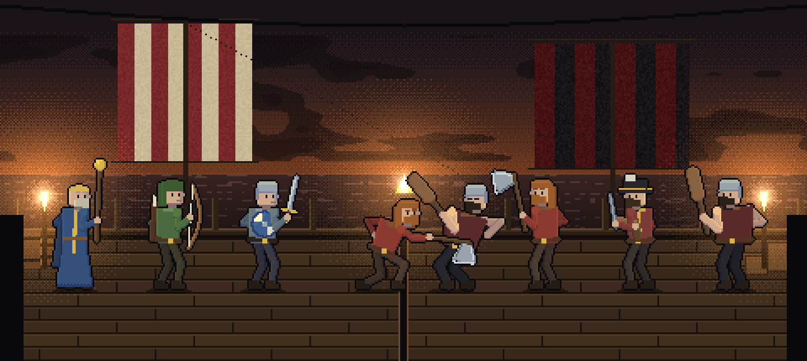
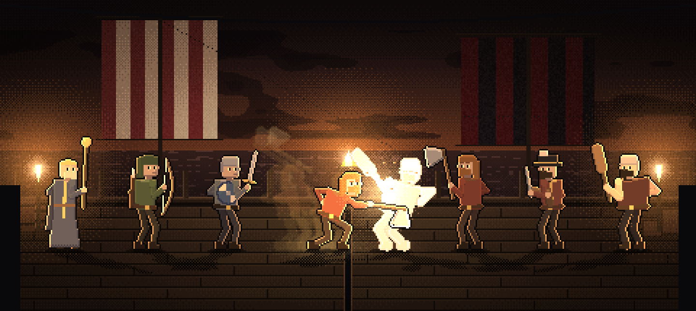
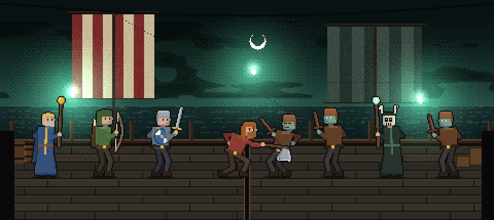
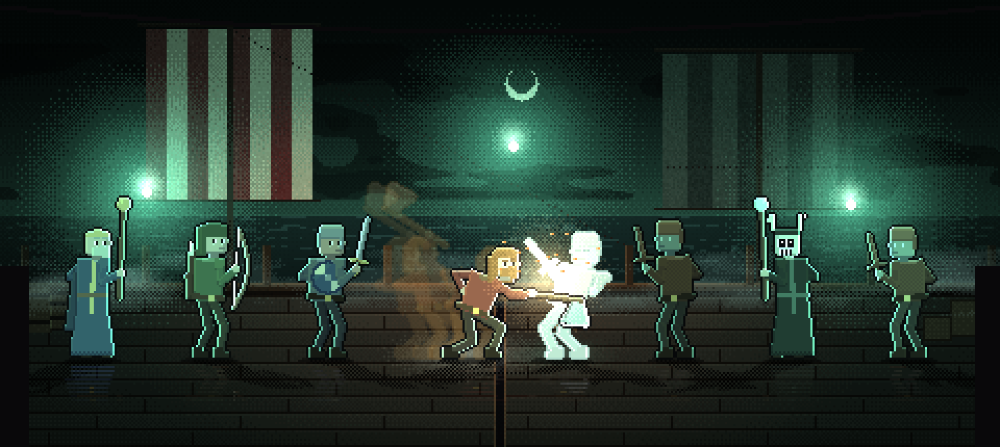

# D2: Bild. Bühne, Licht, Atmosphäre, Figuren, Shader

Stand: 4. November 2026. Entwurf für den Besitzerwunsch "Grafik deutlich aufbohren, damit es mitreißender ist" und "der Angreifer steht im Rampenlicht".
Grundlage: Auftragsblatt `tools/dev/BRIEF.md` und die Berichte R1 (Ablauf), R2 (Figuren), R3 (Bühnentechnik), R4 (Vorbild), R5 (Oberfläche), alle gelesen, dazu die
Schichten und Shader im Hauptprojekt (`sky_layer.gd`, `ocean_layer.gd`, `rain_layer.gd`, `waves.gd`, `sky.gdshader`, `ocean.gdshader`, `foes.gd`, `sfx.gd`).
Das Hauptprojekt wurde **nicht** verändert. Ich habe die Bilder dieses Blatts nicht im Spiel, sondern mit einem Python-Mock (`docs/kampf_spektakel/D2_mock_licht.py`) gerechnet:
er benutzt die echten Rig-Figuren aus R2 und rechnet die hier vorgeschriebenen Algorithmen (Abstufung, Leuchten, Randlicht, Schatten, Spiegelung) Pixel für Pixel nach.
Das ist **kein Engine-Foto**. Was am Mock geprüft ist und was nicht, steht in Abschnitt "Aufwand und Risiko".

---

## Leitidee

**Das Deck ist ein dunkler Ort, an dem es nur wenige Lichter gibt, und wer handelt, tritt in eines davon.** Daraus folgen sechs Entscheidungen, die zusammen das Bild tragen:

1. **Die Bühne wächst auf y 0..215** (R5: heute 0..166) und die Figuren wachsen auf **65 Pixel Körper** (Rig aus R2, heute 40). Über den Köpfen bleiben rund 75 Pixel für Segel, Takelage,
   Mond und Horizont: so wirkt das Deck wie ein Ort und nicht wie ein Streifen. Die Kamera darf bis 2,0 hineinfahren (ganzzahlig scharf, R3 2.4), der Angreifer wird dann 130 Pixel groß.
2. **Ein Lichtmodell mit vier Klassen** (Abschnitt "Ablauf und Zahlen" 3): Ortslicht (gedämpft, gefärbt, je Kampfort), Lampen (feste Lichtpunkte, additiv, flackernd, mit **Randlicht** auf den Figuren),
   Rampenlicht (der Handelnde, ein Lichtkegel plus warmes Randlicht und Lichtpfütze) und Impulslicht (Halo am Einschlag, Aufflackern der Lampen bei Krit und Todesstoß).
   Die Lampen sind die Dramaturgie: sie reagieren auf das Geschehen.
3. **Jeder Kampfort ist ein eigener Ort**, kein Farbfilter: eigene Gegnerschiffe in Zielgröße, eigenes Deck (gleich: unser Deck mit Kerben, ihres modrig, schmutzig, gepflegt oder ein Steg),
   eigene Requisiten, eigene Lichter und eigenes Wetter (Draugr: Nebel und Irrlichter, Räuber: Fackeln und Funken, Händler: Laternen und Dämmerung, Dorf: Feuer und Fenster, Kraken: Sturm).
4. **Figuren: Weg C aus R2, aber mit einer verschärften Auslieferungsregel.** Die 23 menschlichen Figuren (5 Männer, 18 Gegner) werden vom gemeinsamen Körper-Rig neu erzeugt (31 Posen, Zelle 112x104 plus 2 Pixel Rand),
   Hund, Fangarm und Kraken behalten ihre Bilder und bekommen Zusatzposen. **Alle Figuren und die Kulisse haben dieselbe Pixelgröße (1 Bildpunkt = 1 Spielpixel).**
   Das ist der Grund, warum ich R5s "alte Figuren 2-fach vergrößert" nur als Gerüst zulasse und nicht als Ergebnis: sie hätten doppelt so grobe Pixel wie Himmel, Deck und Schrift (Abschnitt 5.1).
5. **Alles Bild ist Anzeige.** Die Bühne wird nur gebaut, wenn ein Kampf von Hand gezeigt wird; im schnellen Kampfmodus, bei Bots und headless gibt es sie nicht (Abschnitt "Schnittstellen" 6).
6. **Kosten bleiben klein**: etwa 250 bis 320 Zeichenaufrufe je Bild (R3 maß 108 bis 183 für den Prototyp, hinzu kommen Partikel, Schatten, Nachbilder, Requisiten).

Was die Rechenprobe zeigt (Bilder in `img/`, 3-fach vergrößert, 480x215 Spielpixel). "ohne" heißt: ohne Abstufung, Randlicht, Schatten und Rampenlicht; der Lampenschein bleibt darin (das Mock-Programm zeichnet ihn in beiden Fassungen). "mit" ist das volle Modell:






Gelesen am Bild (ich habe alle vier Bilder angesehen und danach die Werte abgestimmt):

* **Maßstab stimmt.** Acht Rig-Figuren zu 65 Pixel stehen auf 215 Pixel Bühne dicht genug, um ein Deck zu füllen, und die Segel darüber tragen das Bild. Kein Gedränge, die Waffen reichen über die Fuge.
* **Das Licht macht den Unterschied.** Räuber: Fackeln, Randlicht in Orange an den Männern, Pfütze unter dem Angreifer, dunkle Schwarzflächen mit Farbstich. Draugr: Irrlichter, grünes Randlicht, Nebel und Spiegelung
  auf nassem Deck; das Bild erzählt "Geisterschiff", ohne dass Text es sagt. Ohne Licht (links oben) ist es dagegen ein sauberes, aber flaches Schaubild.
* **Ehrlicher Befund gegen meine eigene Erwartung:** die helle Rohfassung (besonders Draugr "ohne") ist am **lesbarsten**: Segel, Gesichter, Deck sind klar. Die volle Fassung gewinnt Stimmung, Fokus und Tiefe,
  kostet aber Lesbarkeit der Kulisse. Darum sind alle Abstufungswerte unten Anfangswerte in einer **Spanne** (`dark` 0,22 bis 0,40), und die Abnahme misst Helligkeit (K7, K14) statt nur zu schauen.
* **Der erste Versuch war zu dunkel** (Abstufung 0,45 bis 0,52, Männer grau). Die Werte unten sind die nachjustierten: Abdunkeln 0,30 bis 0,42, Entsättigen der Figuren höchstens 0,25
  (sonst verlieren Skalde und Schildträger ihre Farbe, an der man die Rolle erkennt).
* **Zwei Schwächen, die das Mock sichtbar macht und die im Entwurf berücksichtigt sind:** (a) Der Treffer-Blitz ist mit 0,55 Deckkraft noch eine weiße Silhouette ohne Gesicht: der Blitz darf nur 50 Millisekunden stehen (Stufentabelle 3.5).
  (b) Im Draugr-Bild verschwimmen die grünhäutigen Gegner mit dem grünen Hintergrund: Gegner brauchen ein Randlicht in **Gegenfarbe** zum Ort und einen dunkleren Hintergrund hinter sich (Abschnitt 4, Draugr).

---

## Ablauf und Zahlen

Alle Maße in Spielfeldpixeln (480x320), Zeiten in Millisekunden, Faktoren ohne Einheit. Bildschirmfotos haben 6,0 Bildschirmpixel je Spielpixel (`shot.ps1`), der Bildschirm des Besitzers 6,5.

### 1. Geometrie (eine Stelle: `StageGeo`)

| Größe | Wert | Anmerkung |
|---|---|---|
| Bühne | `Rect2(0, 0, 480, 215)` | `UI_BAR_Y = 215` (R5); Kopfzeile y 0..30 und alles darunter gehört der Oberfläche |
| Bodenlinie `FEET` | 172 | Stiefelsohle aller Figuren; R5-Wert. `FightFx.FEET` (heute 120, doppelt) wird `StageGeo.FEET` |
| Reihen-Mitten x | Männer `[212, 156, 100, 44]`, Gegner `[268, 324, 380, 436]`, Riese 408 | R5 (`FIGHT_BIG_X = 408`); Reling/Fuge bei x 239, Fuge 237..242 |
| Horizont (Wasserlinie hinter der Reling) | y 104 | Himmel y 0..104, Meer 104..140 |
| Reling hinten | Oberkante y 136, Pfosten alle 58 Pixel ab x 10, 18 hoch | Pfosten x = 10 + 58·k, y 118..136 |
| Deck | y 142..215 | 9 Plankenreihen zu 8 Pixeln, Naht alle 69 Pixel, je Reihe um 23 versetzt (wie R3) |
| Figur | Zelle 116x108 (112x104 Rig plus 2 Pixel Rand), `ANCHOR = (42, 101)` | Pixel (Spalte, Zeile) der Zelle, der auf `(feet.x, FEET)` liegt. Gespiegelt (Gegner): Spalte 73 |
| Körperhöhe | Scheitel 64 über der Sohle (`FIG_TOP = 64`), mit Stab, Geweih, Axt im Jubel bis 80 | `StageGeo.head_y(f) = FEET - 64`; der **Kraken** (88 hoch) `FEET - 88` |
| Kontaktschatten | drei Rechtecke: Breite ±13 / ±9 / ±11, Alpha 0,5 / 0,3 / 0,4 auf Zeile FEET+1 / +2 / FEET (Riese ±30 / ±22 / ±26) | `draw_rect`, schwarz |
| Plaketten (Name, Balken) | y 177..212, Sache der Oberfläche | Bühne liefert nur `actor_xf()` (Abschnitt "Schnittstellen") |
| Vortreten des Handelnden | zuletzt gezeichnet (`z_index +10`), 2 Pixel tiefer (`y + 2`), Schatten 4 Pixel breiter | R4 Technik 2; Rückweg 160 ms |

Platzverbrauch der Figurenspitzen: Scheitel bei y = 172 − 64 = **108**, mit Stab 92. Bei Zoom 1,5 (Angreifer) liegt der Scheitel bei y 172 − 64·1,5 = 76, bei Zoom 2,0 bei 44 und der Stab ragt in die
Zugleistenzone (y 3..29): zulässig, die Oberfläche zeichnet darüber.

### 2. Schichten, Tiefe, Zeichenreihenfolge

Die Bühne ist ein `Control` (`FightStage`, 480x215, `clip_contents`, `mouse_filter = IGNORE`) im Szenenbaum **unter** dem Hud (R3 Abschnitt 3 und 4.1). Kamera nach R3 4.2: Zoom um die Bodenlinie
(`t.y = FEET·(1 − z)`, `t.x = clamp(lerp(f.x, 240, u) − f.x·z, 480·(1 − z), 0)`, `u = clamp(z − 1, 0, 1)·0,5`), Schichtmaßstab `s = 1 + (z − 1)·Tiefe`, Ursprung `round(t·Tiefe + Wackeln·Tiefe)`.

Zeichenreihenfolge von unten nach oben (**Z** ist die Nummer, auf die der Abschnitt "Erzeugte Bilder" verweist):

| Z | Schicht | Tiefe | Inhalt | Material / Knoten |
|---|---|---|---|---|
| 0 | Himmel | 0,05 | `SkyLayer` (Instanz der Bühne, `storm_override`, `sun_vis = 0`), Mond und Sterne aus `stage_sky_extra.png` | Shader `sky.gdshader` (erweitert) |
| 1 | Ferne | 0,12 | `stage_far.png` (Flotten, Küste, Rauchsäule), Möwen (`gulls.png`) | `DrawLayer` |
| 2 | Meer fern | 0,20 | `OceanLayer` (layer 2), `base_y = 104` | Shader `ocean.gdshader` (erweitert) |
| 3 | Kulisse | 0,30 | Gegnerschiff (`stage_foe_*`), eigenes Schiff (`stage_own.png`), Dorf (`stage_village.png`), Fangarme hinten | `DrawLayer`, Wippen `round(sin(t·0,9)·1,5)` |
| 4 | Meer mitte | 0,40 | `OceanLayer` (layer 0), `base_y = 118`, verdeckt die Rümpfe | Shader |
| 5 | Dunst hinten | 0,50 | Nebelbank y 112..150 | `ColorRect`, `stage_fog.gdshader` |
| 6 | Reling, Rückwand | 0,85 | Reling, Pfosten, Schildreihe, Taue, Netze, Lampenkörper (Pfosten, Haken) | `DrawLayer`, Texturen aus `stage_props.png`, `stage_lamps.png` |
| 7 | Deck | 1,00 | `stage_deck.png` (linke Hälfte unser Deck, rechte Hälfte Ortsdeck), Fuge, Bodenrequisiten | `DrawLayer` |
| 8 | Boden-Schatten | 1,00 | Kontaktschatten, geworfene Schatten, Spiegelungen (z_index −1, über Deck) | `FighterNode`-Kinder |
| 9 | **Abstufung** | Bildschirm | liest Z0..Z8 | `ColorRect` + `stage_grade.gdshader`, **einziger** Leser von `hint_screen_texture` |
| 10 | Lichtpfützen | 1,00 | Pfütze des Handelnden, Pfütze am Ziel, Lampenschein auf dem Deck | `DrawLayer`, additiv |
| 11 | **Figuren** | 1,00 | je Kämpfer ein `FighterNode` (Sprite2D plus Schatten-, Spiegel- und Nachbild-Kinder), Reihe 4 zuerst, Angreifer zuletzt | `ShaderMaterial` `fighter_lit.gdshader` |
| 12 | Wirkungen | 1,00 | `FightFx.draw(ci)`: Hiebbögen, Pfeile, Funken, Ringe | `DrawLayer` |
| 13 | Leuchten | 1,00 | Lampen- und Feuerkerne, Halos, Mondhof, Blitzfläche | `DrawLayer`, `BLEND_MODE_ADD` |
| 14 | Partikel | 1,00 | Funken, Glut, Gischt, Staub, Glühwürmchen, Irrlichtfunken (höchstens 80) | `DrawLayer`, normal |
| 15 | Dunst vorn | 1,20 | Nebelbank y 100..160 (nicht tiefer, sonst Schachbrett hinter den Plaketten, R3 7.4) | `ColorRect` + `stage_fog.gdshader` |
| 16 | Vordergrund | 1,45 | `stage_front_<ort>.png` (Takelage oben, Mastfuß und Pfosten seitlich, Kisten unten) und Kraken-Fangarme | `DrawLayer`, **nicht** abgestuft |
| 17 | Regen | 1,45 | `RainLayer` (nur Kraken) | vorhandene Klasse |
| 18 | Hud | Ebene 1 | Schrift, Balken, Zahlen, Banner, Karten | `CanvasLayer` |

Gründe der Anordnung: die Abstufung liegt **unter** den Figuren (R3 2.7: darüber zerstippelt das Raster Blitz und Randlicht), also muss alles, was dunkel sein soll (Z0..Z8), darunter liegen
und alles, was leuchten soll (Z10, Z13), darüber. Die Figuren dunkeln sich über ihr eigenes Material nach demselben Rezept ab (Abschnitt 6, `fighter_lit`), damit Kulisse und Figur zusammengehören.

### 3. Lichtmodell

#### 3.1 Ortslicht (Umgebung), je Kampfort

Die Abstufung (`stage_grade.gdshader`) rechnet je Bildpunkt: Entsättigen (`desat`), Ortsfarbe (`tint`, Anteil `tint_amt`), Abdunkeln (`dark`), Vignette (`vig`). Neu gegenüber R3: **Schattenfarbe** (`shadow_col`): Schwarz wird
nie neutral, sondern zieht zur Ortsfarbe (Darkest-Dungeon-Art "Verlauf nach Schwarz, nicht nach Grau", R4 Q8). Werte nach der Rechenprobe (die abgestimmten, nicht die R3-Werte):

| Ort | `dark` | `desat` | `tint` (hex, Anteil) | `shadow_col` | `vig` | Figuren: `desat` max | Figuren: `amb` (Ortslicht als Faktor) |
|---|---|---|---|---|---|---|---|
| draugr | 0,38 | 0,45 | #59E6B8, 0,45 | #04100E | 0,55 | 0,25 | (0,52 / 0,64 / 0,60) |
| raeuber | 0,30 | 0,30 | #F28050, 0,30 | #140806 | 0,45 | 0,18 | (0,68 / 0,56 / 0,50) |
| haendler | 0,30 | 0,30 | #8CADD9, 0,28 | #070B14 | 0,40 | 0,18 | (0,58 / 0,64 / 0,72) |
| dorf | 0,30 | 0,25 | #F29E59, 0,32 | #120A05 | 0,45 | 0,15 | (0,70 / 0,60 / 0,50) |
| kraken | 0,42 | 0,40 | #8073F2, 0,42 | #060510 | 0,60 | 0,25 | (0,50 / 0,52 / 0,66) |

`amb` ist die Farbe, mit der die **nicht beleuchtete** Figur multipliziert wird (entspricht in etwa `(1 − dark) · tint`); der Handelnde bekommt `amb → (1,06 / 1,0 / 0,92)`, sobald `lit → 1` geht.

#### 3.2 Lampen (feste Lichtpunkte)

Je Ort eine Liste `(x, y, Art, Farbe, Radius)` in Kulissenkoordinaten (Tiefe 1,0). Jede Lampe zeichnet **drei** additive Dinge (Schicht Z13): Hof (`radius` 70, Alpha 0,75), Kern (Radius 12, Alpha 0,8, fast weiß)
und, falls Fackel oder Becken, Funken (Partikel). Flackern: `fl(t) = 0,85 + 0,15·sin(9·t + 2·i)·sin(5,3·t + i)` multipliziert Alpha und Radius (±8 %), Irrlichter statt dessen Pendeln `x += sin(0,7·t + i)·6`, `y += sin(0,5·t + 2·i)·3`.
Lampen sind **Datenpunkte**: aus ihnen berechnet die Bühne je Figur das Randlicht (3.4) und das Lampenlicht (3.3). Ohne Lampe im Ort wäre das Randlicht nicht begründbar.

Hof-Textur: zur Laufzeit erzeugte 96x96-Textur, `v = (1 − d)²`, in 6 Stufen mit Bayer-Dithering (R3 6.2 Nr. 3; die Mock-Rechenprobe benutzt dieselbe Stufung). Das passt zur Pixelkunst, weiche Verläufe tun es nicht.

#### 3.3 Lampenlicht auf der Figur

Je Figur die nächste Lampe `L` (kleinster `|x_L − x_f|`). `lamp_amt = max(0, 1 − dist / 170)²` mit `dist = |(x_f, FEET − 30) − (x_L, y_L)|`; Figur wird mit `lamp_col · lamp_amt · 0,22` aufgehellt
(multipliziert mit ihrer Helligkeit, damit Dunkles dunkel bleibt). Ergebnis: Figuren neben einer Lampe sind heller, die in der Mitte des Decks dunkler. Das ist der Tiefeneindruck im Mock (Räuber: linker Skalde und rechter Brecher).

#### 3.4 Randlicht (der größte Einzelgewinn auf den Figuren)

Pro Figur im Shader `fighter_lit`: Ein Bildpunkt **innen neben der dunklen Kontur** bekommt einen Farbstich, wenn der Nachbar in Lichtrichtung Kontur oder Transparenz ist.
Rechnung (Beschreibung des Shaders, Code in Abschnitt 6):

* `rim_side` 0,9 (im Licht) bzw. 0,7 (Ortslicht) für die Seite **zur nächsten Lampe hin** (Richtung `rim_dir = (±1, 0)` in Textur-UV; bei gespiegelten Figuren Vorzeichen drehen),
* `rim_top` 0,45 (im Licht) bzw. 0,25 für **oben** (Himmelslicht),
* Farbe: im Rampenlicht die warme Schlüsselfarbe (Handelnder `key`, Gegner `foe_key`), sonst `rim` des Ortes; Aufhellung `rim_col · k · 0,6`.
* Nur **ein** Pixel Breite, keine Verläufe: Pixelkunst.

Im Mock: sichtbarer, kräftiger Gewinn an jeder Figur (Kanten von Schwert, Stab, Schulter), kostet im Shader zwei zusätzliche Texturabfragen je Bildpunkt. Wichtig: **Gegner bekommen Randlicht in Gegenfarbe zum Ort**
(`foe_key`-Spalte der Tabelle 4.2), sonst verschwimmen grüne Draugr im grünen Ort (Mock, Draugr).

#### 3.5 Rampenlicht (der Handelnde) und Impulslicht, Stufen

Rampenlicht = Ellipse in der Abstufung (`spot`, `spot_r`, `spot_amt`, 5 Stufen gedithert wie R3) plus `lit` auf den Figuren plus Lichtpfütze auf dem Deck (additiv, 46 Pixel Radius, Höhe 32 %, Alpha 0,38).

| Größe | Wert |
|---|---|
| Mitte | `(x_mid, FEET − 34)`, `x_mid` = Mitte zwischen Angreifer und Zielen (60 % Angreifer, 40 % Ziele, wie R4); ohne Handelnden im Ruhezustand: der Mann am Zug |
| Radien (im Mock getestet) | `(190, 110) · zoom` (R3 nahm (150, 78): bei 65 Pixel hohen Figuren zu klein) |
| Einblenden `spot_amt` | `k = 1 − exp(−dt·14)` je Bild, das sind rund 140 ms |
| Ausblenden | `k = 1 − exp(−dt·10)`, rund 160 ms |
| `lit` je Figur | gleiche Glättung `k = 1 − exp(−dt·10)`; Angreifer und Ziele 1, alle anderen 0; `state == "done"` alle 1 |
| Farbe Held | `key` (Tabelle 4.2), Gegner `foe_key` |
| Handelnder zusätzlich | Randlicht 0,9/0,45, Pfütze, Nachbilder (3.6) |

Impulslicht `pulse_light(pos, col, radius, dur)`: additiver Halo am Einschlag, Radius wächst von `radius` auf `1,5·radius` in `dur`, Alpha `0,85·(1 − u)`.
**Eskalationsleiter, Bildkanäle** (Regie wählt die Stufe, die Bühne führt aus; Zahlen für Zoom, Standbild und Wackeln stehen bei der Regie, nicht hier):

| Stufe | Auslöser | Halo (Radius, `dur`) | Blitz auf dem Ziel (`flash`) | Rotstich Ziel | Lampen | Ortsfarbe (`mood`) |
|---|---|---|---|---|---|---|
| 0 | Streifer | 26, 160 ms, Alpha 0,45 | 33 ms, 0,6 | 100 ms | - | - |
| 1 | normaler Treffer | 34, 200 ms | 50 ms, 0,8 (danach 30 ms 0,4) | 150 ms | - | - |
| 2 | schwer (Schaden ab 24) | 42, 220 ms | 50 ms, 0,8 | 150 ms | - | Staub (4 Partikel am Boden) |
| 3 | Krit | 54, 260 ms, Gold | 66 ms, 0,85 | 180 ms | alle Lampen +30 % für 200 ms (Aufflackern, Klang `flare`) | Gold, Anteil 0,18, 120 ms |
| 4 | Todesstoß, letzter Gegner | 64, 350 ms | 80 ms, 0,85 | 220 ms | +50 % für 300 ms | Rot, 0,25, 400 ms |
| Heldenmut | `heroic` | 50 am Mann | - | - | +40 %, 500 ms | Gold, 0,25, 600 ms |
| Zusammenbruch | `snap` | - | - | - | **−40 %** für 700 ms (die Lampen ducken sich) | Kaltblau (#7090FF), 0,30, 700 ms, Figuren-`desat` +0,4 |
| Tod eines Gegners | `die` | - | - | - | - | Figur löst sich in Nebel oder Funken (Abschnitt 4, "Besonderes") |

Der Blitz ist ein **Material-Wert auf der Figur** (`flash`), nie ein Vollbild (R4 Technik 8: Vollbildblitze vermeiden). `flash_col = (1,0 / 0,96 / 0,88)`, nie reines Weiß; die Rechenprobe zeigt: bei 0,55 bleibt noch Zeichnung,
bei 0,85 über mehr als 66 ms ist die Figur nur noch ein weißer Fleck.

#### 3.6 Nachbilder, Schatten, Spiegelung

* **Nachbilder** (nur Angreifer, nur während Ausholen und Zuschlagen): Ring von **3 Sprites** (`TrailSprite`, wiederverwendet), Abtastung alle 40 ms, Alpha 0,30 / 0,20 / 0,10, Farbe warm `(255, 190, 90)` mit Anteil 0,55, gezeichnet mit `mode = 3` des Figuren-Shaders. Bei Zeitlupe läuft die Abtastung in Anzeigezeit.
* **Geworfener Schatten** (nur Stufe "voll"): zweites Sprite je Figur (`mode = 1`, schwarz, Alpha 0,26 / Handelnder 0,34), auf ein Fünftel der Höhe gequetscht (`scale.y = −0.2`, Fußpunkt gleich) und von der nächsten Lampe weggeneigt (`skew.x = ∓0,55`).
  **Unbewiesen im Engine-Lauf**: Pixel-Snap kann gequetschte Sprites zeilenweise streichen; Rückfall ist der Kontaktschatten allein (Abnahmekriterium K12).
* **Spiegelung** (nur Orte mit nassem Deck: kraken, draugr): drittes Sprite (`mode = 2`), `scale.y = −0,5`, Alpha 0,22 mal `smoothstep(0.4, 0.95, UV.y)`, abgeschnitten bei 40 Pixel Höhe, Streifen jede zweite Zeile (im Mock getestet: gerastert wirkt es nass, durchgehend wie eine zweite Figur).

### 4. Ortsthemen

Alles, was ein Ort ist, steht in **einem Wörterbuch** `StageThemes.DATA[<formation>]` (reine Daten, in `scripts/stage_themes.gd`, headless prüfbar). Schlüssel: `sky` (Verschiebung `tone_mul`, `storm`, `moon`), `sea`, `kulisse` (Liste), `deck`, `props` (Liste),
`lamps` (Liste), `fog` (hinten/vorn Dichte und Farbe), `grade` (Zeile aus 3.1), `light` (`key`, `foe_key`, `rim`, `lamp`), `particles` (Liste), `wet` (bool), `front` (Bild), `special` (Ereigniszuordnung).

#### 4.1 Gemeinsames

* **Himmel**: `SkyLayer` mit neuem Uniform `tone_mul` (Standard `(1,1,1)`, die Weltansicht bleibt unverändert) und `sun_vis = 0`; der Mond ist ein Sprite aus `stage_sky_extra.png` (24x24, zwei Phasen), bei `(x_moon, y_moon)` in Tiefe 0,05, dazu Hof additiv (Radius 40, Alpha 0,35).
* **Meer**: `OceanLayer` fern (`base_y = 104`) und mitte (`base_y = 118`), Uniform `tone_mul` wie Himmel; `storm` kommt aus `storm_override` (statt der Klassenvariable `Waves.storm`, sonst Doppelquelle mit der Welt, R3 7.2). Glitzerspuren: unter jeder Lampe und unter dem Mond
  ein senkrechter Streifen aus 6 bis 10 kurzen additiven Strichen (2 bis 4 Pixel breit), die mit `Waves.time` wandern (Zeichnung in Z13, ohne Bild).
* **Eigenes Schiff** (alle Orte außer Kraken, wo es das ganze Deck ist): `stage_own.png` mit Mast, rot-weiß gestreiftem Segel, Rah, links bei `x = 70..150`, Segel y 14..96. Mast läuft hinter den Männern durch; in 3.2 hängt dort eine Laterne an der Rah (Haken).
* **Deck**: linke Hälfte immer `stage_deck.png` Zeile 0 (unser Deck, warme Eiche, Kerben, Teerfugen), rechte Hälfte die Ortszeile (oder alles Zeile 1 beim Kraken).
* **Vordergrund**: je Ort `stage_front_<ort>.png` (576x215), Mastfuß links und rechts unten (dunkle Silhouetten, nie abgestuft), Takelage quer oben.

#### 4.2 Die fünf Orte

| | **Draugr** | **Räuber** | **Handelsschiff** | **Küstendorf** | **Kraken** |
|---|---|---|---|---|---|
| Stimmung | Geisterschiff im Nebel, kalt, grün | Brand am Horizont, Fackeln, Enterhaken | blaue Dämmerung, Laternen, Gepflegtes | Abendrot, Steg, Fenster, Feuer | Sturm, Nacht, Blitz |
| Himmel `storm`, `tone_mul` | 0,35, (0,55 / 1,05 / 0,95) | 0,30, (1,10 / 0,85 / 0,80) | 0,25, (0,85 / 0,95 / 1,10) | 0,20, (1,15 / 0,95 / 0,80) | 0,85, (0,70 / 0,70 / 1,00) |
| Mond (x, y, Phase) | (250, 40), Sichel, hinter Wolken | (330, 46), Scheibe, rot angehaucht | (330, 40), Scheibe | kein Mond, tiefe Sonne unter dem Horizont (Himmelsglut y 90..104) | (240, 30), fast verdeckt |
| Kulisse (Z3) | `stage_foe_draugr.png` bei x 318..510 (Geisterschiff, Alpha 0,8), `stage_far.png` Geisterflotte x 150..246 y 76..110 | `stage_foe_raeuber.png` bei x 318..510, Taue (3 Linien von der Rah über die Fuge, im Wind pendelnd ±1 px) | `stage_foe_haendler.png` bei x 318..510, `stage_far.png` Handelsflotte, Möwen | `stage_village.png` (560x112, Hang mit Häusern, Steg) hinter der rechten Hälfte, Rauch aus Schornsteinen | drei Fangarme hinten (aus `enemies.png`-Zellen 9..11, später eigenes Bild) bei x 70, 190, 410, Tiefe 0,3 |
| Deck (Zeile in `stage_deck.png`) | 2 modrig, grau, Algen, Löcher mit grünem Schimmer | 3 schmutzig, geflickt, Blutflecken, Kerben | 4 gepflegt, Messingbeschläge, Teppich vor dem Kaufmann | 5 Steg: helle Bretter, Pfähle, Netze | 1 nass, Wasserlachen |
| Requisiten (Rückwand, Tiefe 0,85) | Rippenbogen (Wrack) x 420, Anker rostig x 18, Netz zerrissen x 380..404 an der Reling | Schildreihe an der Reling, 8 runde Schilde 12x12 x = 254 + 28·k (abwechselnd rot/schwarz), Waffenständer x 458 | Warenballen 3 x = 440, 456, 470, Wimpel am Mast des Gegners (4 Frames), Waage x 424 | Wäscheleine x 300..380, Hundehütte x 300, Fischkorb x 456 | Wasserfässer umgestürzt x 20 |
| Requisiten (Deck, Tiefe 1,0, Basis y 156..162) | Knochenhaufen x 330, Runenstein x 402, Kerzenstümpfe x 258 | Fässer x 8 und x 24 (groß, klein), Kisten x 456 / 443, Kohlebecken x 240, Enterhaken-Bündel x 296 | Kisten gestapelt x 456 / 443 / 450 (y −12), Truhe mit Münzen x 340, Fässer x 8, x 24 | Holzstapel x 440, Netz x 280 | Fässer x 8, x 24, Taurolle x 420 |
| Lampen (Kulisse) | 3 Irrlichter (70, 92), (246, 70), (408, 98), pendelnd, Farbe #6EFFC8 | Fackel (26, 120) auf Ständer 8x28, Becken (240, 112), Fackel (454, 120), Farbe #FF9E40 | Laterne an Haken (60, 100) unter der Rah, Laterne (418, 108) am Pfosten, Farbe #FFC766, Kette 10x22 | Lagerfeuer (400, 150, Flamme 6 Frames), Fackeln (250, 118), (470, 120), Fensterlichter (aus `stage_village.png`, 3x4, Liste im Atlas), Farbe #FFB347 | 1 kalte Laterne (240, 88), **pendelnd** `x += sin(2,4·t)·8`, Farbe #B3CCFF; Blitz |
| Licht Held `key` / Gegner `foe_key` / `rim` | #FFE9B0 / #A8FFD8 / #78FFD2 | #FFD680 / #FF7A50 / #FFAA5A | #FFE4A8 / #9CC4FF / #FFD58C | #FFD890 / #FF8A5A / #FFB86A | #FFF0C8 / #C8A8FF / #A8C0FF |
| Nebel hinten / vorn (Dichte, Farbe) | 0,95 / 0,60, #96C8BE | 0,30 / 0,20, #78503C (Rauch) | 0,35 / 0,20, #AAC0D8 | 0,50 / 0,35 (Bodennebel auf dem Strand, y 128..150), #D8B89A | 0,60 / 0,40, #8A86B8 |
| Partikel | Irrlichtfunken 3 je s, 1 Pixel, Leben 3 s, steigen 20 px; Tropfen aus der Reling 1 je s | Funken je Fackel 6 je s, Leben 1,2 s, steigen 26 px, schwingen ±6; Rauch vom Becken (flache additive Wolken, 3) | Staub im Licht 5; Glitzern an der Truhe: 2x2 alle 1,5 s; Möwen alle 14 s | Glühwürmchen 8 (1 Pixel, additiv, sinusförmig), Feuerfunken 4 je s, Rauchfahnen aus dem Atlas | Regen 200 (RainLayer, Tiefe 1,45), Gischt 14 je s an der Reling, Blitz alle 4 bis 9 s |
| Wetter/Seegang | Seegang 0,35, Deck nass (Spiegelung) | 0,30 | 0,25 | 0,20 | 0,85, **Bühne hebt und senkt sich** `round(sin(0,9·t)·1)·storm` Pixel in allen Schichten mit ihrer Tiefe |
| Besonderes (Ereignis -> Bild) | Treffer auf Draugr: Irrlichter +30 % für 120 ms grünlich; **Gefallene lösen sich als Nebelwisch** (Alpha-Abklang 700 ms, 12 helle Partikel steigen auf) | Gegnerzug: Fackeln +25 % für 200 ms (rötlicher); Funken fliegen beim Einschlag **nach oben** (6) | Treffer auf Kaufmann: 3 bis 5 gelbe Münzen-Partikel mit Bogen (ohne Regelbezug) | Hund springt (R2), bekommt eigenen Schatten; Fenster flackern alle 2 s einmal | Fangarm-Schlag (`attack` Fangarm): Blitz, Spritzer 4 Frames (`stage_splash.png`) an der Reling, Bühne ruckt (Regie) |

Mond/Sonnen-Zeile und Himmelswerte sind Anfangswerte zum Abstimmen mit Bildern aller fünf Orte (Abnahme K6).

#### 4.3 Besonderheiten

* **Gegner gegen Ort lesbar halten** (Befund aus dem Mock): hinter den Gegnern (x 250..480) ist die Abstufung eine Stufe **dunkler** (Zusatz `dark + 0,06` auf der rechten Hälfte, Dither-Übergang um x 237..243) und das Gegnerschiff in der Kulisse 15 % dunkler gezeichnet.
  Gegner-Randlicht in der Gegenfarbe des Ortes (Tabelle).
* **Kraken**: der Riese (88x88) steht bei x 408, Sohle y 164 (4 Pixel über FEET) in einem Wasserfuß (`stage_splash.png`, 4 Frames, wippend, vor dem Körper in Z11 direkt hinter ihm, Z12 davor). Die zwei Vordergrund-Fangarme (`stage_kraken_front.png`, Tiefe 1,45, zwei Frames, Wippen
  mit 0,7 Hz) fliegen beim Zoom aus dem Bild (R3 2.3). Der **Griff** des Fangarms (heute ein Bogen über die Männer) bleibt in der Hud-Linie der Oberfläche; die Bühne liefert nur die Anker.

### 5. Figuren

#### 5.1 Entscheidung: Rig für 22 Menschen, Zusatzposen für Hund, Fangarm, Kraken, alles 1x

Belege (gelesen und angesehen): R2 Kontaktblätter und Prototypen (`R2_rig_helden.png`, `R2_proto_rigstrike.png`, `R2_proto_mixed.png`) und mein Mock (Körper 65 px in 480x215 Bühne). Befunde:

1. **Die alten Figuren haben kein Ausholen** und keinen Nachschwung (R2 1.2, 3.4): die Waffe schwingt nicht; Prozeduralanimation macht daraus "Ruck mit Nachbildern". Das ist das Gegenteil von "Wucht". Damit scheidet Weg A als Ergebnis aus (er bleibt als Rückfall).
2. **Das Rig trägt die Posen**: Ausholen, Zuschlagen, Nachschwung, Fallen, Block, Zaubern (R2 `R2_rig_helden.png`: lesbare Silhouetten in allen elf Kernposen). Im Mock sind die Rig-Männer neben Rig-Gegnern ein stimmiger Satz; der Treffer-Frame (`hit_0`) verbiegt den Körper.
3. **Pixelgröße**: Das Rig zeichnet mit 1 Pixel Kontur auf 1-Pixel-Raster. R5 wollte die alten Zellen 2-fach nehmen (88x112): das ergibt Pixel von 2x2 neben Schrift, Himmel und Deck in 1x1: ein sichtbarer Stilbruch ("Mixels"), den ich im R5-Bild (`r5s_fight2.png`, dunkler Hintergrund) nicht beurteilen kann, weil dort noch keine Kulisse steht.
   Meine Regel: **eine Pixelgröße im ganzen Bild**; Größe kommt aus **mehr Pixeln je Figur** (Rig: 65 statt 40) und aus der **Kamera** (ganzzahlig 2,0 bleibt scharf, R3 2.4), nicht aus Vergrößerung der Figur.
4. **Nicht-ganzzahlige Skalierung des Rigs (1,5-fach)** gibt ungleiche Pixel (R2 3.2): verworfen. Ein **größeres Rig** (Körper 90 px, eigener Kopf 16x16) wäre sauber, aber ein neues Kunstwerk (Beine 36, Rumpf 25, Köpfe neu): zurückgestellt, Abschnitt "Was ich bewusst weglasse".

**Entscheidung:**

| Gruppe | Anzahl | Weg | Zelle |
|---|---|---|---|
| Männer: schild, axt, bogen, skalde, muskete | 5 | Rig, 31 Posen | 116x108 |
| Gegner mit Menschenkörper (`Foes.ROW` ohne hund, tentakel): rost, bogner, totenwart, brecher, messerkerl, schuetze, haken, wache, armbrust, kaufmann, bauer, schmied, priester, waechter, beschwoerer, knochen, antreiber, kraeuterfrau | 18 | Rig, 31 Posen | 116x108 |
| Hund, Fangarm | 2 | alte Zeichnung (1x) neu gerastert in Streifen, 14 bzw. 12 Posen, Fehlendes über Fallback | 116x108 (Hund 37 px lang) |
| Kraken | 1 | `kraken.png` (88x88, 5 Zellen) plus `kraken_ex.png` (3 Zellen: Hochreißen, Zuschlagen, Sinken) | 88x88 |

(R2 spricht von 22 Menschen mit 17 Gegnern; `Foes.ROW` enthält 20 Gegnerschlüssel, ohne `hund` und `tentakel` bleiben **18**, zusammen mit den 5 Männern **23**. Die Abnahme prüft gegen `Foes.TYPES` selbst, nicht gegen eine Zahl, K3.)

**Auslieferungsregel:** Die **Endabnahme** (K5, K7, K14) gilt erst, wenn **alle** Rig-Streifen da sind (Selbsttest prüft `FileAccess.file_exists` für jeden Schlüssel); Rig-Männer neben 40-Pixel-Gegnern wären ungleich (R2 5.1), also nie gemischt.
**Zwischenstände** (Stufe 1 in "Aufwand") laufen mit `FigArt.use_rig = false`: alter Atlas, `FighterNode` skaliert das Sprite **ganzzahlig 2-fach** (Anker (22, 52) · 2, Zelle 44x56 -> 88x112, R5-Gerüst) und beschriftet das Bild nicht anders; das ist ausdrücklich vorläufig und wird im Foto-Kommentar so genannt.

#### 5.2 Wiedergabe in der Bühne (`FigArt` und `FighterNode`)

* `FigArt.sheet(kind) -> Dictionary` `{tex: Texture2D, cell: Vector2i(116, 108), anchor: Vector2i(42, 101), rig: bool}`, `FigArt.frame(kind, name) -> Dictionary` `{col: int, name: String}` (Rückfall-Tabelle für fehlende Posen: Spalten-Namen aus R2 5.3, `strike_1 -> strike_0`, `cast_* -> strike_0`, `fall_* -> hit_1`, `dead -> hit_1`, `cheer_* -> ready_0`, ...).
* Je Figur ein `Sprite2D` (Rückfall alter Atlas: siehe Auslieferungsregel; `centered = false`, `region_enabled = true`, `region_rect = Rect2(col·116, 0, 116, 108)`, `offset = -anchor`; Gegner `flip_h = true`, `offset.x = -(116 − 1 − 42) = -73`).
  Position immer `round()`; Kamera rechnet die Bühne, nicht die Figur.
* Streifen: **eine PNG je Figur**, 32 Spalten x 116 = **3712 x 108**, träge geladen (`ResourceLoader.load_threaded_request` ab der Aufstellung, Abschnitt "Schnittstellen" 5), höchstens 9 Streifen je Kampf (rund 14,5 MB), Zwischenspeicher bis Kampfende.
* **Stehen läuft in der Bühne** (`frame == ""`): `idle_0..3` im Takt 0-1-2-1 mit 200 ms je Bild, Phase `rank · 140 ms`; `ready_0/1` (250 ms) für den Mann am Zug, `stun_0/1` (300 ms), `door_0/1` (500 ms) nach Zustand. Takt aus der **Bühnenuhr** `_t` (nicht `Time.get_ticks_msec()`), damit Screenshots wiederholbar sind (`--shotclock=<s>`).
* Alle Aktionsposen (`windup_*`, `strike_*`, `follow_*`, `cast_*`, `block_*`, `dodge`, `hit_*`, `fall_*`, `dead`, `cheer_*`) setzt die Regie mit `set_pose`.
* **Zahlen und Anker** aus dem Rig (`assets/fig/anker.json`: je Figur und Pose Hand, Waffenspitze, Brust, Kopf, relativ zur Fußmitte, x nach vorn, y nach oben): `FightStage.anchor(f, "tip") -> Vector2` in Bühnenkoordinaten (spiegelt für Gegner, addiert Versatz). R2 5.4 gibt die Standardwerte.
  `FightFx` zeichnet Hiebbögen, Pfeile und Funken an diese Punkte statt an `FEET − 30`.

### 6. Shader (vier, davon einer neu, einer stark erweitert)

Alle Shader laufen nur dort, wo die Bühne gebaut ist. Welt-Shader (`sky`, `ocean`) behalten ihr Aussehen: neue Uniforms haben Standardwerte, die nichts ändern (Abnahme K2: Weltbild Byte für Byte gleich).

| Shader | Datei | Neu/Änderung | Leser von `hint_screen_texture` |
|---|---|---|---|
| Abstufung | `shaders/stage_grade.gdshader` | aus R3, plus `shadow_col`, `mood` (`vec4`: Farbe und Anteil, für Stufe 3/4/Heldenmut), `side_dark` (Zusatzabdunkeln der Gegnerseite ab x 240), Fläche 480x215, Standard `dark 0,30`, **ein** Rampenlicht-Ellipsenpaar | ja, einziger |
| Nebel | `shaders/stage_fog.gdshader` | aus R3 unverändert, plus `fade_bottom` (blendet in den unteren 25 % des Bandes auf 0 aus, gegen das Schachbrett hinter den Plaketten) | nein |
| Figuren | `shaders/fighter_lit.gdshader` | **neu**, ersetzt `fighter_fx` aus R3: Ortslicht, Randlicht, Lampenlicht, Blitz, Rotstich, Umriss (Zielwahl), Modi Schatten, Spiegelung, Nachbild | nein |
| Himmel/Meer | `shaders/sky.gdshader`, `shaders/ocean.gdshader` | je ein `uniform vec3 tone_mul = vec3(1.0)`, Anwendung am Ende von `fragment()`; Himmel `sun_vis` bleibt | nein |

`fighter_lit.gdshader` (der Kern, vollständig genug zum Bauen; Texturen mit 2 Pixel Rand, deshalb sind die Nachbarabfragen sicher und blutet kein Nachbarbild herein):

```glsl
shader_type canvas_item;

uniform float alpha = 1.0;                   // statt modulate (COLOR enthält die Textur schon)
uniform float flash = 0.0;                   // Treffer-Blitz 0..1
uniform vec4 flash_col : source_color = vec4(1.0, 0.96, 0.88, 1.0);
uniform float red = 0.0;                     // Rotstich nach dem Treffer 0..1
uniform float desat = 0.0;                   // Entsättigen (Figuren höchstens 0,25, Zusammenbruch +0,4)
uniform vec3 amb : source_color = vec3(1.0); // Ortslicht, multipliziert (Tabelle 3.1)
uniform vec3 tint : source_color = vec3(1.0);
uniform float tint_amt = 0.0;
uniform float lit = 0.0;                     // Rampenlicht 0..1
uniform vec3 key_col : source_color = vec3(1.0, 0.84, 0.55);
uniform vec3 rim_col : source_color = vec3(1.0, 0.7, 0.35);
uniform vec2 rim_dir = vec2(1.0, 0.0);       // in Textur-UV, bei flip_h Vorzeichen drehen
uniform float rim_side = 0.7;
uniform float rim_top = 0.25;
uniform vec3 lamp_col : source_color = vec3(1.0);
uniform float lamp_amt = 0.0;
uniform vec4 outline : source_color = vec4(0.0);   // Zielwahl; a = 0 aus
uniform int mode = 0;                        // 0 Figur, 1 Schatten, 2 Spiegelung, 3 Nachbild
uniform float mode_alpha = 0.3;
uniform vec3 ghost_col : source_color = vec3(1.0, 0.75, 0.35);

float luma(vec3 c) { return dot(c, vec3(0.299, 0.587, 0.114)); }

bool edge_at(vec2 uv) {                       // Transparenz oder dunkle Kontur
	vec4 n = texture(TEXTURE, uv);
	return n.a < 0.5 || luma(n.rgb) < 0.09;
}

void fragment() {
	vec4 c = texture(TEXTURE, UV);
	vec2 px = TEXTURE_PIXEL_SIZE;
	if (c.a < 0.5) {
		float e = 0.0;
		if (outline.a > 0.0) {
			e = max(max(texture(TEXTURE, UV + vec2(px.x, 0.0)).a, texture(TEXTURE, UV - vec2(px.x, 0.0)).a),
					max(texture(TEXTURE, UV + vec2(0.0, px.y)).a, texture(TEXTURE, UV - vec2(0.0, px.y)).a));
		}
		COLOR = (e > 0.5 && mode == 0) ? vec4(outline.rgb, outline.a * alpha) : vec4(0.0);
		return;
	}
	if (mode == 1) { COLOR = vec4(0.0, 0.0, 0.0, mode_alpha * alpha); return; }
	if (mode == 2) { COLOR = vec4(c.rgb * amb, mode_alpha * alpha * smoothstep(0.4, 0.95, UV.y)); return; }
	if (mode == 3) { COLOR = vec4(mix(c.rgb, ghost_col, 0.55), mode_alpha * alpha); return; }
	float l = luma(c.rgb);
	vec3 rgb = mix(c.rgb, vec3(l), desat);
	rgb = mix(rgb, rgb * tint * 1.7, tint_amt);
	rgb *= mix(amb, vec3(1.06, 1.0, 0.92), lit);
	rgb += lamp_col * lamp_amt * 0.22 * l * 3.0;              // Lampenlicht, hell bleibt heller
	if (l >= 0.09) {                                           // Randlicht nur INNEN neben der Kontur
		float k = 0.0;
		if (edge_at(UV + rim_dir * px)) k += rim_side;
		if (edge_at(UV + vec2(0.0, -px.y))) k += rim_top;
		rgb += mix(rim_col, key_col, lit) * k * 0.6;
	}
	rgb = vec3(rgb.r * (1.0 + 0.7 * red), rgb.g * (1.0 - 0.5 * red), rgb.b * (1.0 - 0.5 * red));
	rgb = mix(rgb, flash_col.rgb, flash);
	COLOR = vec4(clamp(rgb, 0.0, 1.0), c.a * alpha);
}
```

Bekannte Fallen dazu (aus R3, gelesen): `COLOR` nicht mit `modulate` mischen, `alpha` als Uniform; jeder `ColorRect` braucht `mouse_filter = IGNORE`; ein zweiter Leser von `hint_screen_texture` braucht `BackBufferCopy` (wir haben keinen).

### 7. Atmosphäre: Zeiten, Mengen, Kosten

| Ding | Werte |
|---|---|
| Nebel hinten (Z5) | Band y 112..150, Dichte laut Tabelle 4.2, Drift `x_drift = t·6` px/s, Farbe aus Tabelle, 4 Stufen gedithert (Shader aus R3) |
| Nebel vorn (Z15) | Band y 100..160, Drift 14 px/s, Dichte laut Tabelle, `fade_bottom` 0,25 |
| Partikel | `PackedVector2Array` für Ort und Geschwindigkeit, `PackedFloat32Array` für Alter; **höchstens 80** gleichzeitig, `draw_rect` 1x1 oder 2x2 mit `round()`; Aufnahme ab 4 Partikeln/s je Quelle nur bei Stufe "voll" |
| Regen (Kraken) | vorhandene `RainLayer` (200 Tropfen bei `storm 0,85`), nur Tiefe 1,45; ein Blitz setzt `Waves.flash` (Himmel, Meer, Blitzfläche in Z13: `Rect2(-60, -20, 600, 255)` Alpha `0,5·flash·flash_scale`) |
| Blitz im Kraken-Kampf | alle 4 bis 9 s Zufall; zusätzlich bei jedem Fangarm-Schlag (`react("kraken_slam")`); Donner `thunder` nach 300 bis 900 ms |
| Gischt | 14 Partikel/s an der Reling (x zufällig, y 136), Anstieg 8 bis 14 px, Leben 500 ms, 2x2 weiß, Alpha 0,7 |
| Rauch (Becken, Schornsteine) | additive flache Wolken (Texturen `stage_lamps.png`, 16x8), steigen 12 px/s, Leben 3 s, drei gleichzeitig |
| Glühwürmchen (Dorf) | 8 Punkte, `x += sin(0,5·t + i·1,3)·18`, `y += sin(0,7·t + i)·10`, Alpha `0,5 + 0,5·sin(3·t + i)` |
| Nebelwisch beim Tod (Draugr) | Alpha 1 -> 0 in 700 ms, Sprite steigt 6 px, 12 helle Partikel (1 Pixel) steigen 20 bis 34 px |

**Zeichenaufrufe je Bild** (geschätzt aus Bauteilen, R3 maß die Hälfte davon im Prototyp): Himmel 1, Meer 2, Kulisse 6, Dunst 2, Reling und Requisiten 24, Deck 4, Schatten 24 + 8 Sprites, Abstufung 1, Pfützen 4, Figuren 8 + Nachbilder 3 + Spiegel 8,
Wirkungen 20, Leuchten 16, Partikel bis 80, Vordergrund 3, Regen (Kraken, aus `RainLayer`) rund 60. Das sind **260 bis 320** (Obergrenze 340, Abnahme K9).

### 8. Schnell, Bots, headless: was nie geschieht

* `FightStage` wird **nur** gebaut, wenn `DisplayServer.get_name() != "headless"` **und** ein Kampf mit Anzeige beginnt (`voy.auto_combat == false` beim Eintritt in die Aufstellung). Sonst existiert die Klasse zur Laufzeit nicht (kein `new()`), keine Textur wird geladen, kein Shader kompiliert.
* Beim Übergang in die Aufstellung erzeugt `Main._ensure_stage()` die Bühne einmalig (träge) und lässt sie bis zum Kampfende am Leben; außerhalb von `Phase.COMBAT` ist sie `visible = false` und `process_mode = DISABLED`.
* `StageThemes` und `StageGeo` sind reine Daten ohne Texturen und deshalb im Selbsttest prüfbar.
* Die Bühne wartet **nie** auf Eingaben und schreibt **nie** in `voy._combat_t` oder `Combat`. Sie liest nur, was ihr `FightStage.set_pose/focus/...` vom Hud gibt (Push, nicht Pull aus Privatvariablen wie im R3-Prototyp).
* `Settings.stage_fx` (neu, `int`: 0 "schlicht", 1 "voll"; gespeichert in `user://settings.cfg`, Hud-Einstellungszeile "Kampfbild: voll / schlicht"): schlicht schaltet Nebel, Partikel, geworfene Schatten, Spiegelung, Nachbilder und Regen ab (Abstufung und Leuchten bleiben). Standard "voll".
* Schwacher Rechner: bei mehr als 24 frischen Ereignissen (`loud` aus R1) werden Halos, Partikel und Nachbilder des Pakets übersprungen (Kampf läuft wie bisher).

---

## Schnittstellen

### 1. Neue Klassen

```gdscript
# scripts/stage_geo.gd  (reine Konstanten, headless nutzbar)
class_name StageGeo
const VIEW := Vector2(480, 320)
const STAGE_RECT := Rect2(0, 0, 480, 215)
const FEET := 172.0
const HERO_X := [212.0, 156.0, 100.0, 44.0]
const FOE_X := [268.0, 324.0, 380.0, 436.0]
const BIG_X := 408.0
const FIG_TOP := 64.0                       # Scheitel über der Sohle (Rig)
const CELL := Vector2i(116, 108)
const ANCHOR := Vector2i(42, 101)
const HORIZON := 104.0
const RAIL_Y := 136.0
const DECK_Y := 142.0
static func fig_x(f: Combat.Fighter) -> float          # wie Hud._fig_x, mit Rang des Ereignisses falls bekannt
static func head_y(f: Combat.Fighter) -> float         # FEET - 64, Kraken FEET - 88
```

```gdscript
# scripts/stage_themes.gd  (Daten, Selbsttest prüft Vollständigkeit)
class_name StageThemes
const DATA := { "draugr": {...}, "raeuber": {...}, "haendler": {...}, "dorf": {...}, "kraken": {...} }
static func get_theme(formation: String) -> Dictionary        # Rückfall "haendler"
static func validate() -> PackedStringArray                    # Fehlerliste, leer = in Ordnung (Schlüssel, Dateien, Lampen im Bild)
```

```gdscript
# scripts/fig_art.gd  (Frame-Namen, Streifen, Anker; headless: nie laden)
class_name FigArt
const FRAMES := ["idle_0", ..., "grab"]                    # 32 Namen, Reihenfolge = Spalte (R2 5.2)
static var use_rig := true
static func id_of(f: Combat.Fighter) -> String             # "schild"... oder Foes-Schlüssel
static func has_rig(id: String) -> bool                    # FileAccess.file_exists("res://assets/fig/<id>.png"), headless sicher
static func sheet(id: String) -> Dictionary                # lädt träge
static func frame(id: String, name: String) -> int         # Spalte, mit Rückfall
static func anchor(id: String, name: String, which: String) -> Vector2   # "hand", "tip", "chest", "head"; (0,0) wenn unbekannt
static func prewarm(ids: Array) -> void                    # load_threaded_request
```

```gdscript
# scripts/fight_stage.gd
class_name FightStage
extends Control
static var instances := 0                                   # Test: im schnellen Kampfmodus bleibt 0

func begin(c: Combat, formation: String) -> void           # Ort, Figurenknoten, Kamera zurück auf (1, Mitte)
func end() -> void                                          # Knoten frei, Streifen bleiben im Zwischenspeicher
func prewarm(formation: String, kinds: Array) -> void      # ab der Aufstellung: Streifen und Ortsbilder laden
func set_pose(f: Combat.Fighter, frame: String, off: Vector2 = Vector2.ZERO, opts: Dictionary = {}) -> void
    # frame "" = Stehen/Bereit/Betäubt/Schwelle laufen selbst; opts: flash, red, alpha, lit (-1 = automatisch), outline (Color),
    # trail (bool), z_top (bool), lift (float), desat_add (float), mirror (bool, selten)
func focus(attacker: Combat.Fighter, targets: Array, zoom: float, hold_in: float = 0.14) -> void
func release(hold_out: float = 0.16) -> void
func pulse_light(pos: Vector2, col: Color, radius: float, dur: float) -> void       # pos in Bühnenkoordinaten
func mood(col: Color, amount: float, dur: float) -> void                              # Ortsfarbe kurz verschieben (Abschnitt 3.5)
func lamps_flare(amount: float, dur: float) -> void                                   # Lampen +/- amount (0,3 = +30 %)
func react(kind: String, f: Combat.Fighter, strength: float = 1.0) -> void
    # kind: "hit","crit","die","miss","heal","foe_turn","hero_turn","kraken_slam","win","lose"; Ort entscheidet über Zusätze
func lightning(strength: float = 1.0) -> void
func actor_xf() -> Transform2D                                                        # Kamera der Figurenschicht
func layer_xf(depth: float) -> Transform2D
func to_screen(p: Vector2) -> Vector2                                                 # Bühne -> Bild
func anchor(f: Combat.Fighter, which: String) -> Vector2                             # in Bühnenkoordinaten, mit Spiegelung/Versatz
func is_ready() -> bool
var flash_scale := 1.0                                                                # Barrierefreiheit: 0,3 bei "Blitze schwach"
```

```gdscript
# scripts/fighter_node.gd
class_name FighterNode
extends Node2D                                              # Sprite2D (Figur), Kinder: ShadowSprite, ReflectSprite, ContactShadow (_draw)
var f: Combat.Fighter
func apply(frame_col: int, off: Vector2, p: Dictionary, light: Dictionary) -> void   # setzt Shader-Uniforms (nur bei Änderung)
```

`StageLight` (Datei `scripts/stage_light.gd`, kein `class_name` nötig) hält Lampenliste, Flackerfunktion, `nearest_lamp(x) -> Dictionary` und `rim_for(f) -> Dictionary` (Richtung, Stärke, Lampenlicht). `StageParticles` (`scripts/stage_particles.gd`) hält die Partikelfelder und `emit(kind, pos, n)`.

### 2. Wer ruft wen

```
Main._ready          : baut _stage lazily: _ensure_stage()  (nicht headless; ein Aufruf bei der ersten Aufstellung)
Voyage.start_fight   : (kein Eingriff) auto_combat -> Kampf ohne Bühne
Hud._draw_fight_prep : einmal je fight_prep: stage.prewarm(prep.formation, prep.units + Männer)
Hud._draw_combat_view: stage.begin() beim neuen Combat (_ev_combat), danach je Bild:
    - für jeden Kämpfer stage.set_pose(f, frame, off, opts)            (Regie bestimmt frame und opts aus Ereignissen, siehe R1/D1)
    - stage.focus(...)/release()                                       (Regie)
    - Plaketten, Namen, Zahlen, Klickflächen über stage.actor_xf() / to_screen()   (Oberfläche)
Hud._fight_events    : ruft pulse_light, mood, lamps_flare, react, lightning an den Stellen von _fx_hit/_fx_go/_fight_outro
FightStage._process  : Kamera, Licht (spot_amt, lit je Figur), Partikel, Nebel, queue_redraw; **keine** Schreibzugriffe auf Voyage/Combat
FightFx.draw(ci)     : wird von FightStage (Z12) aufgerufen, nicht mehr vom Hud
Main._click/_unhandled_input : unverändert (Klicks bleiben im Hud; Bühne = mouse_filter IGNORE)
```

Aufrufe der Regie (D1) und Oberfläche (D3) auf die Bühne sind **die vier der R3**: Fokus setzen, Posen je Bild, Lichtimpuls, Fokus lösen; alles Weitere (`mood`, `lamps_flare`, `react`) ist freiwillig. Ruft die Regie nichts davon, zeigt die Bühne Stehen,
Ort, Lampen, Randlicht und das Rampenlicht auf `c.actor` (Rückfall, damit die Bühne auch allein lauffähig ist).

### 3. Änderungen an vorhandenen Dingen (kleine, abgegrenzte Eingriffe)

* `SkyLayer`, `OceanLayer`: je `@export var storm_override := -1.0` (negativ = `Waves.storm`) und `tone_mul: Color`; `RainLayer`: `@export var storm_override`.
* `FightFx`: Konstante `FEET` entfällt (`StageGeo.FEET`), Zeichenmethoden mit festen Koordinaten (`_ink` 22..237 x 62..118 usw.) rechnen relativ zu `FEET` und zu Ankern; `FightFx.draw(ci)` bleibt als Funktion.
* `Hud`: entfernt `_draw_deck`, den Sprite-Teil von `_draw_fighter`, den Zoom-Block in `_draw_combat_view`; behält Beschriftung, Klick, Zahlen. `fight_click`, `fight_key`, `_fight_skill`, `_loadout_man`, `_fight_actor`, `_fight_move` bleiben (R1 5.4).
* `Main`: `_ensure_stage()`, Flags (Abschnitt "Dateien"), Welt im Kampf `visible = false` **und** `process_mode = PROCESS_MODE_DISABLED` (R3 7.1; nach dem Kampf wieder einschalten, Abgang des Gegnerschiffs prüfen).
* `Settings`: `stage_fx`.
* `Sfx`: Eintrag `"flare"` in `GAIN` (−9 dB).

### 4. Ereignisse, die die Bühne braucht (Absprache mit D1)

Die Bühne braucht **keine** neuen `Combat`-Felder, weil sie nur Posen, Ziele und Stufe bekommt. Nützlich wären `rank`, `act`, `tgts`, `hp0/hp1` aus R1 3.4, damit Pfeile und Hiebe am richtigen Ort starten; ist das nicht da, bleibt es bei Anker plus Hud-Rang wie heute.

### 5. Laden ohne Ruckler

`prewarm()` wird in der Aufstellung gerufen (der Spieler braucht dort Sekunden). `ResourceLoader.load_threaded_request("res://assets/fig/<id>.png")` für bis zu 9 Streifen, dazu die Ortsbilder (`stage_foe_<ort>.png`, `stage_front_<ort>.png`, gemeinsame Atlanten).
`begin()` holt mit `load_threaded_get`; ist etwas nicht fertig, wird auf `ResourceLoader.load` zurückgegriffen (kurzer Ruckler statt Absturz). Gemessen ist das nicht (Abnahme K11).

---

## Dateien

Besitzer: **Bild** = Helfer dieses Entwurfs, **Regie** = D1, **Oberfläche** = D3. "gem." = geteilt, Absprache nötig.

### Neu

| Datei | Inhalt | Besitzer |
|---|---|---|
| `scripts/stage_geo.gd` | Geometrie | Bild |
| `scripts/stage_themes.gd` | Ortsdaten, `validate()` | Bild |
| `scripts/fig_art.gd` | Streifen, Frame-Namen, Rückfall, Anker | Bild |
| `scripts/fight_stage.gd` | Bühne, Kamera, Schichten, Schnittstelle | Bild |
| `scripts/fighter_node.gd` | Figurenknoten | Bild |
| `scripts/stage_light.gd` | Lampen, Flackern, Randlicht-Berechnung | Bild |
| `scripts/stage_particles.gd` | Partikel | Bild |
| `scripts/stage_atlas.gd` | **erzeugt** (von `make_stage_art.py`): Rechtecke und Anker der Atlanten (`const RECTS`, `const WINDOWS`) | Bild |
| `shaders/fighter_lit.gdshader`, `shaders/stage_grade.gdshader`, `shaders/stage_fog.gdshader` | Shader (Abschnitt 6) | Bild |
| `tools/make_stage_art.py` | alle Kulissenbilder und den Atlas | Bild |
| `tools/make_fig_rig.py` | Rig (aus `docs/kampf_spektakel/R2_rig_proto.py` ausgebaut), schreibt `assets/fig/<id>.png`, `assets/fig/anker.json` | Bild |
| `tools/make_fig_tier.py` | Hund, Fangarm (Streifen aus der alten Zeichnung plus Zusatzposen), `kraken_ex.png` | Bild |
| `tools/stagetest.gd` | headless: Themen, Dateien, Figuren, `instances == 0` im Schnellmodus (Abnahme K1 bis K4) | Bild |
| `tools/dev/luma.py` | liest ein Foto (PNG ohne Bibliothek, wie `R3_laufweiten.py`), gibt mittlere Helligkeit und Farbe von Rechtecken aus (Abnahme K5, K6) | Bild |

### Geändert

| Datei | Änderung | Besitzer |
|---|---|---|
| `scripts/hud.gd` | Weiterleitung an die Bühne, Entfernen von `_draw_deck` und Sprite-Zeichnung; **nur** diese Stellen anfassen, der Rest gehört Regie und Oberfläche | gem. (Bild liefert Diff der Stellen) |
| `scripts/main.gd` | `_ensure_stage()`, Welt aus im Kampf, Flags `--shotform`, `--stage=`, `--shotclock`, `--nointro` im Block der `_shot_*` | gem. (Bild) |
| `scripts/fight_fx.gd` | `FEET`, feste Koordinaten, Ankerfunktion | Bild |
| `scripts/sky_layer.gd`, `ocean_layer.gd`, `rain_layer.gd` | `storm_override`, `tone_mul` | Bild |
| `shaders/sky.gdshader`, `shaders/ocean.gdshader` | `tone_mul` | Bild |
| `scripts/settings.gd`, Hud-Einstellungszeile | `stage_fx` | Bild |
| `scripts/sfx.gd`, `tools/make_sfx.py`, `tools/sfxtest.gd` | `flare` | Bild |
| `scripts/foes.gd` | nur `FIG_ID`-Tabelle (Typ -> Streifenname), falls nicht aus `ROW` ableitbar | Bild |
| `tools/selftest.gd` | Prüfung `StageThemes.validate()` und `FigArt.has_rig` (Präfix `sg_` für Variablen) | Bild |
| `scripts/combat.gd`, `scripts/voyage.gd` | **keine** Änderung durch Bild (Ereignisfelder und `stage_t` sind Sache der Regie) | Regie |

---

## Erzeugte Bilder und Töne

Alle Bilder entstehen als Code (reines Python, `Img` aus `tools/make_art.py`): Aufruf `C:\Users\trell\AppData\Local\Programs\Python\Python313\python.exe -X utf8 -I tools/make_stage_art.py` usw.; danach einmal `rungd.ps1 -Script import`.
Spalte **Z** ist die Zeichenreihenfolge aus Abschnitt 2, Größe in Pixeln, Anker bei Atlanten steht in `scripts/stage_atlas.gd`.

### Figuren (`tools/make_fig_rig.py`, `tools/make_fig_tier.py`)

| Datei | Größe | Inhalt | Erzeuger | Z |
|---|---|---|---|---|
| `assets/fig/<id>.png` für 23 Schlüssel: `schild, axt, bogen, skalde, muskete` und die 18 Menschen-Gegner (`rost, bogner, totenwart, brecher, messerkerl, schuetze, haken, wache, armbrust, kaufmann, bauer, schmied, priester, waechter, beschwoerer, knochen, antreiber, kraeuterfrau`) | je **3712 x 108** (32 Spalten zu 116 x 108; 31 Posen plus `grab`) | Rig-Posen nach R2 5.3, Figur nach rechts, 2 Pixel Rand, Fußmitte (42, 101) | `make_fig_rig.py` | 11 |
| `assets/fig/hund.png`, `assets/fig/tentakel.png` | je 3712 x 108 (nur Hund: 14 Spalten, Fangarm: 12 Spalten belegt, Rest leer, Fallback über `FigArt`) | alte Zeichnung aus `make_combat_art.py` (gleicher Quelltext, anderes Raster) plus Zusatzposen (Hund: Sprung, Jaulen, Fallen; Fangarm: Peitschen-Ausholen, Sinus-Wellen) | `make_fig_tier.py` | 11 |
| `assets/kraken_ex.png` | 264 x 88 (3 Zellen zu 88x88) | Hochreißen, Zuschlagen, Sinken (der Körper, gleiches Raster wie `kraken.png`) | `make_fig_tier.py` | 11 |
| `assets/kraken.png`, `assets/combat.png` | unverändert (440 x 88, 220 x 1400) | bleiben als Rückfall (`FigArt.use_rig = false`) | `make_combat_art.py` (alt) | 11 |
| `assets/fig/anker.json` | Text, rund 70 KB | Anker (Hand, Waffenspitze, Brust, Kopf) je Figur und Pose | `make_fig_rig.py` | - |

Hinweis zur Zahl: R2 zählt 22 Menschen; in `Foes.ROW` stehen 18 menschliche Gegnertypen, zusammen mit den 5 Männern 23. Das Skript leitet die Liste **aus `Foes.TYPES` minus `hund`, `tentakel`** ab, nicht aus einer Zahl (Abnahme K3).

### Kulisse (`tools/make_stage_art.py`)

| Nr | Datei | Größe | Inhalt | Z / Tiefe |
|---|---|---|---|---|
| 1 | `assets/stage_deck.png` | **240 x 444** (6 Kacheln 240 x 74: 0 unser Deck trocken, 1 unser Deck nass, 2 Draugr modrig, 3 Räuber schmutzig, 4 Händler gepflegt, 5 Dorf-Steg) | Planken in Reihen zu 8 Pixeln, Nähte, Kerben, Teerfugen; Kachel 1: dunkler, Glanzlichter | 7 / 1,0 |
| 2 | `assets/stage_props.png` | **384 x 160** (Atlas, freie Rechtecke, Tabelle in `stage_atlas.gd`) | Fass groß 16x20, Fass klein 13x15, Kiste groß 20x18, Kiste klein 14x12, Taurolle 14x8, Sack 12x14, Netz 24x16, Anker 20x24, Warenballen 18x12 (3 Farben), Truhe 20x14 (2 Frames: Glitzern), Knochenhaufen 24x10, Runenstein 14x20, Kohlebecken 16x16 (2 Frames), Kanone 28x16, Ruder 8x40, Hundehütte 20x16, Fischkorb 14x12, Holzstapel 24x14, Wäscheleine 80x12, Schild rund 12x12 (2 Farben), Wimpel 12x8 (4 Frames), Waage 16x16, Rippenbogen 40x36, Waffenständer 14x20, Enterhaken-Bündel 16x12, Kerzenstümpfe 12x8 | 6 oder 7 / 0,85 bzw. 1,0 |
| 3 | `assets/stage_lamps.png` | **256 x 64** | Laterne mit Haken und Kette 10x22 (4 Farben), Fackelständer 8x28, Flamme 16x24 (6 Frames), Irrlicht 8x12 (4 Frames), Fensterlicht 3x4, Rauchwölkchen 16x8 (3) | 6 und 13 / 0,85 bzw. 1,0 |
| 4 | `assets/stage_own.png` | **192 x 136** | unser Schiff als Kulisse: Mast, Rah, rot-weiß gestreiftes Segel (92x82), Takelage, Teil der Reling; **in Zielgröße gezeichnet**, nicht aus `ship.png` skaliert | 3 / 0,3 |
| 5 | `assets/stage_foe_draugr.png`, `stage_foe_raeuber.png`, `stage_foe_haendler.png` | je **192 x 136** | Gegnerschiff: Mast, Segel (Geisterschiff zerlumpt und grünlich; schwarz-rot gestreift mit Rammsporn; blau-gelbe Kogge mit Bugaufbau), Rah, Rumpfkante hinter der Reling; Anker unten Mitte (96, 136) | 3 / 0,3 |
| 6 | `assets/stage_far.png` | **320 x 48** | Geisterflotte (3 Segel, 96x40), Handelsflotte (2 Segel, 80x32), Rauchsäule 16x48, Küstenband (24x16) | 1 / 0,12 |
| 7 | `assets/stage_village.png` | **560 x 112** | Küstenpanorama: Hang, 4 bis 5 Häuser, Steg 96x32, 2 Baumtypen 24x40, Fischerhütte, Wäscheleine; Fenster als Liste in `stage_atlas.gd`; Rauch 8x16 x 4 Frames am Rand der Datei (Spalten 512..544) | 3 / 0,3 |
| 8 | `assets/stage_kraken_front.png` | **384 x 168** | zwei Riesen-Fangarme im Vordergrund, je 96x168, je 2 Frames (Wippen), dunkle Silhouette mit hellem Saum | 16 / 1,45 |
| 9 | `assets/stage_splash.png` | **192 x 24** | Spritzer / Wasserfuß 48x24, 4 Frames | 12 und 14 / 1,0 |
| 10 | `assets/stage_front_draugr.png`, `_raeuber`, `_haendler`, `_dorf`, `_kraken` | je **576 x 215** | Vordergrund: oben Takelage und Netze (Seegras beim Draugr, Banner beim Räuber, Tauwerk beim Händler, Stegpfähle und Netz im Dorf, nasses Tau beim Kraken), links Mastfuß (36 x 90), rechts Pfosten (40 x 80), unten Rand mit Kisten und Fässern (dunkel, nie abgestuft); sonst durchsichtig | 16 / 1,45 |
| 11 | `assets/stage_sky_extra.png` | **256 x 32** | Mondscheibe 24x24 (voll), Sichel 24x24, Sterne 4x4 (3), Wolkenschleier 160x16 (2) | 0 / 0,05 |
| 12 | (Laufzeit, **keine Datei**) | `Image` 96 x 96 | Leuchttextur (Hof) in 6 Stufen gedithert; zweite, weichere für Pfützen (Ellipse 76x28) | 10 und 13 |
| 13 | (Laufzeit, keine Datei) | `Image` 8 x 8 | Partikelpunkte (Nutzung `draw_rect`, keine Textur nötig) | 14 |

Summe neu: rund 1,0 Megapixel Kulisse (0,79 Mpx laut R3 plus 4 Kulissenschiffe, Vordergründe in voller Höhe) und 23 Streifen zu 0,4 Mpx = 9,2 Mpx Figuren auf Platte (als PNG je Streifen etwa 15 bis 40 KB, nicht gemessen); im Speicher je Kampf höchstens 14,5 MB Figuren und 5 MB Kulisse.

### Töne

| Datei | Dauer | Klang | Erzeuger | Gebrauch |
|---|---|---|---|---|
| `assets/sfx/flare.wav` | 0,45 s | Fackel oder Laterne flackert auf: kurzes Zischen mit steigendem Filter, leises Knistern | `tools/make_sfx.py` (reines Python) | `Sfx.play("flare", -9)` bei Stufe 3 und 4 und Heldenmut (`lamps_flare`); in `Sfx.GAIN` `-9.0`; `SKILL_SND` bleibt unberührt |

Sonst keine neuen Töne: Gewitter (`thunder`), Wellen (`wave`), Seilknarren (`creak`) und Spritzer (`splash`) sind vorhanden; `Sfx` kennt keine Schleifen, **Dauergeräusche je Ort entfallen** (Abschnitt "bewusst weglasse").
`tools/sfxtest.gd` muss `flare` kennen (63 -> 64 Klänge).

---

## Akzeptanzkriterien

K1 bis K4 und K10 sind **Läufe**, K5 bis K9 und K12 **Messungen am Foto**, K6 und K13 **Sichtprüfungen am Bild** (Foto ansehen, urteilen).

| Nr | Kriterium | Prüfung |
|---|---|---|
| K1 | Regeln, Tests, Bots unverändert | `rungd.ps1 -Script tools/selftest.gd` meldet `FEHLER: 0`; `sfxtest.gd` und `musictest.gd` ebenfalls; `runbots.ps1 -Mode --autoplay -Seeds @(1,2,3)` und `--random` ohne Fehlerzeilen |
| K2 | Welt unverändert | Kartenfoto (`shot.ps1 -Flags "--seed=3"` ohne Kampf) vor und nach dem Umbau Byte für Byte gleich (neue Shader-Uniforms haben Standardwerte) |
| K3 | Daten vollständig | `tools/stagetest.gd` (headless): `StageThemes.validate()` leer; jede Formation aus `Foes.FORMATIONS` hat ein Thema mit allen Schlüsseln; jede Datei aus Thema und Liste existiert; für jeden `Foes.TYPES`-Schlüssel außer `hund`, `tentakel` und `kraken` gibt es `assets/fig/<id>.png`; `FigArt.frame` liefert für jede Pose und jede Figur eine gültige Spalte 0..31 |
| K4 | Schnell, Bots, headless | `tools/stagetest.gd` löst 100 Kämpfe mit `voy.auto_combat = true` und prüft `FightStage.instances == 0`; keine Textur-, keine Shader-Last (`Main._stage == null`); Rechenzeit je Kampf (`R1_evtime`) ändert sich um höchstens 3 % |
| K5 | **Figurgröße** | `shot.ps1 -Flags "--seed=3 --shotform=raeuber --shotfight2 --stage=nofog,noglow"`: Körper des ersten Mannes vom Scheitel bis zur Sohle im Foto 384 ± 18 Bildschirmpixel hoch (64 ± 3 Spielpixel bei Faktor 6,0), Sohle auf Fotozeile `172 · 6,0 ± 6`; Verhältnis zur Figurenhöhe auf `R2_ist_fight2.png` (40 Pixel) mindestens **1,5**. Gilt ab Stufe 2 |
| K6 | **Orte unterscheidbar** | je Formation ein Foto (`--shotform=<f> --shotfight2 --nointro`, 5 Fotos); `tools/dev/luma.py` mittelt das Rechteck `(0,30,480,100)` (nur Himmel/Segel/Meer): Draugr `G > R + 12`, Räuber `R > B + 25`, Händler `B > R + 10`, Dorf `R > B + 30` und `R > G`, Kraken Helligkeit `< 0,6 ·` Händler. Sichtprüfung: auf jedem Foto ist der Ort ohne Beschriftung erkennbar |
| K7 | **Rampenlicht** | `--shotfx2` (Axthieb) mit `--stage=nofog`: mittlere Helligkeit des Handelnden (Rechteck um den Körper) `>= 1,35 ·` der des Mannes in Reihe 4 (nicht im Licht); gleiche Messung bei `--stage=nospot`: Verhältnis `< 1,15` (die Differenz kommt vom Rampenlicht, nicht vom Zufall) |
| K8 | **Randlicht** | `--shotfight2` mit und ohne `--stage=norim`: in jedem der 8 Figuren-Rechtecke weichen mindestens 25 Pixel und höchstens 18 % der Figurenpixel ab, die Abweichung liegt innerhalb von 1 Pixel an der Kontur (Abstand zu einem dunklen Nachbarn `<= 1`) |
| K9 | **Kosten** | jedes Foto meldet `STAGE Messung: Zeichenaufrufe=... Primitive=...`: Zeichenaufrufe `<= 340` in allen fünf Orten und in `--shotfx2` (Krit-Moment), Primitive `<= 6000`; Rechenzeit je Bild `Performance.TIME_PROCESS` plus Renderzeit der Bühne `<= 4 ms` (Laptop des Besitzers, drei Läufe zu 600 Bildern, Median) |
| K10 | **Klicken bleibt** | `--clicktest` aus R3 (Fertigkeit gewählt, auf `ft1_0` klicken): Zoom 1,0 und 1,5 treffen, Ereignisse 1 -> 3, Kraft des Gegners sinkt. Alle Bühnen-`Control`s haben `mouse_filter = IGNORE` (Test durchläuft den Baum) |
| K11 | **Kein Ruckler beim Start** | Aufstellung -> "Kampf!": Zeit zwischen `fgo` und erstem gezeichneten Bühnenbild `<= 120 ms` (Messung mit `Time.get_ticks_usec` im Probeflag `--stage=timing`); Frame-Zeit des Bildes nach `fgo` `<= 40 ms` |
| K12 | **Schatten** | `--shotfight2` mit `--stage=noshadow`: der geworfene Schatten ist im Foto zu erkennen (mindestens 40 abgedunkelte Pixel je Figur gegenüber `noshadow`, die **nicht** auf Zeile `FEET+1..2` liegen). Misslingt das (Pixel-Snap streicht Zeilen), wird das Sprite entfernt und der Kontaktschatten allein bleibt; **Bühne wird dadurch nicht abgelehnt** |
| K13 | **Zoom scharf, Plaketten ruhig** | `--stage=zoom:1.5` und `zoom:2.0`: Streifenmessung (`R3_laufweiten.py`) 9/9/9 bzw. 12/12/12 Bildschirmpixel; Plaketten (Name, Balken) liegen auf gleicher Fotozeile wie bei Zoom 1,0 (±3); Namen nicht mitvergrößert |
| K14 | **Gegner lesbar** | Draugr-Foto: mittlere Helligkeit der Gegnerfiguren gegen den Hintergrund direkt dahinter (Rechteck ±8 Pixel um die Figur, ohne die Figur) `>= 1,25`; Sichtprüfung: Rost-Draugr hebt sich vom Schiff ab |
| K15 | **Kraken-Stimmung** | `--shotkraken2`: Regen sichtbar (Striche), Blitzfläche bei `--stage=lightning` hebt die mittlere Himmelshelligkeit um mindestens 40 %; Wasserfuß vor dem Körper; Körper Sohle y 164 ± 1 |
| K16 | **Flächen und Rückfall** | Mit `Settings.stage_fx = 0` (schlicht): keine Partikel, kein Nebel (Zähler `StageParticles.count == 0`), Aufrufe `<= 200`, Bild sieht weiterhin nach Ort aus |
| K17 | **Wiederholbar** | `--shotclock=2.0` zweimal hintereinander ergibt dasselbe Foto (Byte für Byte), weil Stehen, Flackern und Nebel die Bühnenuhr nutzen |

---

## Aufwand und Risiko

### Arbeitspakete (Arbeitstage eines Entwicklers, mit Bildschirmfotos)

| Paket | Inhalt | Tage |
|---|---|---|
| P1 | `FightStage`-Skelett aus dem R3-Prototyp lösen: Schichten, Kamera, `StageGeo`, `StageThemes`, Hud-Weiterleitung, `main.gd`-Flags; Welt aus im Kampf | 2,0 |
| P2 | Shader: Abstufung erweitern, Nebel, `fighter_lit` (Rand-, Lampenlicht, Modi), `tone_mul` in Himmel und Meer | 1,5 |
| P3 | Licht: Lampenliste, Flackern, Pfützen, Impuls, `mood`, `lamps_flare`, Nachbilder, Schatten, Spiegelung | 2,0 |
| P4 | Partikel und Atmosphäre (Funken, Gischt, Rauch, Glühwürmchen, Nebelwisch, Münzen, Blitz-Anschluss) | 1,5 |
| P5 | Figuren: Rig-Kern auf Stand R2 5.9 (Haltung, Waffen, Kopfformen), 5 Männer | 4,5 |
| P6 | 18 menschliche Gegner (Beschreibung aus `make_combat_art.FOES`, Archetypen: Draugr-Skelett, Räuber, Wache, Dorfbewohner, Robe: etwa 0,3 Tage je Figur nach den ersten sechs) | 5,0 |
| P7 | Hund, Fangarm, Kraken: Streifen, Zusatzposen (`make_fig_tier.py`) | 2,0 |
| P8 | Kulisse `make_stage_art.py`: Deck (0,5), Lampen und Flammen (0,5), Requisiten (1,0), vier Schiffskulissen (1,5), Küstenpanorama (1,0), Kraken-Vordergrund und Spritzer (1,0), fünf Vordergründe (1,0), Ferne und Himmelszutaten (0,5) | 7,0 |
| P9 | Themen füllen, je Ort zwei Durchgänge mit Fotos (Werte aus Abschnitt 4 abstimmen), Anker an `FightFx` | 2,5 |
| P10 | Tests: `stagetest.gd`, `selftest.gd`, `luma.py`, Messläufe K1 bis K17, `flare.wav`, Einstellung `stage_fx` | 1,5 |
| **Summe** | | **29,5** |

Davon unabhängig lieferbar (Stufen, jede für sich im Spiel sichtbar):

1. **Bühne und Licht mit alten Figuren als 2x-Gerüst** (P1, P2, P3, P4 teilweise, P8 nur Deck, Lampen, Requisiten, Schiffe, Vordergründe, P9 reduziert): **rund 13 Tage**. Ergebnis: neuer Ort, Licht, Randlicht und Pfützen; Figuren grob (doppelte Pixel), vorläufig.
   Die Oberfläche kann darauf ihr Layout bauen. Diese Stufe würde ich dem Besitzer **zuerst** vorführen, mit dem Hinweis, dass die Figuren hier noch nicht das Endbild sind.
2. **Rig-Figuren** (P5 bis P7): 11,5 Tage. Erst hiermit wirken Ausholen, Zuschlagen, Fallen. Gate: alle Figuren da.
3. **Rest** (Dorf-Panorama, Kraken-Vordergrund, Feinabstimmung): 5 Tage.

Schätzung ehrlich: die Zahl 17 Gegner zu 0,5 Tagen aus R2 5.7 ergibt 8,5, in der Tabelle von R2 4 stehen dagegen 1,5; ich rechne mit 5 (viele Gegner teilen Körperbau und Haltungsklasse, aber jedes Gesicht, jede Waffe ist Handarbeit).
Meine Schätzung für alles zusammen ist damit **doppelt so hoch wie R2 (12,5)** und gilt für Figuren **und** Bühne.

### Risiken

| # | Risiko | Wirkung | Gegenmittel |
|---|---|---|---|
| B1 | **Stilbruch Rig gegen alte Zeichnung** (Hund, Fangarm, Kraken bleiben handgesetzt) | Kante zwischen Menschen und Tieren sichtbar (`R2_proto_mixed.png`: Fangarme und Hund flacher) | Zusatzposen, Randlicht und Ort gleichen vieles aus; Kraken bleibt 88 px und wirkt durch Größe, nicht Stil. Wenn nötig P7 verlängern |
| B2 | **Rig noch gröber als die alten Figuren** (R2 5.9: dünne Waffen, Gesichter aus zwei Punkten) | Spieler sieht weniger Charakter | Feinabstimmung der Männer zuerst (0,3 Tage je Mann extra); der Mock zeigt, dass Randlicht und Ortsfarbe den Eindruck stark heben |
| B3 | **Shader nur im Mock geprüft**, nicht in der Engine: Randlicht (Nachbarabfrage bei flip_h, Region im Atlas), Gewichtung der Lampenlicht-Formel | Falsche Seite beim Spiegeln, Kantenflimmern | zuerst P2 mit einer Figur und `--stage=norim`-Vergleich (K8), dann alles andere |
| B4 | **Pixel-Snap streicht Zeilen** beim gequetschten Schatten- und Spiegelsprite | Schatten lückenhaft | Rückfall Kontaktschatten (K12 lässt das ausdrücklich zu) |
| B5 | **Dither-Raster schwimmt** bei Zoom und Schwenk (R3 7.3, ungeprüft in Bewegung) | Flimmern der Abstufung | `cell` = Zoom (R3), Zoomstufen in Achteln; Vignette notfalls ohne Dither |
| B6 | **Zu dunkel** (der erste Mock war es) | Figuren und Texte schlecht lesbar | Werte aus Abschnitt 3.1 (abgestimmt), Messung K7 und K14, zwei Fotodurchgänge je Ort (P9) |
| B7 | **Lade-Ruckler** beim Kampfstart (9 Streifen zu 1,6 MB) | Hänger nach "Kampf!" | `prewarm()` in der Aufstellung; K11 misst |
| B8 | **Kopplung an Regie und Oberfläche** (Hud ist ein Brennpunkt: R1 5.4, R5 2.10) | Konflikte in `hud.gd` | Bild fasst `hud.gd` nur an wenigen Stellen an und liefert die Bühne als eigene Dateien; Absprache der Schnittstelle (Abschnitt "Schnittstellen" 1 und 2) vor P1 |
| B9 | **Zwei Wetterquellen** (Welt und Bühne, R3 7.1/7.2) | Doppeltes Gewitter | Welt `PROCESS_MODE_DISABLED`; `storm_override` statt statischer Variable; Rückkehr der Welt prüfen (Gegner-Abgang nach dem Sieg, nicht untersucht) |
| B10 | **Speicher** (9 Streifen = 14,5 MB, plus Kulisse) | gering, aber bei Mehrkämpfen wiederholt | Zwischenspeicher mit Obergrenze 12 Streifen, am Kampfende freigeben |
| B11 | **Kunstumfang** (rund 30 Bilder, 23 Streifen) | zeitaufwendig, Qualität schwankt | Reihenfolge der Wirkung je Aufwand (R3 6.2): Lampen und Deck, Requisiten, Vordergrund, Küste und Kraken, Schiffe, Ferne; schon nach Stufe 1 vorzeigbar |
| B12 | **Bewegtbild nicht beurteilt** | Zittern, Schwimmen, Zeitlupe-Wirkung unbekannt | Prüfung durch den Besitzer nach Stufe 1; Einstellung "schlicht" und `flash_scale` als Rückfall |
| B13 | Draugr-Gegner im Ort schlecht lesbar (Mock) | Verwechselung | `side_dark`, Gegnerfarbe des Randlichts, K14 |

Was am Mock **nicht** geprüft ist: Bewegung; Lichtübergänge (140 ms, 160 ms); Engine-Raster (Godot rastet Texturen zusätzlich); die Wirkung auf dem 3120x2080-Bildschirm des Besitzers (Faktor 6,5); der Leistungsbedarf in Millisekunden; die Orte Händler, Dorf, Kraken
(nur Räuber und Draugr gerechnet); die Kulissenbilder selbst (im Mock sind es Platzhalter aus Rechtecken, die echte Kunst fehlt).

---

## Was ich bewusst weglasse und warum

| Weggelassen | Grund |
|---|---|
| **Figuren 2-fach vergrößert** (R5-Vorschlag, als Endzustand) | doppelt so grobe Pixel wie die restliche Welt; nur als Layoutgerüst erlaubt |
| **Rig in 1,5-facher Größe** | ungleiche Pixel (R2 3.2) |
| **Neues, größeres Rig (Körper 90 px)** | wäre sauber und würde die Bühne noch mehr füllen, ist aber ein neues Kunstwerk (neue Köpfe, neue Proportionen) und würde den Aufwand etwa verdoppeln; als Ausbaustufe nach Besitzerurteil über Stufe 2 |
| **Echtzeit-Schatten, Normalen, Lichtberechnung je Pixel** | passt nicht zur Pixelkunst, kostet Zeit; Randlicht plus Pfützen plus ein gequetschter Sprite-Schatten genügen |
| **SubViewport für Kamera oder Abstufung** | R3 2.4 hat gemessen: schlechter (12/6-Streifen oder weich), ohne Vorteil |
| **Kamerarolle, Kamera-Kippen, Zoom unter 1,0** | Übelkeit (R4 Q28), und die Figuren stehen nahe an den Bildrändern |
| **Vollbildblitze, Letterbox/Kinobalken, Smear-Frames, Impact-Frames** | R4: Schmuck; Vollbildblitz ist die Schutzfrage; der Treffer-Blitz sitzt am Sprite |
| **Dauergeräusche je Ort (Wind, Wellen, Feuer)** | `Sfx` hat keine Schleifen; ein Ausbau wäre eine eigene Aufgabe (nur `flare` kommt neu) |
| **Tageszeiten, Wetterwechsel im Kampf, mitwandernder Mond** | ein Ort, ein Wetter, damit jeder Kampfort wiedererkennbar bleibt; Seegang aus Fahrt nicht übernommen |
| **Eigene Tönung je Mann** (Ortsfarbe nur je Ort) | Rollen werden an der Kleidung erkannt, nicht an einer Tönung |
| **Wasserreflexion des Meeres auf dem Deck, bewegte Rümpfe der Gegnerschiffe in Perspektive** | Seitenansicht; Glitzerspuren und leichtes Wippen (Kulisse 1,5 px) genügen |
| **Gesichtsreaktionen (Entsetzen) als eigene Gesichter** | die Rig-Köpfe haben Gesichtsvarianten (`face`) im Rig; ein eigener Gesichtssatz je Figur wäre zusätzliche Arbeit |
| **Neuzeichnen von Hund, Fangarm, Kraken auf Rig-Niveau** | R2: besten Bilder des Satzes (Fangarm, Kraken), drei Zusatzposen genügen |
| **Eigene Bühne im schnellen Kampfmodus oder für Bots** | Schnellmodus und Bots bleiben unberührt (Abschnitt 8) |
| **Schalter für jedes Detail (Bloom, Schatten, Nebel einzeln)** | ein Schalter "Kampfbild: voll / schlicht" reicht |
