# R3: Bühnentechnik (Belege, Render-Architektur, Themen je Kampfort)

Auftrag: prüfen, ob die Technik für eine viel reichere Kampfbühne trägt (Vollbild-Abstufung, Leuchten, Tiefenschichten, Zoom, Shader auf Figuren), und es
durch Prototypen **beweisen**. Alles Behauptete unten ist an Bildschirmfotos oder gemessenen Zahlen geprüft; was nicht geprüft ist, steht in Abschnitt 8.
Die Versuche liefen nur in der Arbeitskopie `..\_sandbox\buehne\` (Godot 4.7.2, `--no-window`, Bilder in `img/R3_*.png`). Im Hauptprojekt wurde keine Spieldatei angefasst.

Die Arbeitskopie enthielt bereits Prototypen eines früheren, nicht zu Ende gekommenen Laufs (Bühne, Prüfstand, Shader, Bilder, aber kein Dokument). Ich habe sie übernommen,
jeden Versuch neu laufen lassen, **jedes Bild neu erzeugt und angesehen**, zwei Annahmen aus dem früheren Lauf **widerlegt bzw. umgedreht** (Letterbox, Lage der Abstufung, siehe 2.1 und 2.7)
und drei Lücken geschlossen (Klicktest mit Zoom, Messung der Streifenbreiten, SubViewport als Gegenprobe). Überholte Bilder des früheren Laufs sind gelöscht.

---

## 0. Kurzfassung

| Frage | Antwort | Beleg |
|---|---|---|
| (a) Vollbild-Shader mit `hint_screen_texture`: Rampenlicht, Abdunkeln, Entsättigen, Farbstich | **Ja.** Ein `ColorRect` mit Shader genügt, geht mit `--no-window`-Fotos und im Stretch-Modus `canvas_items`/fractional. Letterbox ist **kein** Problem (Viewport-Textur = Spielfeld). Zwei Bildschirm-Shader in einem Bild brauchen `BackBufferCopy`. | 2.1, `R3_a_*` |
| (b) additives Leuchten | **Ja.** `CanvasItemMaterial` mit `BLEND_MODE_ADD` auf einem eigenen Knoten. Mit Alpha-Mischung bekommt man nie ein Ausbrennen. Ohne Leuchten verliert auch der Treffer-Blitz seine Wirkung. | 2.2, `R3_b_additiv`, `R3_h_ohne_glow` |
| (c) Parallax-Schichten, in `Hud._draw` per `draw_set_transform` skaliert | **Ja**, rein zeichnend. Es kann aber **keine** Mischmodi, keine Shader und keine Bildschirmtextur mitten im Zeichenstrom. | 2.3, `R3_c_parallax_*` |
| (d) Zoomqualität 1,5x und 2x mit Nearest und Pixel-Snap | **Sauber**, sofern der Zoom direkt im Spielviewport läuft (`draw_set_transform`, `Sprite2D.scale`, Eltern-`Node2D.scale` sind pixelgleich). Ein **SubViewport** ist schlechter (bei 1,5x ungleiche Streifen 12/6 statt 9/9, oder weich). | 2.4, `R3_d_zoom`, `R3_f_*` |
| (e) Shader auf Sprites: weißer Treffer-Blitz, Umriss, Entsättigung, Farbstich | **Ja**, je Figur ein `Sprite2D` mit `ShaderMaterial` (oder ein gemeinsames Material mit `instance uniform`). Der Umriss braucht 1 bis 2 Pixel transparenten Rand im Bild. | 2.5, `R3_e_sprite_shader` |
| Eingaben und Klickflächen | **Bleiben unberührt**, wenn jeder Bühnenknoten `mouse_filter = IGNORE` hat (ein `ColorRect` hat standardmäßig STOP und **schluckt** den Klick) und das Hud die Klickflächen durch die Kameramatrix umgerechnet weiter registriert. Im Spiel bei Zoom 1,0 und 1,5 geprüft. | 2.6, `R3_j_*` |
| Hud als einziges Control: Kindknoten oder Zeichnen? | **Eigene Bühne als Geschwisterknoten unter dem Hud** (Kindknoten je Schicht), das Hud zeichnet nur noch Schrift, Balken, Zahlen, Karten. Rein Zeichnen scheitert an (a), (b), (e): Material und Mischmodus gelten je Zeichenfläche, nicht je Aufruf. | 3 |
| Kosten | **108 bis 183 Zeichenaufrufe** je Bild (heutige Ansicht bei gleicher Mannschaft: 118 bis 188, also 10 bis 15 mehr). Primitive 3000 bis 4500 (heute 1700 bis 2800). Weit unter dem Budget. | 2.7 |
| Gesamtbild | Die Bühne verändert die Wirkung stark (`R3_g_ist_axt` gegen `R3_g_stage_axt15`). Der Prototyp nutzt nur vorhandene Bilder (Himmel, Meer, `enemies.png`, `ship.png`). Für ein wirklich reiches Bild fehlen Requisiten, Laternen mit Pfosten, Takelage, Dorf-Panorama (Abschnitt 6). | 2.7, 5, 6 |

Zwei Entscheidungen, die man vorab kennen muss:

1. **Die Abstufung (Abdunkeln, Farbstich, Rampenlicht) liegt UNTER den Figuren**, nicht darüber. Darüber zerstippelt das Dither-Raster den weißen Treffer-Blitz und den Umriss
   der Figuren (`R3_h_grade_ueber` gegen `R3_h_grade_unter`). Die Figuren dunkeln sich über ihr eigenes Material selbst ab.
2. **Der Zoom läuft in der Bühne, nicht im Hud.** Namen, Balken, Zahlen bleiben ungestreckt und scharf, nur ihr Ort wird durch dieselbe Matrix umgerechnet
   (`Hud._draw_fighter_labels`). Das behebt auch die in R2 (3.6) beschriebene Falle (Text im Zoom).

---

## 1. Ausgangslage (aus dem Code gelesen)

* `Main` (Node2D) baut `_world` (Node2D: `SkyLayer`, ferne `OceanLayer`, `EnemyLayer` hinten, mittlere `OceanLayer`, `ShipSprite`, später Mannschaft, vordere `EnemyLayer`,
  vordere `OceanLayer`, `WakeLayer`, `RainLayer`) und darüber ein `CanvasLayer` (Ebene 1) mit dem **einen** `Hud` (Control).
* `Hud._draw_combat_view` (`hud.gd` ab etwa Zeile 2340) deckt die ganze Welt mit `draw_rect(0, 0, 480, 320, Color(0.02, 0.03, 0.05, 0.9))` zu, setzt dann
  `draw_set_transform(_fx.offset() + _fx.zoom_offset(), 0, (zsc, zsc))` und zeichnet **in dieser Transformation** das Deck (`_draw_deck`: 46 Zeilen Planken aus `draw_rect`),
  die Beschriftungen "Eure Männer" und "Gegner", alle Figuren samt Namen, Balken und Zahlen und `_draw_fight_overlay` (Nachbilder, `FightFx.draw`, schwebende Zahlen).
  Erst danach setzt es die Transformation zurück (`_draw_fight_texts`: Vignette, Blitz, Banner, große Ansage) und zeichnet Meldungen und Fertigkeitskarten.
* Figuren: `draw_texture_rect_region` aus `assets/combat.png` (Zelle 44x56, Füße Zeile 52) bzw. `kraken.png` (88x88), Tönung nur über den `modulate`-Parameter von `draw_texture_rect_region`.
* Klickflächen: das Hud sammelt sie jedes Bild in `_btns` (`_register(rect, id)`), `Main._click(p)` fragt `Hud.button_at(p)`. Tasten laufen in `Main._unhandled_input`.
  Das Hud setzt `mouse_filter = IGNORE` (`hud.gd` Zeile 78) und nimmt selbst keine Mauseingaben, alles geschieht über `Main`. Eine Bühne darf daran nichts ändern.
* Hintergrund im Kampf heute: **nichts** außer dem 0,9-Rechteck. Die Welt (Himmel, Meer, Schiff) scheint nur noch als ahnbares Dunkel hindurch (`R3_00_ist_fight2.png`).

---

## 2. Belege

Prüfstand: `scripts/stage_test.gd` der Arbeitskopie, Aufruf `shot.ps1 -Flags "--stagetest=a|b|c|d|e|v|i[:arg]"`. Quelltext liegt als `R3_stage_test.gd.txt` bei.
Das Foto ist das Bild des Spielviewports (`get_viewport().get_texture()`, 2881x1921, 3081x2054 oder ähnlich, je nach Fenstergröße des Testlaufs: gemessen wurden Faktoren 6,0 und 6,42).

### 2.1 (a) Vollbild-Shader: Rampenlicht, Abdunkeln, Entsättigen, Farbstich

Versuch: links drei Figuren auf Himmel und Deck, rechts dasselbe unter einem `ColorRect` mit `shaders/stage_grade.gdshader` (`hint_screen_texture`, filter_nearest). Der Shader
entsättigt, färbt (Teal), dunkelt ab und lässt einen elliptischen Lichtkegel frei. Kegel und Vignette sind im Bayer-Raster **gedithert** (harte Pixel, wie `sky.gdshader`).
Unten: eine Farbleiste mit einem zweiten `ColorRect` über die ganze Breite.

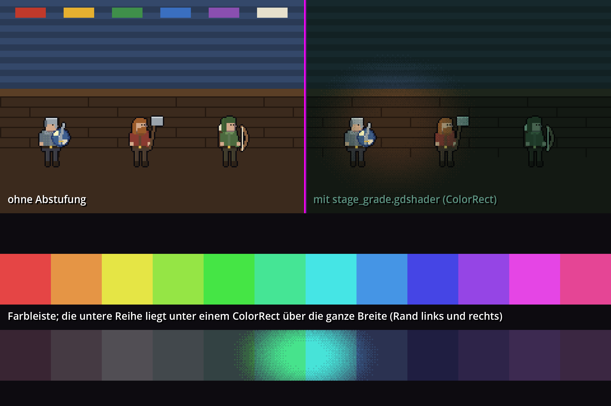

* **Geht mit `--no-window`:** ja, das Foto zeigt die Abstufung. Im Spiel (2.7) bleibt das Hud (CanvasLayer 1) hell und unberührt, denn `hint_screen_texture` liest nur, was bis zu diesem Knoten schon gezeichnet ist.
* **Geht mit Stretch `canvas_items`/fractional:** ja. Der Shader rechnet mit `UV` über dem `ColorRect` (in Spielfeldpixeln: `rect_pos + UV * rect_size`) und rastet auf `floor(...)` ein.
  Das Dither-Raster liegt damit fest im 480x320-Raster und passt zur Pixelkunst des Spiels.
* **Letterbox:** der frühere Lauf (Kommentar im Shader) hatte vermutet, `SCREEN_UV` decke bei Fenstern, die nicht 3:2 sind, auch die schwarzen Ränder ab, und deshalb `UV` vorgeschrieben.
  **Das stimmt nicht.** Fenster 2000x1500 (4:3) und 2400x1000 (breit): die Viewport-Textur ist genau das Spielfeld (2000x1333 bzw. 1500x1000), die Ränder sind **nicht** Teil davon.
  Rechnet man die Lage mit `SCREEN_UV * 480` statt mit `UV`, ist das Foto **Byte für Byte gleich** (7 998 000 Bytes verglichen, 0 abweichende). Auch die Testläufe selbst hatten
  Ränder (Fenster 3840x2054 bei Foto 3081x2054) und zeigen die Abstufung richtig. Die Rechnung über `UV` ist trotzdem die sauberere Wahl (unabhängig vom Verhalten der Engine bei Fenstern).
  Beleg: `img/R3_a_letterbox_breit.png` (Fenster 2400x1000).
* **Falle: zwei Bildschirm-Shader in einem Bild.** Das zweite `ColorRect` unten sieht ohne `BackBufferCopy` **Schwarz** (`R3_a_ohne_backbuffercopy.png`), mit `BackBufferCopy` (copy_mode VIEWPORT)
  davor die richtige Farbleiste. Wahrscheinlich liegt es daran, dass die Engine die Bildschirmkopie einmal anlegt und nur für die Fläche des ersten Lesers (Vermutung, nicht untersucht).
  Folge für den Bau: **nur eine** Fläche mit `hint_screen_texture` je Bild (die Abstufung der Bühne). Nebel, Leuchten, Effekte brauchen die Bildschirmtextur nicht.
* **Falle: `ColorRect` schluckt Klicks** (2.6). Immer `mouse_filter = IGNORE`.
* Eine eigene `CanvasLayer` für die Abstufung war nicht nötig und wurde nicht geprüft.

### 2.2 (b) Additives Leuchten (Laternen, Funken, Blitze, Einschlag)

Versuch: dieselben Figuren vor dunkler Wand, zwei Laternen mit radialer Leuchttextur (zur Laufzeit aus `Image` erzeugt, 96x96), Funken, ein Blitzstreifen. Links normal gemischt,
rechts in einem Knoten mit `CanvasItemMaterial.blend_mode = BLEND_MODE_ADD`. Unten: dasselbe Leuchten auf hellem Grund.

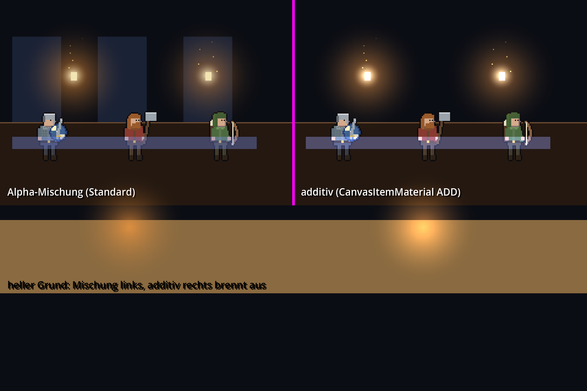

* Additiv liefert den heißen Kern und den warmen Hof, der **hellere** Flächen zusätzlich aufhellt (unten rechts: Ausbrennen zu Gelbweiß), Alpha-Mischung dagegen nur ein schmutziges Orange.
* Es geht nur über einen **eigenen Knoten** (ein Material je Zeichenfläche). Der Knoten ist ein `Node2D` mit eigener `_draw`, kostet einen Zeichenaufruf.
* Im Gesamtbild: ohne die additive Schicht (`R3_h_ohne_glow.png`) fehlen Laternen, Mond und der Halo am Einschlag, und der Treffer-Blitz sieht rosa-blass statt ausgebrannt aus.
  Das ist der größte Unterschied, den eine einzige Zeichenfläche macht.

### 2.3 (c) Parallax-Schichten in einem Control per `draw_set_transform`

Versuch: ein `Control` (wie das Hud) zeichnet in `_draw` Himmel (Tiefe 0), zwei Schiffe (0,3), Deck und Figuren (1,0), Vordergrund mit Seil und Silhouetten (1,45).
Jede Schicht bekommt `draw_set_transform(pos, 0, (s, s))` mit `s = 1 + (z - 1) * Tiefe` und `pos = t * Tiefe`. Die Beschriftung wird ungestreckt an den umgerechneten Ort gesetzt.

Zoom 1,0 / 1,5 / 2,0:

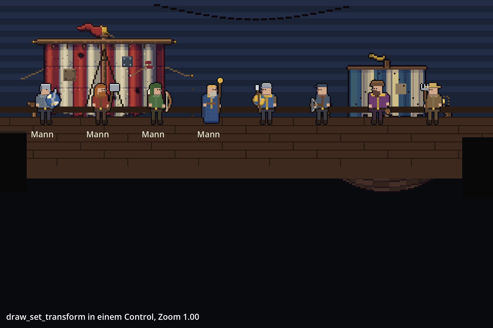
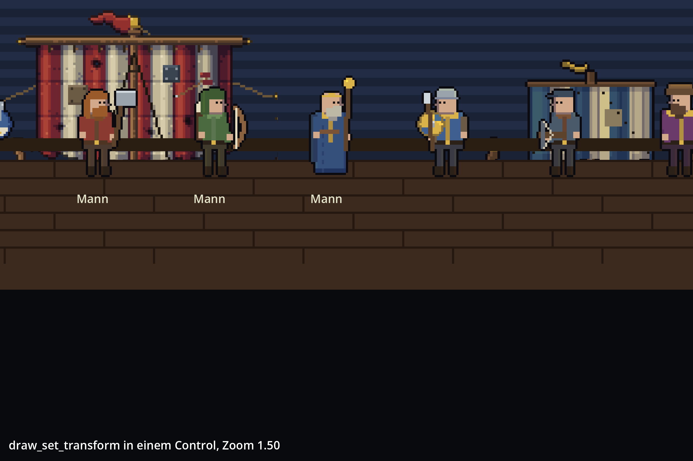
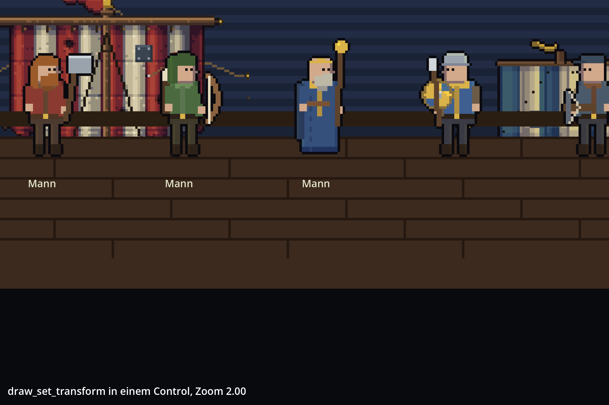

* Die Schiffe wandern kaum (Tiefe 0,3), die Männer sehr, der Vordergrund (Seil, Pfosten) fliegt bei 1,5x schon aus dem Bild. Die Tiefe ist sichtbar.
* Die Namen ("Mann") bleiben scharf und gleich groß, sitzen aber unter den umgerechneten Füßen.
* Kosten: 7 Zeichenaufrufe, 330 Primitive.
* **Grenze:** alles in einer `_draw` teilt ein Material und einen Mischmodus (bekannte Eigenschaft der Engine, nicht eigens getestet; die Versuche (a), (b), (e) laufen
  deshalb in eigenen Knoten). Rein Zeichnen taugt für Himmel, Meer, Deck, Requisiten, Vordergrund, nicht für Abstufung, Leuchten, Figuren mit Shader.

### 2.4 (d) Zoomqualität bei 1,5x und 2x (Nearest, Pixel-Snap AN)

Versuch (`--stagetest=d:1.5`): dieselbe Figur plus ein Streifenmuster (16x4 Pixel, abwechselnd hell/dunkel je ein Pixel) bei 1,0 / 1,5 / 2,0 auf **drei Wegen**:
`draw_set_transform` im Control, `Sprite2D.scale`, Eltern-`Node2D.scale` (so skaliert die Kamera der Bühne).

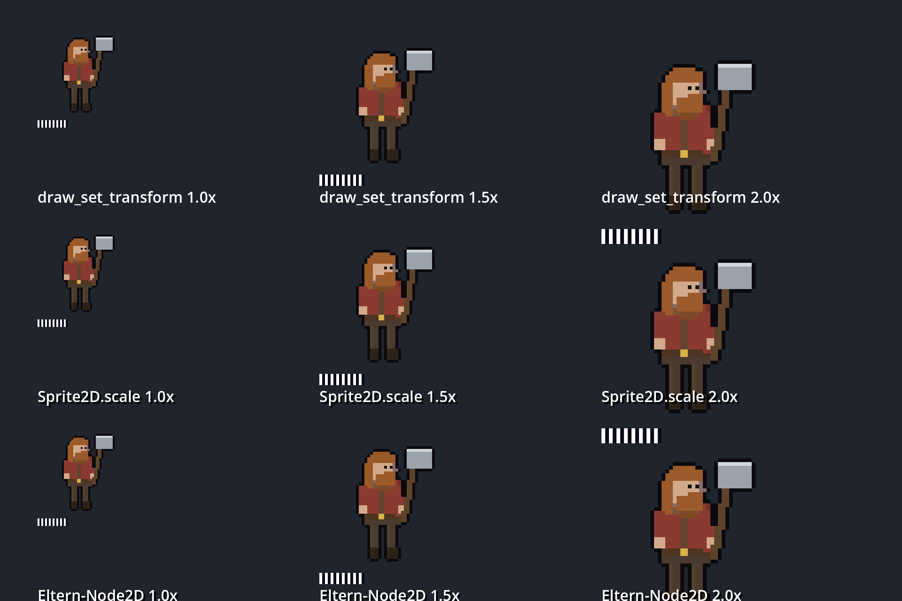

Gemessen wurde die Breite der hellen und dunklen Streifen im Foto (`R3_laufweiten.py`, liest das PNG selbst, ohne Bibliotheken). Faktor des Fotos 6,002 (Bildschirmpixel je Spielpixel):

| Zoom | Streifenbreiten im Foto (Bildschirmpixel) | Auswertung |
|---|---|---|
| 1,0 | 6 | ein Spielpixel = 6,0 |
| 1,5 | **9 / 9 / 9 ...** (bei Foto-Faktor 6,42: 10 / 9 / 9 / 10 ...) | 1,5 Spielpixel = 9 bzw. 9,6 Bildschirmpixel, **gleichmäßig** |
| 2,0 | **12 / 12 / 12 ...** (6,42: 13 / 12 / 13) | gleichmäßig |

* **Alle drei Wege liefern pixelgleiche Ergebnisse** (gemessen bei Zoom 1,0 und 1,5: die drei Streifenfolgen sind identisch; bei 2,0 liegt der dritte Weg im Foto teilweise unter dem Bildrand,
  die beiden messbaren sind identisch).
* **Gemessen: die Streifen werden nicht auf ganze Spielpixel gerundet, sondern auf Bildschirmpixel** (trotz `snap_2d_*` = AN): bei Rundung auf Spielpixel wäre bei Zoom 1,5 ein Muster 12/6
  (2 und 1 Spielpixel) entstanden. Es bleibt nur die 1-Pixel-Ungleichheit, die der gebrochene Faktor des Bildschirms (6,5 beim Besitzer) schon ohne Zoom hat (dort 6/7).
  1,5x und 2x sind also nicht schlechter als 1,0x. Folge: Ort und Versatz, die auf dem Spielraster bleiben sollen (Schichtursprünge, Wackeln), muss die Bühne selbst auf ganze Spielpixel runden (macht der Prototyp).
* Gegenprobe **SubViewport** (`--stagetest=v:1` und `v:2`; Bühne in einen SubViewport rendern und als `TextureRect` zeigen, die Kamera als `Node2D.scale`):

  | Weg | Streifen bei 1,5x | Bild |
  |---|---|---|
  | SubViewport 480x320 (1x) | **12 / 6 / 12 / 6**: jedes 1-Pixel-Detail wird 2:1 verzerrt | `R3_f_subviewport_1x.png` |
  | SubViewport 960x640 (2x) | 9 / 9 (gleichmäßig), aber das Bild wirkt **weich** (Nearest war gesetzt, Ursache nicht untersucht) und kostet das Vierfache an Pixeln | `R3_f_subviewport_2x.png` |
  | direkt im Spielviewport (Weg 3) | 9 / 9, scharf | `R3_d_zoom.png` |

  **Ein SubViewport lohnt nicht.** Er brächte keinen Vorteil, den der Spielviewport nicht auch hat.
* Gute Zoomstufen: beliebig (der Zoom ist frei), die Bühne rastet ihn trotzdem auf Achtel (`zq = 0.125`), damit die Kanten beim Halten ruhig stehen (R4, Technik 3).
  Das Wandern der Kanten **während** der Fahrt ist nicht geprüft (nur Standbilder, Abschnitt 8).

Der Zoom 2,0 in der echten Bühne (`R3_g_stage_axt20.png`) hält die Pixelkunst scharf, entlarvt aber die kleinen Figuren (grobe Gesichter), wie R2 in 3.6 festhält.

### 2.5 (e) Shader-Effekte auf Sprites

Versuch (`--stagetest=e`): Axtmann aus `combat.png` in sechs Zuständen mit `shaders/fighter_fx.gdshader` (je Figur ein `ShaderMaterial`), darunter derselbe Satz mit **einem gemeinsamen**
Material und `set_instance_shader_parameter` je Sprite (`shaders/fighter_inst.gdshader`).

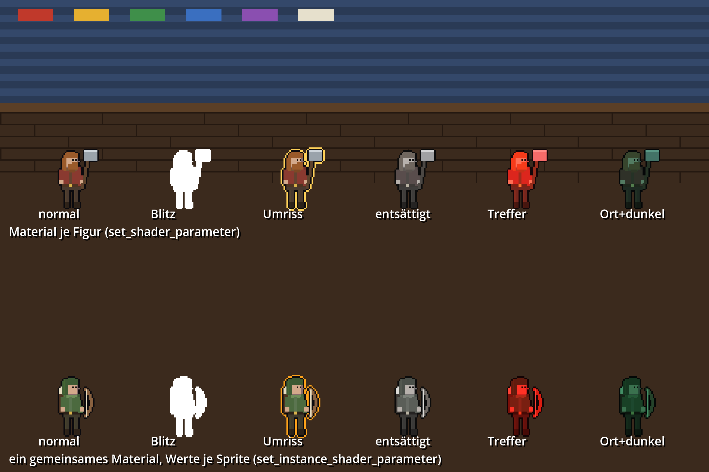

Von links: normal, weißer Blitz, goldener Umriss, entsättigt, roter Treffer-Stich, Ortsfarbe plus dunkel.

* Alle sechs Zustände funktionieren, auch mit `instance uniform` für CanvasItems (Godot 4.7.2: `set_instance_shader_parameter` geht, die untere Reihe ist gleich).
* **Umriss:** der Shader prüft die vier Nachbarpixel auf Alpha. Dafür braucht jedes Bild **2 Pixel transparenten Rand** (im Prototyp werden die Zellen zur Laufzeit mit Rand in eine `ImageTexture` kopiert).
  Die Zellen in `combat.png` haben diesen Rand nicht überall (R2: 24 von 125 Frames sind am Zellrand abgeschnitten); ein Umriss auf abgeschnittenen Frames wäre ebenfalls abgeschnitten.
  Das Rig aus R2 (Zelle 112x104 mit Rand) löst das.
* **Falle: Alpha und `modulate`.** In `canvas_item`-Shadern enthält `COLOR` in `fragment()` schon die Textur; wer wie der Prototyp aus `texture(TEXTURE, UV)` neu aufbaut, ignoriert
  `modulate` und `self_modulate`. Darum steht die Durchsichtigkeit (Gefallene blenden aus) als eigenes `uniform float alpha`.
* Farbstich je Kampfort: `tint.rgb * 1,7` gemischt mit `tint.a` (bei 0,5 bis 0,7 des Ortsstichs, damit die Männer nicht alle gleich aussehen), ergänzend zur Abstufung der Bühne.
* Eine Zeichenfläche je Figur: höchstens 9 zusätzliche Zeichenaufrufe (im Gesamtbild gemessen, 2.7: die Bühne hat insgesamt weniger Aufrufe als die heutige Ansicht).

### 2.6 Eingaben: bleibt alles klickbar?

Zwei Versuche.

**(i) Reiner Eingabetest** (`--stagetest=i`; die Eingabe geht den echten Weg über `Input.parse_input_event` mit der Fensterumrechnung `get_window().get_final_transform()`, dann GUI, dann `_unhandled_input`):

| Knoten über der Fläche | `_unhandled_input` erhält den Klick |
|---|---|
| nichts | **1** |
| `ColorRect`, Standard (`mouse_filter = STOP`) | **0**, das `ColorRect` selbst erhält ihn |
| `ColorRect`, `mouse_filter = IGNORE` | **1** |
| `Node2D`, `Sprite2D`, `Control` (clip_contents) und `CanvasLayer` + `ColorRect`, alle IGNORE | **1** |

Die Bühne muss also **jedes** `Control`, jedes `ColorRect` und `TextureRect` auf `IGNORE` setzen. `Node2D` und `Sprite2D` nehmen ohnehin keine GUI-Eingaben.

**(ii) Im Spiel** (`--clicktest`, Fertigkeit gewählt, auf den ersten Gegner geklickt; Mannschaft über `--seed=3` festgelegt):

| Kamera | Klickfläche `ft1_0` (Hud, umgerechnet) | Wirkung |
|---|---|---|
| Zoom 1,0 (`R3_j_klick_zoom10.png`) | (248, 68), Größe 52x60 | 1 -> 3 Ereignisse, Kraft des Gegners 51 -> 44 |
| Zoom 1,5 (stehend) | (360, 44), Größe 74x86 | 1 -> 3 Ereignisse, Kraft des Gegners 51 -> 44 |

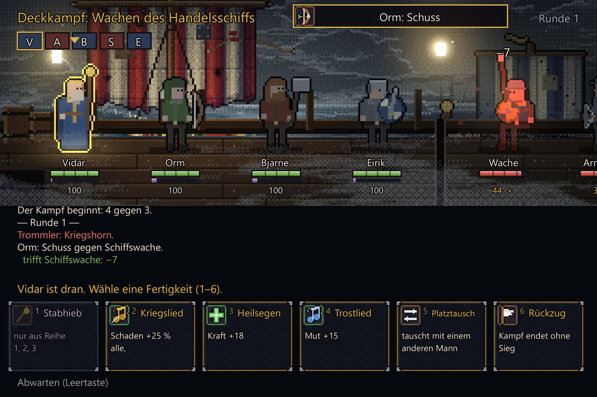

Das Hud rechnet die Fläche jedes Kämpfers mit `Rect2` * Kameramatrix (`rect_s = xf * rect`, dazu 4 Pixel Rand) und registriert sie wie bisher mit `_register(rect_s, "ft%d_%d")`; auch der Tooltip
(`_tip`) nimmt die umgerechnete Fläche. `Main._click` und die Tastenbehandlung (Q W E R, 1 bis 6, Leertaste, Esc) sind **unverändert**.
Beim Zoom 1,5 mit Blick auf den Helden liegen die Gegner am Rand: nicht jede Zielfläche ist im Bild. Für eine Kamera, die beim **Wählen** zoomt, muss sie so lenken,
dass alle gültigen Ziele sichtbar sind (die Bühne zoomt im Prototyp nur während Angriffen und im Ruhezustand gar nicht; `idlezoom` ist nur zur Prüfung da).

### 2.7 Gesamtprototyp im Spiel

Die Bühne `scripts/stage_proto.gd` (Quelltext als `R3_stage_proto.gd.txt`, rund 700 Zeilen) ist ein
`Control` unter dem Hud mit den Schichten aus Abschnitt 4. Aufruf: `shot.ps1 -Flags "--seed=3 --shotfx2 --stage=zoom:1.5 --nointro"`.
Änderungen am Hud: +68/-8 Zeilen; an `Main`: +88 Zeilen, davon etwa 25 für die Bühne selbst, der Rest sind Prüfhaken (`--stage`, `--stagetest`, `--clicktest`, `--shotform`, `--winsize`, `--nointro`).

Vorher und nachher, gleicher Augenblick (Axthieb, 0,28 s):

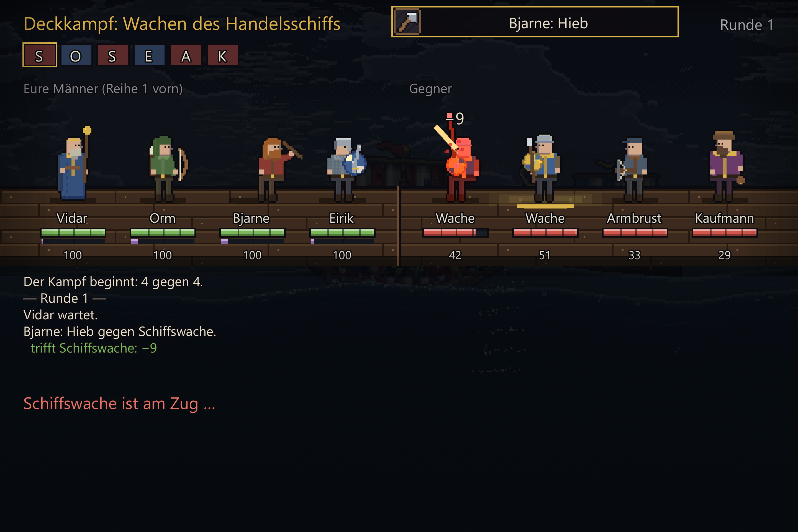


Der Angreifer (Bjarne) steht im Licht und hat einen goldenen Umriss, die anderen sind abgedunkelt und leicht entsättigt, das Ziel brennt weiß aus, ein Halo liegt am Einschlag,
Laternen und Mond leuchten, hinter den Männern stehen zwei Schiffe. Beschriftung, Balken, Zugleiste, Meldungen und Karten sind unberührt.

Ruhezustand (ein Mann ist am Zug, Kamera 1,0, alle acht Figuren im Bild; das Bild der heutigen Ansicht dazu ist `R3_00_ist_fight2.png`):

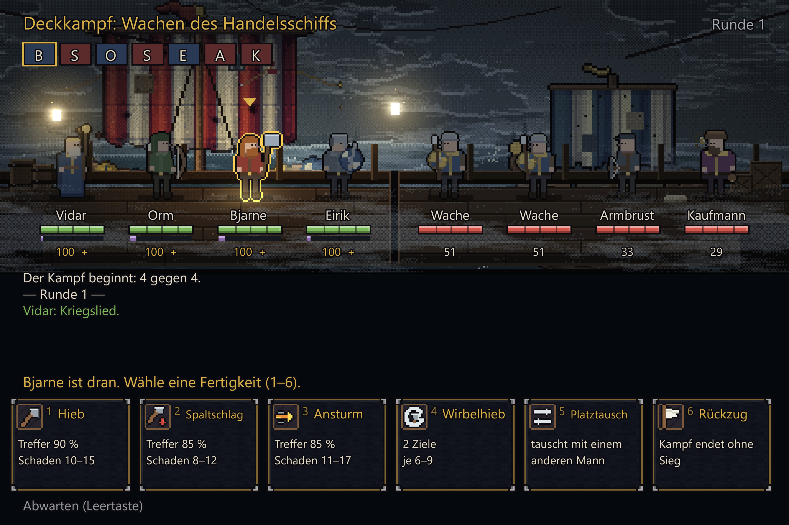

Der Mann am Zug trägt den goldenen Umriss und eine Lichtpfütze, das Dreieck des Hud bleibt. Die Plaketten (Name, Balken, Zahl) sitzen unverändert unter den Füßen und sind lesbar.

**Abstufung über oder unter den Figuren** (Zoom 1,5, gleicher Augenblick):


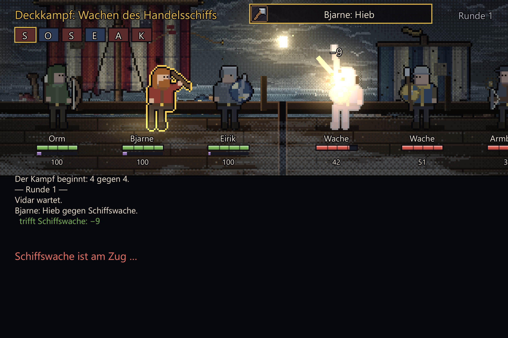

Oben (Abstufung über allem) zerstippelt das Dither-Raster den Blitz auf dem Ziel und den Umriss. Unten (Abstufung unter den Figuren) bleiben beide ein gefülltes Pixelbild.
Standard in der Arbeitskopie: Abstufung unter den Figuren, `--stage=gradeover` zeigt die alte Fassung.

**Dither-Raster bei Zoom.** Der Shader hat eine Rasterweite (`uniform float cell`, im Prototyp = Zoom), damit das Muster zur vergrößerten Pixelkunst passt statt halb so grob zu bleiben.
Zoom 2,0 mit `cell` (`R3_g_stage_axt20.png`) gegen ohne (`R3_h_zoom2_ohne_cell.png`): der Unterschied ist **klein** (Himmel und Deck wirken mit `cell` aus einem Guss, ohne `cell` feiner gerastert).
Ein Gewinn an Einheitlichkeit, nicht an Lesbarkeit; die Figuren sind in beiden Fällen unberührt, weil die Abstufung unter ihnen liegt.

Was jede Zutat beiträgt (Ausblendversuche, gleicher Augenblick, Zoom 1,5):

| Weggelassen | Bild | Wirkung |
|---|---|---|
| Abstufung | `R3_h_ohne_grade.png` | Himmel, Wasser und Deck hell und bunt, gut lesbar, aber ohne Stimmung; der Fokus hängt nur noch am goldenen Umriss und am Abdunkeln der Figuren selbst |
| Leuchten (additiv) | `R3_h_ohne_glow.png` | Laternen, Mond und Halo weg; der Treffer wirkt rosa statt ausgebrannt |
| Parallaxe | `R3_h_ohne_parallaxe.png` | Hintergrund wächst mit dem Zoom mit, Schiffe rücken zu nah; der Unterschied ist **dezent**, die Tiefe ist die schwächste der drei Zutaten |
| Nebel | `R3_h_ohne_nebel.png` | das **Schachbrettmuster am unteren Rand verschwindet**: es kam von der vorderen Nebelbank (Dither), nicht von der Abstufung; Deck und Plaketten werden ruhig, der Horizont etwas härter |
| Nebelbank höher (`fogy:70`) | `R3_h_nebel_hoeher.png` | das Muster liegt jetzt auf den Beinen der Figuren statt hinter den Plaketten: Schleier vor den Männern, Plaketten sauber. Die Bank gehört in die Höhe der Figuren, nicht auf den Plakettenstreifen |

**Kosten** (gemessen aus `Performance.RENDER_TOTAL_*` im Foto-Bild):

Gleiche Mannschaft (`--seed=3`), gleiche Formation, heutige Ansicht gegen Bühne (Zoom 1,0, Gegnerwahl):

| Formation | Ansicht | Zeichenaufrufe | Primitive | Objekte |
|---|---|---|---|---|
| Händler | heute / Bühne | 188 / **178** | 2819 / 4165 | 1404 / 2077 |
| Draugr | heute / Bühne | 118 / **108** | 1704 / 3046 | 846 / 1517 |
| Kraken | heute / Bühne | 182 / **167** | 2471 / 4517 | 1233 / 2256 |
| Axthieb (Händler, Zoom 1,5, 0,28 s) | heute / Bühne | 129 / **115** | 1888 / 3226 | 940 / 1609 |

Die Bühne hat **10 bis 15 Zeichenaufrufe weniger** als die heutige Ansicht (Deck und Planken sind ein Knoten statt vieler `draw_rect`), aber **1,4- bis 1,8-mal so viele Primitive**
(Himmel, Meer, Nebel, Leuchten). Alles bleibt weit unter dem Budget (einige hundert Aufrufe). Millisekunden sind **nicht** gemessen (Abschnitt 8). Selbsttest in der Arbeitskopie: `FEHLER: 0`.

---

## 3. Entscheidung: Kindknoten je Schicht oder reines Zeichnen im Hud

Das Hud ist ein einziges `Control`, das alles in `_draw` zeichnet. Drei Wege:

| Kriterium | A: rein Zeichnen in `Hud._draw` | B: Kindknoten **im** Hud | C: eigene Bühne als Geschwister **unter** dem Hud (gewählt) |
|---|---|---|---|
| Parallax, Zoom | ja (2.3) | ja | ja |
| additives Leuchten | nein (ein Material je Zeichenfläche) | ja | ja |
| Bildschirm-Shader mitten im Zeichenstrom | nein | ja | ja |
| Shader je Figur (Blitz, Umriss, Stich) | nein | ja | ja |
| Zeichenreihenfolge zu den Hud-Texten | frei | **Kinder zeichnen nach dem Elternknoten**, also über den Panels und Karten des Hud; nur mit `show_behind_parent` umkehrbar (nicht geprüft) | sauber: Bühne (Ebene 0) liegt unter dem Hud (Ebene 1), keine Tricks |
| Abstufung berührt das Hud nicht | geht nicht | nur mit Reihenfolgetricks | ja (belegt: das Hud bleibt hell) |
| Eingabe | unverändert | Kinder können Klicks schlucken (2.6) | unverändert, solange IGNORE gilt |
| Umbau im Hud | klein, aber 3 der 5 Zutaten fehlen | mittel: Hud erhält Kinder, `_draw` zeichnet teils unter, teils über | **klein: Hud entfernt Deck und Figuren, behält Beschriftung** (+68/-8 Zeilen im Prototyp) |
| Testbarkeit | `_draw` läuft headless nicht | wie A | Bühne ist eigene Datei; headless wird sie gar nicht gebaut |
| Kamera | `draw_set_transform` je Schicht | wie A | `Node2D.transform` je Schicht, Hud fragt `actor_xf()` |

Ergebnis: **C.** Die Bühne ist ein `Control` (für `clip_contents` und die Größe 480x168) mit **Node2D-Kindern je Schicht**. Reines Zeichnen bleibt innerhalb der Schichten erhalten
(`DrawLayer`: ein `Node2D`, das eine Funktion zeichnet), wo es reicht: Deck, Rückwand-Kunst, Vordergrund, Leuchten, Effekte. Kindknoten gibt es nur dort, wo ein **Material** gebraucht wird
(Abstufung, Leuchten, Nebel, Figuren). Das hält die Zahl der Knoten klein: ein paar Dutzend im Prototyp (davon höchstens neun Figuren mit je einem `Sprite2D`).

---

## 4. Empfohlene Render-Architektur

### 4.1 Knotenbaum

```
Main (Node2D)
├─ _world (Node2D)                      Welt der Fahrt; im Kampf unsichtbar UND ohne Verarbeitung (process_mode DISABLED, siehe 7.1)
├─ FightStage (Control, clip_contents, 480x168, mouse_filter IGNORE, focus NONE)    NEU, Ebene 0, nur wenn nicht headless
│   ├─ Back (Node2D, Tiefe 0,3)         Kulisse hinter den Schiffen
│   │   ├─ SkyLayer                     vorhandene Klasse (Shader sky.gdshader), eigene Instanz
│   │   ├─ OceanLayer far, OceanLayer mid
│   │   ├─ BackArt (DrawLayer)          Gegnerschiff aus enemies.png, eigenes Schiff aus ship.png, Dorf/Küste, Tentakel
│   │   └─ FogBack (ColorRect, stage_fog.gdshader, IGNORE)
│   ├─ Deck (DrawLayer, Tiefe 1)        Planken, Reling, Fuge, Requisiten
│   ├─ Grade (ColorRect, stage_grade.gdshader, IGNORE)     einziger Leser von hint_screen_texture
│   ├─ Actors (Node2D, Tiefe 1)         je Kämpfer ein FighterNode (Schatten + Sprite2D mit ShaderMaterial), Riesen hinter den anderen
│   ├─ Fx (DrawLayer, Tiefe 1)          FightFx.draw: Hiebbögen, Pfeile, Funken (wie heute, nur hier gezeichnet)
│   ├─ Glow (DrawLayer, CanvasItemMaterial ADD, Tiefe 1)   Laternen, Halo am Einschlag, Lichtpfütze, Blitz
│   └─ Front (Node2D, Tiefe 1,45)       Takelage, Silhouetten, FogFront, RainLayer
└─ CanvasLayer 1
    └─ Hud (Control)                    Schrift, Balken, schwebende Zahlen, Banner, große Ansage, Zugleiste, Meldungen, Karten, Tooltips, Klickflächen
```

Die Reihenfolge **Deck -> Grade -> Actors -> Fx -> Glow -> Front** ist der Kern: was unter `Grade` liegt, wird abgestuft; was darüber liegt, bleibt scharf und leuchtend.
In der Vorversion lag `Grade` über den Figuren (`--stage=gradeover`), siehe 2.7 für die Gründe, es nicht zu tun.

### 4.2 Kamera

* Ein Zustand (`cam_zoom`, `cam_focus`, `spot_pos`, `spot_amt`), gedämpft mit `1 - exp(-delta * 8)`. Ziele setzt nur das Hud (Regie).
* Zoom **um die Bodenlinie** (`FEET = 120`): die Füße bleiben auf ihrer Zeile, deshalb bleiben die Plaketten (Name, Balken, Zahl) an ihrem Platz und müssen nur in x verschoben werden.
  `t.y = FEET * (1 - z)`, `t.x = clamp(lerp(f.x, 240, u) - f.x * z, 480 * (1 - z), 0)` mit `u = clamp(z - 1, 0, 1) * 0.5` (der Brennpunkt wandert zur Bildmitte, damit Randfiguren nicht verschwinden).
  Die Grenze des Schwenks (`480 * (1 - z)`) sorgt dafür, dass **kein Bild breiter als 480** sein muss; R4 empfiehlt 560 Pixel breite Hintergründe, mit dieser Klammerung genügen 480
  (Himmel und Meer decken schon heute -16 bis 496). Wer weiter schwenken will, braucht breitere Bilder und breitere `OceanLayer`/`SkyLayer`-Flächen.
* Tiefe je Schicht: `s = 1 + (z - 1) * Tiefe`, `Ursprung = round(t * Tiefe + Wackeln * Tiefe)`. Hinten 0,3, Figuren 1,0, vorn 1,45. Aus `Transform2D(Vector2(s, 0), Vector2(0, s), Ursprung)`
  je Schicht (`FightStage._layer_xf`). Rückwand zusätzlich um `BACK_SHIFT = -66` hochgeschoben: die Wasserlinie der Welt (y 174) liegt damit hinter der Reling (y 108).
* Wahl von Zoom und Brennpunkt im Prototyp: Angreifer und alle Ziele in einem Fenster von 420 px: `zoom = clamp(420 / (|x_Ziel - x_Angreifer| + 120), 1, zmax)`, `zmax = 1,5` (R4 empfiehlt als Standard 1,125 bis 1,25; der Wert ist ein Parameter).
  Brennpunkt x: Mitte zwischen Angreifer und Zielen, y: `FEET - 34`. Übernimmt der nächste Akteur sofort, schwenkt die Kamera (kein Rückfall in die Totale), das entspricht R4 Technik 4.
* Rampenlicht: Ellipse mit Halbachsen `(150, 78) * zoom` um `(Mitte, FEET - 30)`, `spot_amt` läuft mit 0,15 je Bild auf 1 (Aktion) oder 0 (Ruhe).
* Zusätzlich gilt der bisherige Kameraschub (`FightFx.zoom`) als **Impuls obendrauf** (`cam_zoom * _fx.zoom_scale()`), und das Wackeln (`_fx.offset()`) wird je Schicht mit der Tiefe gewichtet.

### 4.3 Figuren

* Ein `FighterNode` (Node2D) je Kämpfer: ein `Sprite2D` (nicht zentriert, Offset auf die Füße, 2 Pixel Rand um jede Zelle) und ein Schatten (`_draw`, zwei flache Rechtecke; im Endausbau ein kleines Sprite).
* Material: `fighter_fx.gdshader`, Uniforms `alpha`, `flash`, `dim`, `desat`, `tint`, `outline`. Die Anzeige setzt sie je Bild:
  * `flash` = 1 in den ersten 0,12 s des Treffers (Anzeigezustand `kind == "hit"` in `hud._anim`), danach roter Stich bis zum Ende des Treffers (`tint` (1, 0,35, 0,32, 0,85)),
  * `outline` Gold für den Mann am Zug und den Angreifer, Rot für den Gegner am Zug, pulsierend Rot/Grün für **wählbare Ziele** (ersetzt das heutige Dreieck nicht, ergänzt es),
  * `dim`/`desat`/`tint` für alle, die nicht im Licht stehen (0,42 / 0,35 / Ortsfarbe),
  * `alpha` für Gefallene.
* Welche Zelle gezeigt wird, entscheidet weiter die Anzeige (heute `hud._anim`, `_fig_row`, `_is_big`); mit R2 (Frame-Namen, Zelle 112x104) wird daraus `FigArt.frame(figur, name)`.
* Spiegeln über `Sprite2D.flip_h` (oder negative Skalierung): der Umriss-Shader sieht die gespiegelte Textur richtig.

### 4.4 Wer besitzt was

| Zuständig | Besitzt | Darf nicht |
|---|---|---|
| `Combat` | Regeln, `events` | nichts über Anzeige wissen |
| Hud (Regie, `_fight_events`, später Director aus R1) | Ereignis -> Pose, Zeit, Kameraziel, Zahlen, Klang, `FightFx` | Figuren oder Deck zeichnen, wenn eine Bühne da ist |
| `FightStage` | alles, was im Bereich y 0..168 **hinter** der Beschriftung gezeichnet wird; Kamera; Themen; Material der Figuren | Eingaben, Spiellogik, Zeitgeber der Regeln |
| Hud (Beschriftung) | Name, Balken, Zahlen, Status, Pfeile, Banner, große Ansage, Zugleiste, Meldungen, Karten, Tooltips, Klickflächen | die Lage der Figuren ohne `actor_xf()` bestimmen |
| `FightFx` | Datenmodell der Effekte (RefCounted) | zeichnen: das tut die Bühne in der Ebene `Fx` mit `FightFx.draw(ci)` |
| `Main` | baut die Bühne (nicht headless), blendet die Welt im Kampf aus, `_click` | Bühnendetails |

### 4.5 Schnittstelle Hud <-> Bühne (Vorschlag)

Der Prototyp liest die Anzeige direkt aus `hud._anim`, `hud._ghosts`, `hud._fx`, `hud._fight_skill` (Abfrage genügt zum Beweis, ist aber eine Kopplung durch Privatvariablen).
Endausbau, alles reine Anzeige und **nie wartend**:

```gdscript
class_name FightStage extends Control
func begin(c: Combat) -> void                                   # Thema aus c.formation, Figurenknoten anlegen
func end() -> void
func set_pose(f: Combat.Fighter, frame: String, off: Vector2, flash: float, alpha: float) -> void   # je Bild
func set_marks(f: Combat.Fighter, outline: Color, dim: float, desat: float, tint: Color) -> void
func focus(attacker: Combat.Fighter, targets: Array, zoom: float) -> void   # Kamera + Rampenlicht halten
func release() -> void                                          # Kamera lösen (oder Übergabe: focus() mit dem nächsten)
func pulse_light(pos: Vector2, col: Color, radius: float, dur: float) -> void   # Halo am Einschlag
func actor_xf() -> Transform2D                                  # Kameramatrix der Figurenschicht, für Plaketten, Zahlen, Klickflächen
func layer_xf(depth: float) -> Transform2D
```

Das Hud rechnet mit `actor_xf()`: Fußpunkt `bp = xf * (cx, FEET)`, Fläche `xf * rect`, Zahlen `xf * (x, y)`; Text bleibt ungestreckt.
Ist `stage == null` (headless, Test, "schnell"), läuft der alte Pfad unverändert; so bleiben `voy.auto_combat`, Bots und Selbsttests unberührt.

### 4.6 Eingaben und Klickflächen (Regeln)

1. Jede `Control`-Ableitung der Bühne (`FightStage`, `ColorRect`, `TextureRect`): `mouse_filter = MOUSE_FILTER_IGNORE`, `focus_mode = FOCUS_NONE`. Das `ColorRect` ist hier die Falle (2.6).
2. Wo es geht `Node2D`/`Sprite2D` statt `Control` (nehmen keine GUI-Eingaben).
3. Klickflächen **bleiben im Hud**, werden jedes Bild mit `_register(xf * rect, id)` neu gesammelt, Tooltips mit `_tip(xf * rect, ...)`. `Main._click`, `fight_click`, `fight_key` bleiben unverändert.
4. Beim Zoomen (Kamera schwenkt): Zielflächen außerhalb des Bildes werden von der Hud-Zielwahl über die Tasten Q W E R weiter erreichbar; die Kamera zoomt beim **Wählen** nicht über das hinaus, was alle gültigen Ziele zeigt.
5. Prüfung: `--clicktest` (in der Arbeitskopie, `main.gd`) klickt in die Mitte der umgerechneten Fläche und prüft Ereignisse und Kraft (2.6).

### 4.7 Tempo, Schnellmodus, Bots, headless

* **headless:** `FightStage` wird nicht gebaut (`DisplayServer.get_name() == "headless"`), keine Texturen, keine Shader (`Hud._draw` läuft dort ohnehin nicht).
* **`voy.auto_combat` / Einstellung "schnell" / Bots:** Bühne unsichtbar und `process_mode = DISABLED`; Regeln und Takt laufen wie heute. Inszenierung wartet nie auf Eingaben oder Zeit.
* **Hit-Stop und Zeitlupe** (`FightFx.freeze`, `time_scale`) wirken über `Hud._tick_fight` auf die Animationszeiten, die die Bühne liest: Posen frieren, Kamera und Hintergrund laufen weiter (Wasser, Nebel). Einfach und ausreichend.
* Die Bühne rechnet je Bild: Kamera (ein paar `lerp`), Posen für höchstens 9 Figuren, `queue_redraw` für 3 bis 6 Zeichenflächen; kein Allozieren pro Bild außer `Color`/`Vector2`.

### 4.8 Umbauplan (Schritte, grob geschätzt)

| Schritt | Inhalt | Aufwand |
|---|---|---|
| 1 | `scripts/fight_stage.gd` aus dem Prototyp lösen (Themen, Kamera, Figuren), `Main` baut sie (nicht headless), `Hud` erhält den `stage`-Zweig (diff `R3_hud_main_diff.txt`) | 1 Tag |
| 2 | Shader `stage_grade`, `stage_fog`, `fighter_fx` ins Hauptprojekt; `cell`-Uniform; Nebel auf die Bühne begrenzt | 0,5 Tag |
| 3 | Schnittstelle 4.5 statt Privatvariablen des Hud; Anschluss an die Regie aus R1/R4 (Fokus, Übergabe, Zoomstufen) | 1 Tag |
| 4 | Bildquellen aus Abschnitt 6 (`tools/make_stage_art.py`), Themen füllen | 3 bis 4 Tage |
| 5 | Tests: Selbsttest prüft, dass **jede** Formation ein Thema hat (reines Datenprüfen, headless möglich); Bilder aller Themen; `--clicktest` | 0,5 Tag |

---

## 5. Themen je Kampfort

Fünf Formationen (`Foes.FORMATIONS`): `draugr`, `raeuber`, `haendler`, `dorf`, `kraken`. Der Prototyp hat ein Wörterbuch `THEMES` (Zelle aus `enemies.png`, Abstufung, Lampenfarbe, Nebel, Seegang)
und wählt es aus `c.formation`. Gemeinsam: Rampenlichtfarbe warm (1, 0,85, 0,5) für Männer, kaltrot (1, 0,4, 0,3) für Gegner am Zug.

Bilder der fünf Themen (Draugr, Räuber, Händler, Dorf, Kraken, jeweils Bühnenausschnitt):

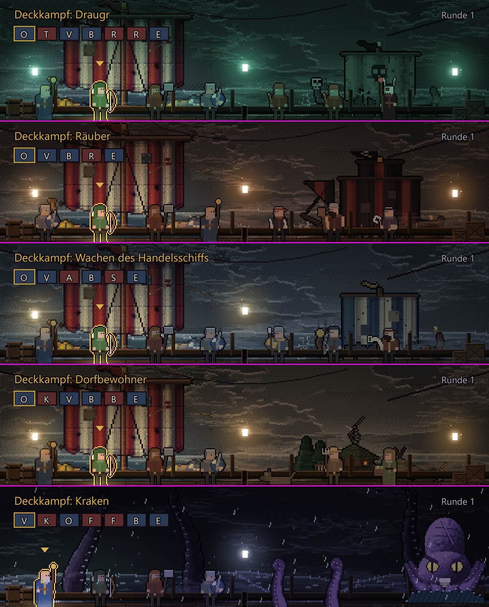

Einzeln in voller Größe: `R3_t_draugr.png`, `R3_t_raeuber.png`, `R3_t_haendler.png`, `R3_t_dorf.png`, `R3_t_kraken.png`.

### 5.1 Parameter der Prototyp-Themen

| Thema | Zelle (`enemies.png`) | Farbstich (RGB / Anteil) | Abdunkeln | Entsättigen | Lampen (Farbe, Anzahl) | Nebel | Seegang (`Waves.storm`) |
|---|---|---|---|---|---|---|---|
| draugr | 0 (Geisterschiff) | (0,35 / 0,90 / 0,72) / 0,55 | 0,52 | 0,60 | (0,45 / 1,0 / 0,8), 3 | 0,95 | 0,35 |
| raeuber | 1 (schwarz-rotes Schiff) | (0,95 / 0,50 / 0,30) / 0,40 | 0,45 | 0,40 | (1,0 / 0,62 / 0,25), 3 | 0,30 | 0,30 |
| haendler | 2 (Kogge, blau-gelbes Segel) | (0,55 / 0,68 / 0,85) / 0,30 | 0,40 | 0,35 | (1,0 / 0,78 / 0,40), 2 | 0,35 | 0,25 |
| dorf | 4 (Küstenstück mit Häusern) | (0,95 / 0,62 / 0,35) / 0,42 | 0,42 | 0,30 | (1,0 / 0,70 / 0,30), 3 | 0,50 | 0,20 |
| kraken | 8 (Kraken) + 9 bis 11 (Tentakel als Kulisse) | (0,50 / 0,45 / 0,95) / 0,50 | 0,55 | 0,50 | (0,7 / 0,8 / 1,0), 1 | 0,60 | 0,85 (Regen, Blitz, Donner über `RainLayer`) |

### 5.2 Ehrliche Bewertung der Prototyp-Themen

Was trägt: Farbstimmung und Lichtfarbe machen sofort einen Unterschied, den man ohne Beschriftung erkennt (grün/kalt, glutrot, bläulich, bernstein, violett/Sturm). Der Kraken im Sturm (Tentakel, Regen,
Fangarm-Bogen über die Männer) ist das stärkste Bild.

Was noch nicht trägt (und in 6 eigene Bilder braucht):
* **Beide Decks sehen gleich aus** (dieselben Planken, dieselbe Reling). Das Gegnerschiff ist nur eine Kulisse dahinter, kein Deck, auf dem die Gegner stehen.
* **Laternen schweben** in der Luft (Leuchten ohne Pfosten, Haken, Kette).
* **Dorf**: ein kleines Küstenstück mit Bäumen und Haus rechts, kein Dorf. Es gibt keinen Steg, keine zweite Häuserreihe.
* **Räuber**: nichts erzählt "Entern": keine Enterhaken und Taue über die Fuge, keine Schilde an der Reling, kein Feuer.
* **Händler**: keine Ladung; nichts verrät, dass es Händler sind, außer dem Segel.
* **Draugr**: das Geisterschiff steht ohne Geisterflotte im Nebel, die Draugr leuchten nicht.
* Die Kulisse wird mit 1,5 skaliert (Standard `bd:1.5`): ungleichmäßig gebrochene Kunstpixel, bei Faktor 6,4 unsichtbar, aber ein Hinweis, die Kulissen später **in der Zielgröße** zu zeichnen.

### 5.3 Plan je Kampfort

Jedes Thema ist ein Datensatz `THEME[<formation>]` mit: Himmel/Meer (`storm`, `sun_pos`, Mondscheibe), Rückwand-Kunst, Deck-Palette, Requisiten, Lichtquellen, Atmosphäre, Abstufung, Besonderes.
Gemeinsame Zutat aller Themen: Rückwand (Himmel + zwei Wasserschichten) aus den vorhandenen Shadern, Leuchten additiv, Nebel auf zwei Tiefen, Vignette im Abstufungs-Shader.

#### Draugr-Geisterschiff
* **Himmel/Meer:** grüngrau, `storm` 0,35, Mond hinter Wolken (Shader `sun_vis` klein), Wasser matt.
* **Kulisse:** Geisterschiff (`enemies.png` Zelle 0) groß und **halbdurchsichtig** (Alpha 0,8, Nebel davor); **Geisterflotte** (drei weitere Segel in Silhouette bei Tiefe 0,2, Bild 6).
* **Deck der Gegner:** modriges, graues Holz, Algen, Muscheln an der Reling, Löcher in den Planken (grüner Schimmer aus den Löchern, additiv).
* **Requisiten:** Knochenhaufen, zerrissene Netze, Rost-Anker, ein Rippenbogen (Wrack), Kerzenstümpfe, Runensteine.
* **Licht:** drei **kaltgrüne Irrlichter** (nicht an Pfosten, sie schweben und pendeln langsam), Augen der Draugr als zwei additive Punkte (2 Pixel).
* **Atmosphäre:** dichter Nebel (0,95), tiefer Nebel über dem Deck wandert, Wassertropfen; **kein** Regen, **kein** Blitz. Abstufung kalt, entsättigt (0,6), stärkste Vignette.
* **Besonderes:** bei jedem Draugr-Treffer ein kurzes grünes Aufleuchten im Halo; Gefallene lösen sich als Nebelwisch (Alpha + Verschiebung nach oben).

#### Räuber
* **Himmel/Meer:** bleigrau mit rotem Schein am Horizont (Brand in der Ferne), `storm` 0,3.
* **Kulisse:** Räuberschiff (Zelle 1, schwarz-rote Segel) groß, davor **Enterhaken und Taue** über die Fuge (2 bis 3 gespannte Linien, Pixelzeichnung, im Wind leicht schwingend).
* **Deck der Gegner:** schmutziges, geflicktes Holz, Blutflecken (dunkle Pixelgruppen), eingehauene Kerben.
* **Requisiten:** **Schildreihe** an der Reling (runde Schilde 12x12, abwechselnd rot/schwarz), Kohlebecken (2 Frames, additive Flamme), Waffenständer, Enterhaken-Bündel, Fässer.
* **Licht:** drei **Orange-Fackeln** (Fackelständer 8x28, additive Flamme 16x24 mit 6 Frames, Funkenflug), Glut-Widerschein auf dem Wasser.
* **Atmosphäre:** Rauch (flache additive Wolken von den Becken), Funken, wenig Nebel (0,3). Abstufung warm (Orange 0,4).
* **Besonderes:** Gegnerzug hellt das Orange kurz auf (Fackelflackern), Funken beim Einschlag fliegen nach oben.

#### Handelsschiff
* **Himmel/Meer:** blaue Dämmerung (Himmel heller als bei den anderen), `storm` 0,25, ruhiges Wasser, Möwen (`gulls.png`) am Horizont.
* **Kulisse:** Kogge (Zelle 2) mit gestreiftem Segel; **Handelsflotte** in der Ferne (zwei kleine Segel, Bild 6).
* **Deck der Gegner:** helleres, gepflegtes Holz, Messingbeschläge, Teppichstück vor dem Kaufmann.
* **Requisiten:** Kisten (gestapelt), Fässer, Warenballen, Truhe mit Münzen (Glitzern additiv, 2 Pixel), Wimpel (4 Frames Flattern), Waage.
* **Licht:** zwei **warme Laternen** an Haken (Messing, Kette), sauberes Gelb.
* **Atmosphäre:** wenig Nebel (0,35), keine Funken. Abstufung bläulich, sachlich.
* **Besonderes:** bei Treffer auf den Kaufmann fliegen Münzen (Partikel, 3 bis 5 gelbe Pixel mit Bogen, ohne Regelbezug).

#### Küstendorf
* **Himmel/Meer:** Abendrot (Himmel orangebraun im Shader), `storm` 0,2, ruhiges Wasser, Brandung am Strand.
* **Kulisse:** **Panorama** statt Zelle: Hang mit Häusern, Steg, Bäumen, Rauch aus Schornsteinen (Bild 7); der Gegner steht auf einem **Landesteg** (Deck der Gegner = helle Stegbretter, Pfähle, Netze zum Trocknen).
* **Requisiten:** Fischernetze, Kisten, Angeln, Wäscheleine, Holzstapel, Hundehütte.
* **Licht:** beleuchtete Fenster (additive gelbe 3x4-Flächen), **Fackeln am Steg**, Lagerfeuer am Strand (Flammenanimation).
* **Atmosphäre:** niedriger Bodennebel (0,5) über dem Strand, Rauch, Glühwürmchen (8 Punkte, additiv). Abstufung warm, gemütlich-bedrohlich.
* **Besonderes:** der Hund (`hund`) bekommt einen eigenen Schatten und springt (R2).

#### Kraken im Sturm
* **Himmel/Meer:** fast schwarz, Wolken in Bewegung, **`storm` 0,85** (hohe Wellen, `RainLayer` mit Regen, Blitz mit `Waves.flash`, Donner), hohe Wellen heben und senken die ganze Bühne um 1 Pixel (an `Waves.height` gekoppelt, gerundet).
* **Kulisse:** drei **Tentakel hinter** der Reling (Zellen 9 bis 11 bei Tiefe 0,3), **zwei riesige Tentakel im Vordergrund** (Tiefe 1,45, dunkle Silhouetten, die ins Bild hineinragen, Bild 8), der Kraken selbst (`kraken.png`, 88x88) hinten rechts.
* **Deck:** nasses Holz, Wasserlachen (additive Spiegelung heller Zeilen), Spritzer beim Tentakelschlag (4 Frames), umgestürzte Fässer.
* **Licht:** eine einzige **kalte Laterne**, die im Takt schwingt (Pendel, Sinus), Blitz als additive Vollfläche (schon im Prototyp: `Waves.flash`), nach jedem Blitz Donner-Wackeln (`FightFx.shake`).
* **Atmosphäre:** Regen auf zwei Tiefen, Gischt, tiefe Nebelbank; Abstufung violett-blau, stärkste Abdunkelung (0,55).
* **Besonderes:** Fangarm-Griff (der heutige Bogen über die Männer) im Kamerabild halten (Zoom 1,0 oder 1,2, Brennpunkt in der Mitte), Tentakel-Aufschlag mit Wackeln und Spritzern.

---

## 6. Prozedural zu erzeugende Bilder und Wiederverwendung der Weltbilder

Alle neuen Bilder entstehen wie bisher als Code: `tools/make_stage_art.py` mit der Hilfsklasse `Img` aus `tools/make_art.py` (nur Standardbibliothek). Zielgrößen nach den Maßen der Bühne:
Bühnenfläche **480 x 168**, Bodenlinie `FEET = 120`, Wasserlinie der Rückwand **138** (nach `BACK_SHIFT`), Reling bei y 108, Himmel bis zum Horizont, Figurenzelle 44x56 (später 112x104, R2).

### 6.1 Was vorhanden ist und wie es wiederverwendet wird

| Vorhanden | Größe | Verwendung auf der Bühne |
|---|---|---|
| `SkyLayer` + `sky.gdshader` | Fläche 512x216 | **unverändert** als Himmel; Uniform `storm`, `sun_pos` (Mondposition), `sun_vis` je Thema; kein neues Bild |
| `OceanLayer` + `ocean.gdshader` (2 bis 3 Schichten) | 480x1 Textur | **unverändert** als Meer hinter der Reling; `storm` je Thema |
| `assets/enemies.png` | 512x384, Zellen 128x96, Anker (64, 72) | Gegnerschiff-Kulisse (Zellen 0, 1, 2), Insel (3), Dorf (4), Hafen (5), Wrack (6), Seeschlange (7), Kraken (8), Tentakel (9 bis 11, je zwei Bilder 64x96), Automatenschiff (12). Heute mit 1,5 skaliert; später in Zielgröße neu zeichnen (6.2, Nr. 4) |
| `assets/ship.png` | 6820x780, 31 x 5 Bilder zu 220x156, Anker (110, 108) | eigenes Schiff als Kulisse: Mast und Segel aus Bild 15 (Mitte), Segelreihe 4 (voll): Ausschnitt (56, 18, 112x78) bei 1,5x; später Segelreihe nach Zustand der Fahrt (`voy.sail_visual`) wählen |
| `assets/coast.png` | 640x40 | Küstenstreifen für Dorf und Händler als ferne Silhouette (Horizont, Tiefe 0,2) |
| `assets/gulls.png` | 36x8 | Möwen am Händler- und Dorfhimmel |
| `assets/cloud_noise.png` | 256x256 | Nebel (`stage_fog.gdshader`) und Wolken; **kein neues Rauschbild** |
| `assets/kraken.png` | 440x88, fünf Bilder zu 88x88 | der Kraken wie bisher |
| `assets/vignette.png` | 480x320 | nur noch, wenn die Vignette im Shader nicht genügt |
| `RainLayer` | Code | Regen, Spritzer, Blitz, Donner im Kraken-Thema |
| `FightFx` | Code | Funken, Hiebbögen, Pfeile, Ringe; additiv über `Glow` zusätzlich (Halo am Einschlag) |

### 6.2 Neue Bilder (nach Wirkung geordnet)

Alle Zahlen in Spielpixeln. "Rand" = mindestens 1 Pixel transparent, wenn ein Umriss oder ein Halo nötig ist.

| Nr | Datei (Vorschlag) | Inhalt | Größe | Themen |
|---|---|---|---|---|
| 1 | `assets/stage_props.png` | Requisiten: Fass groß 16x20, Fass klein 13x15, Kiste groß 20x18, Kiste klein 14x12, Taurolle 14x8, Sack 12x14, Netz 24x16, Anker 20x24, Warenballen 18x12, Truhe 20x14, Knochenhaufen 24x10, Runenstein 14x20, Kohlebecken 16x16 (2 Frames), Kanone 28x16, Ruder 8x40, Hundehütte 20x16, Fischkorb 14x12 | Atlas **384 x 128** (12 x 4 Zellen zu 32x32) | alle |
| 2 | `assets/stage_lamps.png` | Laterne mit Haken und Kette 10x22 (4 Farbvarianten), Fackelständer 8x28, Flamme 16x24 x 6 Frames, Irrlicht 8x12 x 4 Frames, Fensterlicht 3x4 | **256 x 64** | alle |
| 3 | (Laufzeit) `Image` | Leuchttextur radial 96x96 weich und gestuft (mit Bayer-Dithering, wie im Prototyp); **keine Datei** | je 96x96 im Speicher | alle |
| 4 | `assets/stage_foe_<thema>.png` | Gegnerschiff **in Zielgröße** (heute 128x96 bei 1,5x): Draugr, Räuber, Händler mit Reling und Bug, die bis zur Reling der Bühne reichen; **288 x 176**, Anker Wasserlinie Mitte (144, 138) | 3 Bilder je 288x176 | draugr, raeuber, haendler |
| 5 | `assets/stage_deck.png` | **Deck der Gegner** als drei Streifen 480x46 (Palette je Thema: modrig, schmutzig, gepflegt) plus Steg (helle Bretter, Pfähle, 480x46) | 4 Streifen = **480 x 184** | je Thema |
| 6 | `assets/stage_far.png` | ferne Silhouetten: Geisterflotte (3 Segel, 96x40), Handelsflotte (2 Segel, 80x32), Rauchsäule 16x48 | **320 x 48** | draugr, haendler, raeuber |
| 7 | `assets/stage_village.png` | Küstenpanorama: Hang, 4 bis 5 Häuser, Steg 96x32, 2 Baumtypen 24x40, Fischerhütte, Wäscheleine; Rauch 8x16 x 4 Frames | **640 x 112** (kachelt nicht, wird mit Tiefe 0,3 geschoben) | dorf |
| 8 | `assets/stage_kraken_front.png` | zwei Riesen-Tentakel im Vordergrund (Tiefe 1,45): 96x168, je 2 Frames, dunkle Silhouette mit hellem Saum; Spritzer 48x24 x 4 Frames | **384 x 168** | kraken |
| 9 | `assets/stage_front.png` | Takelage und Vordergrund (Tiefe 1,45): Mastfuß links 40x168 und rechts 48x168, Seilnetz oben 480x40, hängendes Tau, Pfosten; je Thema ein Satz (Seegras beim Draugr, Banner beim Räuber, Tauwerk beim Händler, Stegpfähle im Dorf) | je **576 x 112** (Breite für Schwenk und Vordergrund-Skalierung 1,45) | je Thema |
| 10 | `assets/stage_sky_extra.png` | Mondscheibe 24x24 (2 Phasen), Wolkenschleier 160x16 (2), Sterne 4x4 (3) | **256 x 32** | nachts |
| 11 | Laufzeit | Rauch, Funken, Gischt, Regen, Dunst: Partikel im Code (wie `RainLayer`), keine Bilder | - | alle |

Größenbudget (gerechnet): etwa **0,79 Mpx** neue Bilder (384x128 + 256x64 + 3x288x176 + 480x184 + 320x48 + 640x112 + 384x168 + 5x576x112 + 256x32), im Speicher etwa 3 MB;
als PNG schätzungsweise 150 bis 300 KB (flächige Pixelkunst, nicht gemessen). Das ist nicht wenig, aber einmalig und im Verhältnis zu `ship.png` (6820x780, 5,3 Mpx) klein.

Reihenfolge nach Wirkung je Aufwand: (1) Laternen mit Pfosten (Nr. 2) und Deck der Gegner (Nr. 5), (2) Requisiten (Nr. 1), (3) Takelage und Vordergrund (Nr. 9), (4) Küstenpanorama (Nr. 7) und Tentakel-Vordergrund (Nr. 8),
(5) Gegnerschiffe in Zielgröße (Nr. 4), (6) ferne Silhouetten und Sternenhimmel (Nr. 6, 10).

---

## 7. Risiken und Stolperstellen

1. **Zwei Wetterquellen.** Verdeckt man die Welt mit `visible = false`, **verarbeitet** sie weiter (`_process` läuft): der `RainLayer` der Welt kann im Kampf Donner und Blitz auslösen, wenn
   `Waves.storm` aus der Fahrt hoch steht, und der der Bühne dazu. Lösung: `_world.process_mode = PROCESS_MODE_DISABLED`, solange die Bühne aktiv ist. Dann stehen
   `EnemyLayer` (Einfahrt/Abgang), `ShipSprite` und `WakeLayer` während des Kampfes still (sie sind unsichtbar). Beim Zurückkehren laufen sie mit dem nächsten Bild an: prüfen,
   ob die Abgangsanimation des Gegners (Sinken nach einem Sieg) dabei richtig beginnt. Nicht geprüft.
2. **`Waves.storm` ist statisch.** Die Bühne setzt ihn jedes Bild auf den Seegang des Themas; `Main._process` setzt ihn aus `voy.storm` zurück. Das stimmt nur, solange die Bühne **nach** `Main`
   verarbeitet wird (Reihenfolge im Baum, so wie im Prototyp). Sauberer: `SkyLayer`/`OceanLayer` bekommen ein eigenes `storm`-Feld, die Statik bleibt der Welt.
3. **Dither-Raster und Kamera.** Das Raster liegt auf dem Bildschirm (Spielpixel), nicht in der Welt. Beim Zoomen und Schwenken "schwimmt" das Muster über die Pixelkunst. Standbild bei 1,5x und 2x ist ruhig (Uniform `cell`);
   das Schwimmen **während** der Fahrt ist nicht geprüft. Gegenmittel: Abstufung nur mit 3 Stufen, Vignette ohne Dither, oder das Raster an die Welt koppeln (`g / cell` mit der Kameraverschiebung).
4. **Lesbarkeit der Plaketten auf dem unruhigen Deck.** Das Schachbrettmuster am unteren Rand (`R3_g_stage_axt15.png` unten rechts) liegt hinter Namen und Zahlen. Gemessen am Ausblendversuch
   (2.7) kommt es von der **vorderen Nebelbank** (`Rect2(-40, 112, 560, 60)` im Prototyp), nicht von der Abstufung. Lesbar, aber unruhig. Abhilfe: die Bank höher legen (`fogy:70`, `R3_h_nebel_hoeher.png`)
   oder ihre Dichte im Streifen unter den Füßen auf 0 ziehen (senkrechter Verlauf im Shader), zusätzlich ein dunkler Streifen hinter den Plaketten (`draw_rect` mit Alpha 0,55, ein Aufruf).
5. **Umriss braucht Rand im Bild.** Mit dem Atlas aus R2 (Zelle 112x104) ist er da. Mit dem heutigen Atlas (Zelle 44x56) schneidet der Umriss an abgeschnittenen Frames ab (R2 1.1). Der Prototyp blittet die Zellen mit 2 Pixel Rand
   in eigene Texturen (`_tex()`), das genügt für die fünf Standbilder.
6. **Eine Bildschirm-Textur je Bild** (2.1): die Abstufung ist der einzige Leser. Ein späteres Fenster- oder Aufprall-Verzerren darf nicht noch einen zweiten Leser einbauen, ohne `BackBufferCopy`.
7. **Doppelte Vignette.** `Hud._draw_fight_texts` zeichnet weiter seine eigene Vignette (8 Streifen je Seite); in der Bühne macht es der Shader. Das Hud sollte sie im Bühnenmodus auslassen (nicht getan).
8. **Fraktionaler Faktor.** Der Bildschirm des Besitzers hat 6,5 Bildschirmpixel je Spielpixel. Prüfung bei 6,0 und 6,42; bei 6,5 gilt dasselbe Argument (Pixelbreite 6/7 bzw. bei 1,5x 9/10), nicht eigens geprüft.
9. **Bühne mit festen Zahlen.** `FEET = 120`, `STAGE_H = 168`, `BACK_SHIFT = -66` sind aus dem heutigen Hud abgeschrieben; ändert R1/R2 das Raster (z. B. Zelle 112x104, größere Figuren), müssen diese Konstanten in **einer** Stelle stehen.

---

## 8. Was nicht geprüft ist

* **Bewegtbild.** Alle Beweise sind Standbilder (Beobachtung mit dem Auge am Bild). Flimmern, Wandern der Kanten und Dither-Schwimmen **während** Zoom und Schwenk sind nicht beurteilt.
* **Zeitkosten.** Nur Zeichenaufrufe und Primitive, keine Millisekunden je Bild und keine Messung auf dem Rechner des Besitzers (3120x2080).
* **Faktor 6,5.** Gemessen bei 6,0 und 6,42.
* **CanvasLayer für die Abstufung**, **`show_behind_parent`** als Variante B, **Compatibility-Renderer**: nicht versucht (Forward+, wie die Einstellung des Projekts).
* **Ton.** Alles ohne Ton (Regel des Auftragsblatts). Das Donnern der Kraken-Bühne wurde nicht gehört; die doppelte Wetterquelle (7.1) ist aus dem Code gelesen, nicht im Lauf beobachtet.
* **`EnemyLayer`-Abgang** nach Abschalten der Weltverarbeitung (7.1).
* **Bots** und **Schnellmodus** mit Bühne: die Bühne wird dort nicht gebaut/unsichtbar geschaltet; mit der Arbeitskopie lief nur der **Selbsttest (FEHLER: 0)**, nicht die Bots.

---

## 9. Dateien und Reproduktion

Arbeitskopie: `..\_sandbox\buehne\` (nicht Teil des Hauptprojekts). Dem Hauptprojekt liegen **nur** Dokumente und Bilder bei:

| Datei | Inhalt |
|---|---|
| `R3_buehne.md` | dieses Blatt |
| `R3_stage_proto.gd.txt` | Prototyp der Bühne (`scripts/stage_proto.gd`), 697 Zeilen |
| `R3_stage_test.gd.txt` | Prüfstand (`scripts/stage_test.gd`, Modi a, b, c, d, e, i, v) |
| `R3_stage_grade.gdshader.txt`, `R3_stage_fog.gdshader.txt`, `R3_fighter_fx.gdshader.txt` | die drei Shader (Abstufung, Nebel, Figuren) |
| `R3_hud_main_diff.txt` | unified diff gegen `hud.gd` und `main.gd` (Hud: +68/-8, Main: +88 mit Prüfhaken) |
| `R3_laufweiten.py` | misst Streifenbreiten im Foto (PNG-Leser ohne Bibliotheken) |
| `img/R3_*.png` | alle Bilder dieses Blatts (`R3_00_ist_fight2.png` ist das Ausgangsbild der heutigen Ansicht vom Start des Auftrags). Die Fenstergröße der Testläufe schwankt (3840x2054 oder 3120x1921), daher Fotos in 2881x1921 oder 3081x2054 |

Aufrufe (aus der Arbeitskopie, `tools\dev\shot.ps1 -Proj ..\_sandbox\buehne -Out Bild.png -Sec 1 -Flags "..."`):

| Zweck | Flags |
|---|---|
| Einzelbeweise | `--stagetest=a`, `a:nobbc`, `b`, `c:1.5`, `d:1.5`, `e`, `v:1`, `v:2`. Der Eingabetest `i` meldet im Protokoll (Zeilen `STAGETEST i:`), dafür Godot-Konsole direkt starten statt `shot.ps1` (das gibt nur Bildzeilen aus), `-Sec 6` |
| Fenster, nicht 3:2 | `--stagetest=a --winsize=2400x1000` |
| Kampf mit Bühne | `--seed=3 --shotfx2 --stage=zoom:1.5 --nointro` (Sec 0,28), Optionen: `nograde`, `noglow`, `nopar`, `nofog`, `gradeover`, `nocell`, `zoom:2.0` |
| Kampf je Thema | `--seed=3 --shotform=draugr|raeuber|haendler|dorf|kraken --stage --nointro` (Sec 4) |
| Klicktest | `--seed=3 --shotform=haendler --stage=idlezoom:1.0,zoom:1.5,wait:120 --clicktest --nointro` |
| Messung | Ausgabezeile `STAGE Messung: Zeichenaufrufe=... Primitive=... Objekte=...` in jedem Foto-Lauf |
| Streifenbreiten | `python -I R3_laufweiten.py Bild.png` |

Schnittstellen und Vorgaben für die anderen Blätter:

* **R2 (Figuren):** die Bühne zeigt jede Zelle in einem `Sprite2D`; Zelle 112x104 mit Rand genügt für Umriss und Blitz. Fußpunkt (40, 98), Spiegeln über `flip_h`. Zoom 2,0 bleibt scharf (2.4); die Kamera
  darf bei großen Figuren ruhig auf 1,25 bleiben.
* **R1/R4 (Regie):** die Bühne braucht **vier Aufrufe**: Fokus setzen (Angreifer, Ziele, Zoom), Posen je Bild, Lichtimpuls, Fokus lösen/übergeben (4.5). Zoomstufen, Haltezeiten und Übergabe-Regel stehen dort.
* **Bild- und Tonwerkzeuge:** `tools/make_stage_art.py` (neu, Abschnitt 6); `Img` aus `tools/make_art.py`.
