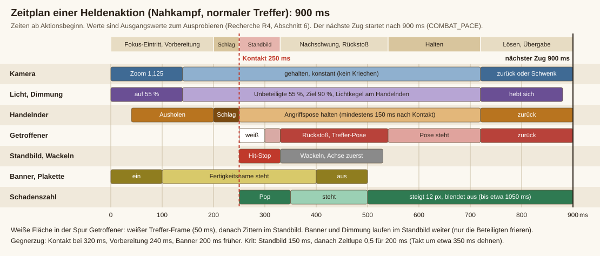

# R4: Vorbild-Recherche. Wie Darkest Dungeon und die Game-Feel-Lehre Kämpfe in Szene setzen

Stand: 3. November 2026, dritter Durchgang. Der zweite Durchgang hatte den ersten Entwurf neu geprüft und mehrere Zahlen korrigiert; der dritte hat die Darkest-Dungeon-Belege (Q1, Q2, Q3, Q6, Q7, Q10, Q13) erneut selbst gelesen, alle bestätigt, und ergänzt: Hit-Stop nach Sakurai (Q26), Vordergrund-Auftritt und Entsetzensgesicht (Q27), Staging als Begründung des Rampenlichts (Q34), Schriftgestaltung der Schadenszahlen, eine Gegenprobe aller Kernzahlen gegen Fremdwerte (Abschnitt 7) und neue Quellen Q26 bis Q41. Abschnitt 8 listet Korrekturen und Prüfergebnisse.
Zielspiel: "Halt Kurs", Bühne 480x320 Pixel, Pixelart, rundenbasiert, Figuren 44x56, rund 0,9 s je Aktion (`COMBAT_PACE` in `voyage.gd`).
Alles ist in eigenen Worten beschrieben. Quellennummern wie [Q7] verweisen auf Abschnitt 10.

**Wie man die Zahlen liest.** Jede Angabe trägt eine Beleggüte:
**[A]** Entwickler- oder Fachquelle, selbst gelesen. **[B]** Wiki, Forum oder Community-Seite, selbst gelesen. **[C]** nur Suchauszug oder schwache Quelle.
**[E]** Empfehlung für dieses Spiel: eigene Ableitung aus den Quellen und aus dem Code, nicht belegt. Wo kein Beleg steht, ist es [E].
Genaue Zahlen von Darkest Dungeon selbst sind nirgends veröffentlicht (Abschnitt 2); alle Millisekundenwerte unten sind Ausgangswerte zum Ausprobieren mit Screenshots.

---

## 1. Kurzfassung

Das Gefühl "die handelnde Figur steht im Fokus" entsteht aus **sieben Zutaten**, die zusammen unter einer Sekunde bleiben:

1. **Abdunkeln der Unbeteiligten** auf etwa 55 % Helligkeit und **Licht** auf dem Handelnden (Tönung der Sprites, ein Rechteck über dem Hintergrund). Wirkt bei jedem Abstand der Figuren und kostet fast nichts.
2. **Kamera**: Zoom 1,125 und Schwenk auf Handelnden und Ziel, 140 ms, Cubic Out, als **gehaltener Zustand** (nicht als Impuls). Wegen der Bühnenbreite nur begrenzt möglich (Abschnitt 4, Technik 3).
3. **Vorbereitung und Halten**: Ausholen 120 bis 200 ms, Schlag 50 ms, danach die Pose mindestens 150 ms halten.
4. **Namensschild und Fertigkeitsname** parallel zum Ausholen, nie davor, nie länger als die Aktion.
5. **Kontakt-Wucht**: Standbild 80 ms, gerichtetes Wackeln, weißer Treffer-Frame, Rückstoß des Getroffenen.
6. **Kameraübergabe**: bei Folgeaktionen direkt zum nächsten Akteur schwenken, nicht erst in die Totale zurück.
7. **Eskalationsleiter**: Zeitlupe, Vollbild-Ansagen und Riesenzoom nur für Krit, Todesstoß, Heldenmut, Zusammenbruch.

Alles übrige (Smear, Impact-Frame, Nachbilder, Funken, Fackelflackern, Letterbox) ist **Schmuck**. Das Siebenerpaket trägt das Gefühl auch ohne Schmuck; Schmuck ohne das Siebenerpaket nicht.

Wichtigste Warnung aus der Recherche: Spieler von Darkest Dungeon haben mehrere Modifikationen gebaut, die den Kampfzoom abschwächen oder die Animationen und Texteinblendungen halbieren, und sie klagen über die Wartezeit vor Fertigkeitsnamen und Wirkungstexten [Q1 bis Q4]. **Fokus darf nicht Tempo kosten.** Inszenierung läuft parallel zur Aktion, nie hinterher, und fällt im Schnellmodus komplett weg.

---

## 2. Was über Darkest Dungeon belegt ist, und was nicht

### 2.1 Belegt

| Befund | Quelle | Güte |
|---|---|---|
| Bei Treffern im Fernkampf, im Nahkampf und bei Fertigkeiten läuft ein Kameraskript aus Vorschritten wie Heranzoomen, Herauszoomen und Schwenken; am Ende steht die Rückkehr zur Grundansicht. Eine Modifikation entfernt diese Schritte für gewöhnliche Treffer, **behält aber den Zoom bei kritischen Treffern**, weil der Autor ihn dort für wirkungsvoll hält. Schaden, Stress, Betäubung und Verstärkung bleiben ohne Zoom lesbar. Nebenwirkung: Kämpfe werden spürbar schneller. | Q1 | [B] |
| Kritische Treffer haben **eigene Zeit- und Kameraskripte**: mehrere Modifikationen, die Animationen beschleunigen, lassen ausdrücklich nur die Krit-Animation unverändert. Eine halbiert die Dauer von Nahkampf-, Fernkampf- und Hilfsfertigkeiten und behält dabei den Zoom. Die Zeitskripte liegen als Textdateien im Spielordner und sind für Modder lesbar. | Q2, Q5 | [B], [C] |
| **Der Fertigkeitsname wird eingeblendet**, und das stört: Ein Spieler beklagt, dass er rund eine Sekunde auf die Namen warten muss, obwohl sie ohnehin im Tooltip stehen; ebenso auf Wirkungstexte ("Widerstanden", "5 Stress"), die erst nach dem Zurückfahren der Kamera erscheinen. Ein Beitrag in der Diskussion präzisiert: gemeint sind die Meldung, die den Angriff ansagt, und die Wirkungstexte nach dem Zurückfahren der Kamera, nicht die Angriffsanimation selbst. Die Dauer ist in einem Zeitskript über einen Wartewert einstellbar (ein Modder rät zu etwa 0,8 s). Animationen und Texte laufen nacheinander, nicht gleichzeitig. | Q3, Q4 | [B], [C] |
| Spieler berichten, dass beim Hinein- und Herauszoomen die Figuren zittern oder flimmern und die Rückfahrt am Ende abrupt wirkt (Kommentare zu einer Tempo-Modifikation). | Q4 | [B] |
| Die Figuren sind in der Animationssoftware Spine als Puppen animiert (vorher in Photoshop gezeichnet). Rezensionen beschreiben die Animation als zurückhaltend, aber wirkungsvoll: gerade genug Bilder, um die düsteren Zeichnungen zu tragen. **Das Drama kommt aus Kamera, Timing und Standbildern, nicht aus vielen Einzelbildern.** | Q8, Q11 | [A], [C] |
| Die Kampfkamera ist eine feste Seitenansicht. Eine isometrische Idee wurde verworfen, weil Draufsicht die Figuren fremder und die enge, bedrückende Stimmung schwächer machte. | Q8 | [A] |
| Kunststil: harte Kanten, tiefe Schwarzflächen ("pooling blacks"), leere Augen, etwas Niedlichkeit für Lesbarkeit. Verlauf nach Schwarz, nicht nach Grau. | Q8 | [A] |
| Der **Zusammenbruch-/Heldenmut-Test** bei 100 Stress wird als Höhepunkt inszeniert: erst ein Banner, das die Prüfung ankündigt, dann eine bewusst gespannte Pause, dann das Ergebnis als **Vollbild-Einblendung**. Danach ein Symbol über dem Kopf, vor eigenwilligen Taten ein Zuruf des Mannes. Die Entwickler sagen ausdrücklich, dass sie hier Extra-Aufwand getrieben haben. | Q6 | [A] |
| Der Erzähler ist **sparsam**: still bei Routine, laut erst bei Massakern und großen Treffern, damit ein Volltreffer sich belohnend anfühlt. Gegnerische Krits sind absichtlich so abgestimmt, dass die Helden schwach wirken. | Q7 | [A] |
| **Death's Door**: Ein Held auf 0 Lebenspunkten bleibt stehen, mit Strafen (-10 Treffer, -25 % Schaden, -5 Tempo, +33 % Stress). Jeder weitere Treffer löst eine Todesstoß-Prüfung aus (Widerstand 67 %, Obergrenze 87 %, ohne Widerstand also 33 % Tod). Heilung um mindestens 1 beendet den Zustand. 200 Stress lösen einen Herzinfarkt aus: Death's Door, und beim zweiten Mal der Tod. | Q9 | [B] |
| Rezensionen: Nachdem man Fertigkeit und Ziel gewählt hat, zoomt die Kamera dramatisch hinein; das macht aus einem sonst zähen Rundenkampf etwas Spannendes. Die Bühne ist eine Reihe, Heldengruppe links, Gegner rechts. | Q11 | [C] |
| Darkest Dungeon II (3D): Red Hook hat Werkzeuge gebaut, um Animationen und Effekte zu **sequenzieren** und per Schnellvorschau zu planen. Ein Rezensionsausschnitt nennt, dass die Kamera nach einem schweren Schlag zurückzieht, um den Nachschwung zu zeigen. | Q10, Q11 | [A], [C] |
| Die Ansage des Angriffs steht im ersten Spiel nach Aussage eines Forumsbeitrags als **Text oben rechts**, nicht als Mittenbanner. Auch so bleibt die Klage bestehen: Wirkungen treten erst nach dem Namen ein, Wirkungstexte erst nach dem Zurückfahren der Kamera. Es liegt also nicht an der Größe der Ansage, sondern daran, dass sie **vor** der Wirkung wartet. | Q3 | [B] |
| Laut Rezension rücken die Kämpfer beim Angriff **nach vorn in den Vordergrund**, und bei schlimmen Ereignissen (Verlust von Verstand) wechselt das Bild der Figur zu einem entsetzten Gesicht. Der Rezensent hält die Bewegungen für schlicht, die Figuren für sehr detailliert. | Q27 | [C] |
| Ein Spieler beschreibt Übelkeit durch Zoomen, Wackeln und Kippen der Kampfkamera (Suchauszug; die Seite lieferte beim Abruf keinen Inhalt). Stützt die Regel "kein Roll" und die Wackel-Einstellung. | Q28 | [C] |

### 2.2 Nicht belegbar (kein Quelltext oder Zahl auffindbar)

Zoomfaktoren und Dauern in Sekunden, ob andere Figuren abgedunkelt werden, ob der Handelnde Licht bekommt, Herzschlag- oder Todesschwellen-Klang, genaue Länge einer Aktion, Darstellung des Lichtmessers im Kampf (er ist nur als Mechanik beschrieben: Fackel wirkt auf Überraschung, Stress und Gegnerwerte).
**Das Spotlight (Abdunkeln plus Licht) und der Fackelschein auf dem Handelnden sind demnach nicht aus Darkest Dungeon belegt, sondern unser Wunsch aus dem Auftragsblatt, abgestützt auf die Game-Feel-Lehre.** Das ist legitim, darf aber nicht als "so macht es Darkest Dungeon" verkauft werden. Belegt sind Zoom, Schwenk, gesonderter Krit-Zoom, Namenseinblendung, Standbild-Rhythmus und die inszenierte Prüfung.

### 2.3 Folgerungen für uns

1. Darkest Dungeon bleibt mit wenigen starken Posen lesbar, weil Kamera und Timing die Arbeit tun. Unsere 5 Posen je Figur (Stehen A/B, Angriff, Treffer, Schwelle) sind eine gute Grundlage; mehr Wirkung bringen Haltedauer, Kamera und Licht als zusätzliche Bilder.
2. Alles, was nur Information ist (Name, Wirkungstext, Status), muss **parallel** laufen und **kürzer als die Aktion** sein. Das ist die größte Klage der Spieler.
3. Der Zoom wird akzeptiert, wenn er schnell ist: Die beliebten Modifikationen halbieren Dauern, behalten aber den Zoom und den Krit-Zoom [Q2]. Unsere 0,9 s sind bereits die schnelle Seite.
4. Zoomen darf die Pixel nicht zittern lassen (Beschwerden in Q4); siehe Technik 3.
5. Krit und Heldenmut bekommen **eigene, größere** Inszenierung; gewöhnliche Treffer eine kleinere (Eskalationsleiter, Technik 10).

---

## 3. Ist-Stand im Spiel (aus dem Code gelesen, nichts geändert)

| Baustein | Heute | Datei |
|---|---|---|
| Takt | Regeln rechnen eine Aktion sofort durch und liefern Ereignisse; die Anzeige spielt sie ab. Zwischen Gegnerzügen liegen `COMBAT_PACE` = 0,9 s. `_slow(s)` dehnt das bei großen Ereignissen. Läuft ein Kampf schnell auf (mehr als 24 frische Ereignisse), bleibt die Anzeige still (`loud`). | `voyage.gd`, `hud.gd` `_fight_events` |
| Angriff | `attack`-Animation 0,42 s, Ausfall 9 Pixel als Sinus hin und zurück, **keine Vorbereitung, kein Halten am Kontakt**. Treffer kommt `hw` = 0,2 s nach dem Ausholen (je weiterer Treffer +0,13 s). | `hud.gd` `_draw_fighter` |
| Getroffener | Pose 3 für 0,42 s, rote Tönung (1,7 / 0,6 / 0,55), Zittern ±1 Pixel (Wechsel alle 25 ms), nur 2 Pixel zurück. **Kein weißer Frame, kein Rückstoß.** | `hud.gd` |
| Kamera | `FightFx.zoom`: Impuls, Zuwachs als Sinus über `dur`, Brennpunkt bleibt stehen. Krit 0,05 (0,3 s), letzter Gegner 0,11 (1,0 s), Tod eines Mannes 0,08 (0,8 s). Nur Bühne, nicht Karten. **Kein Schwenk, kein gehaltener Zustand.** | `fight_fx.gd`, `hud.gd` |
| Standbild | `freeze` hält die gesamte Anzeige an: Krit 0,07 s, Tod 0,09 s. Normale Treffer: keines. | `fight_fx.gd` |
| Wackeln | Verschiebung als Sinus/Kosinus, **ohne Richtung**, ganze Pixel, Krit 2,5 px / 0,25 s, Tod 3 px / 0,3 s, Kraken 7 px / 0,7 s. | `fight_fx.gd` |
| Zeitlupe | Krit 0,5 für 0,25 s; letzter Gegner 0,3 für 1,0 s; Tod eines Mannes 0,35 für 0,8 s. | `hud.gd` |
| Banner | Fertigkeitsname mit Symbol, **1,25 s**: länger als die Aktion (0,9 s), überlappt also die nächste. | `fight_fx.gd` |
| Licht | Der Mann am Zug (Auswahlphase) hat schon einen vierstufigen Lichtkegel auf dem Deck und eine goldene Markierung. Keine Dimmung der anderen. | `hud.gd` `_draw_fighter` |
| Zahlen | 1,0 s, steigen linear 16 px/s, Krit größer und golden, Verfehlt grau. Kein Aufpoppen, kein Halten. | `hud.gd` `_tick_fight` |
| Ansagen | HELDENMUT, ZUSAMMENBRUCH, GEFALLEN, SIEG ...: 1,5 bis 2,4 s, sofort, **ohne Vorspann und ohne Pause**. | `hud.gd` |

Geometrie (für alle Zoomrechnungen): Bühne 480 x 166 Pixel (y 0 bis 166), Füße bei y 120, Helden bei x = 206 / 152 / 98 / 44, Gegner bei x = 274 / 328 / 382 / 436; darunter Meldungen ab y 172.

---

## 4. Katalog der Techniken, nach Wichtigkeit

Kennzeichen: **F** = wesentlich für "die Figur steht im Fokus". **W** = wesentlich für Wucht. **L** = Lesbarkeit/Tempo. **S** = Schmuck. Aufwand: klein / mittel / groß (Code in `hud.gd` und `fight_fx.gd`).

### Rangliste auf einen Blick

| Rang | Technik | Kennz. | Aufwand | Fehlt heute? |
|---|---|---|---|---|
| 1 | Dimmung der Unbeteiligten und Licht auf dem Handelnden | F | klein | ja |
| 2 | Vorbereitung und Halten (Ausholen, Schlag, Nachschwung) | F, W | mittel | ja (Ausholen, Halten) |
| 3 | Kamera: Zoom und Schwenk als gehaltener Zustand | F | mittel | teilweise (nur Impuls) |
| 4 | Kameraübergabe statt Rückfahrt, Tempoverträglichkeit | F, L | mittel | ja |
| 5 | Namensschild und Fertigkeitsname parallel | F | klein | teilweise (zu lang) |
| 6 | Standbild beim Kontakt (Hit-Stop) | W | klein | nur Krit und Tod |
| 7 | Reaktion des Getroffenen (weißer Frame, Rückstoß) | W | klein | ja |
| 8 | Gerichtetes Wackeln | W | klein | ungerichtet |
| 9 | Schadenszahlen: Aufpoppen, Halten, Klassen | W, L | klein | teilweise |
| 10 | Eskalationsleiter (vier Stufen) | W | klein | ja |
| 11 | Gegnerzüge: eigener Auftritt | F | mittel | ja |
| 12 | Klang als Teil der Inszenierung | W | klein | teilweise |
| 13 | Krit, Todesstoß, Zeitlupe | W, selten | mittel | Bausteine da |
| 14 | Prüfung, Heldenmut, Zusammenbruch, Todesschwelle | Ereignis | mittel | ohne Vorspann |
| 15 | Statusrückmeldung | L | klein bis mittel | (Auftrag R5) |
| 16 | Dauerlicht beim Wählen (Mann am Zug) | F | klein | Kegel ja, Dimmung nein |
| 17 | Schmuck (Smear, Impact-Frame, Nachbilder, Letterbox ...) | S | variabel | nein |

### Technik 1: Dimmung der Unbeteiligten und Licht auf dem Handelnden  [F]

*Was.* Alles außer Handelndem und Ziel versinkt im Dunkel; der Handelnde (und sein Ziel) bleiben hell, der Handelnde bekommt einen warmen Lichtkreis. Passt zum Stil von Darkest Dungeon mit seinen tiefen Schwarzflächen [Q8]; als Spotlight selbst ist es dort nicht belegt (Abschnitt 2.2). Es ist **der größte Hebel für "im Rampenlicht"**, weil es unabhängig vom Abstand der Figuren und von der Zoomgrenze wirkt (Technik 3).

*Begründung aus der Lehre.* Die Animationslehre nennt das "Staging": Eine Szene wird so angeordnet, dass der Betrachter sofort weiß, was zählt, mit Platzierung, Licht, Schatten und Kamerawinkel, und überflüssiges Beiwerk tritt zurück [Q34]. Dimmung plus Licht ist genau diese Regel, auf einen Zug angewandt. Sie ersetzt keinen Kamerazoom (den Darkest Dungeon nachweislich hat), ist aber die Zutat, die bei jedem Abstand der Figuren funktioniert.

*Werte [E].*
- Heldenzug: Unbeteiligte auf **55 %** Helligkeit, leicht entsättigt und bläulich (Tönung ca. 0,52 / 0,52 / 0,62), Ziel 90 %, Handelnder 100 % mit warmem Hauch (1,05 / 1,0 / 0,92).
- Anfahrt **140 ms**, Cubic Out; Abfahrt **160 ms**, Sine In Out.
- Hintergrund (Himmel, Deck, Reling) zusätzlich um etwa 35 % abdunkeln: **ein** Rechteck über dem Hintergrund, vor den Figuren gezeichnet.
- Lichtkegel auf dem Handelnden: der bestehende vierstufige Kegel genügt (harte Helligkeitsstufen passen zu Pixelart), Radius 34 auf etwa 44 Pixel vergrößern, Alpha auf das Doppelte. Weiches Aufhellen des Körpers (Tönung 1,08) statt zusätzlicher Zeichenaufrufe.
- Gegnerzug: Helden 70 %, Gegner-Akteur 100 %, kalte, fahle Lichtfarbe statt warm (Technik 11).

*Umsetzung im Pixelbild.* Dimmung als **Tönung der Sprites** (`tint` in `_draw_fighter`) und ein einziges Rechteck hinter den Figuren, **nicht** als graues Rechteck über allem: Das hält Schwarzwerte tief (Verlauf nach Schwarz, nicht nach Grau [Q8]) und lässt Namen, Lebensbalken und Zahlen unangetastet lesbar. Texte und Balken der gedimmten Figuren höchstens auf 80 % absenken. Das Ganze kostet etwa 10 zusätzliche Zeichenaufrufe.

### Technik 2: Vorbereitung, Schlag, Halten (Anticipation, Follow-through)  [F und W]

*Was.* Eine Gegenbewegung vor dem Schlag macht ihn lesbar und schwer. Zu wenig wirkt kraftlos, zu viel wirkt träge; große Angriffe bekommen längere Vorbereitung; die Ankündigung von Gegnerangriffen soll länger sein, damit man sie lesen kann. Nach dem Schlag hält man die Pose, damit man sie lesen kann, und setzt einen Punkt, an dem der Spieler die Kontrolle zurückbekommt [Q16]. Eine Pixelart-Animatorin baut jeden Angriff um Halteposen: Anfangs- und Endpose werden gehalten, die Übergänge werden durchgeeilt und durch einen großen Schwung angedeutet [Q22].

*Werte [E].* Fremdwerte aus Pixelart-Plattformern (60 bis 80 ms Ausholen) gelten für Echtzeit; hier steht die Kamera ohnehin 140 ms, also:
- Held, Nahkampf: **Vorbereitung 160 ms** (2 Bilder à 80 ms, oder 1 Pose plus Verschiebung), Schwerer Angriff +40 ms. Die Figur weicht **3 Pixel** zurück und neigt sich um 1 Pixel.
- **Schlag 50 ms**: Ausfall um **12 Pixel** zum Ziel (statt heute 9 als Sinus), dabei Pose 2 ("Angriff"); Effekt (slash, bash) startet.
- **Halten nach Kontakt: mindestens 150 ms** in der Angriffspose (statt sofort zurück wie heute); der Rückweg danach 160 ms, Quad Out.
- Gegner: Vorbereitung **200 bis 280 ms**, Telegraph kräftiger (Technik 11).
- Fernkampf: Anlegen/Spannen 160 bis 200 ms, Schuss, Flug 90 bis 200 ms (heute vorhanden), Haltebild 150 ms. Rückstoß des Schützen (Musket) 4 Pixel.
- Heilung/Lied/Schild: "Aufruf" 200 ms (Arme hoch, Pose 2), Wirkung bei 300 ms.
- Das Ausholen darf nie auf Eingaben warten; die Gesamtzeit bleibt unter 0,9 s.
- **Vortreten (Vordergrund-Auftritt).** Eine Rezension beschreibt, dass die Kämpfer in Darkest Dungeon beim Angriff nach vorn rücken [Q27, C]. In unserer Seitenansicht ohne Tiefe lässt sich das mit drei billigen Mitteln nachbilden [E]: (1) der Handelnde wird **zuletzt gezeichnet**, also über allen anderen; (2) er sitzt während der Aktion **2 Pixel tiefer** (näher an der Betrachterkante des Decks), sein Schatten wird um 2 Pixel breiter; (3) er geht **nach der Aktion in 160 ms zurück**. Keine Skalierung (Pixelraster). Kostet keinen Zeichenaufruf und macht das Rampenlicht räumlich.
- **Gesichtsreaktion.** Dieselbe Quelle nennt den Wechsel auf ein entsetztes Gesicht bei schlimmen Ereignissen. Wir haben nur Pose 3 ("Treffer"); für `snap` (Zusammenbruch) und die Prüfung genügt, Pose 3 für die Dauer des Vorspanns zu halten und die Figur ±1 Pixel zittern zu lassen [E].

### Technik 3: Kamera, Zoom und Schwenk als gehaltener Zustand  [F]

*Was.* Beim Zug zoomt und schwenkt die Kamera auf Handelnden und Ziel, hält die Einstellung bis zum Nachschwung und löst sich dann. Darkest Dungeon tut das nachweislich (Zoom, Schwenk, gesondert beim Krit) [Q1, Q11]. Ein Entwicklerbericht über ein 2D-Kampfspiel liefert drei Lehren: Brennpunkt der Kamera **getrennt von den Figuren** führen (der erste Zoom, nur "hinein" zur Bildmitte, versteckte Figuren in den Ecken); **Füße im Bild** halten (sonst fehlen bei Würfen die Füße); **Platz für Statussymbole** lassen; Wackeln bei größeren Zoomstufen ergänzen [Q20].

*Werte [E].*
- Held, normal: Zoom **1,125 (9/8)**, 140 ms, **Cubic Out** (schneller Start, weiches Ankommen); Rückkehr 160 ms, Sine In Out.
- Krit: **1,20**, Eintritt 110 ms. Todesstoß: **1,25**, Eintritt schon vor dem Kontakt (Technik 13).
- Heilung/Hilfe/Fehlschlag: 1,06 bis 1,08. Fläche (alle Gegner): 1,00, nur Dimmung.
- Brennpunkt x: Mitte zwischen Handelndem und Ziel, **60 % Handelnder, 40 % Ziel**. Brennpunkt y: **Unterkante der Bühne (y = 166)**. Dann quillt nichts in die Meldungsfläche ab y 172, und oben werden nur etwa 18 Pixel Himmel abgeschnitten.
- **Grenze durch die Bühnenbreite.** Das Bild zeigt bei Zoom z nur 480/z Pixel Breite. Beide Figuren (je 44 Pixel plus 12 Pixel Rand) müssen hineinpassen: z_max = 480 / (Abstand + 68). Die Abstände der Paarungen betragen 68, 122, 176, 230, 284, 338 und 392 Pixel, daraus:

| Abstand Handelnder zu Ziel | höchster Zoom |
|---|---|
| bis 230 px (Reihe 1 bis 3 gegeneinander) | 1,6 (nicht begrenzend) |
| 284 px | 1,36 |
| 338 px (Reihe 4 gegen Reihe 3) | 1,18 |
| 392 px (Reihe 4 gegen Reihe 4) | 1,04 |

  Für 1,125 reicht also jede Paarung bis 358 px, für 1,25 bis 316 px. Nur Reihe 4 gegen Reihe 4 bekommt keinen nennenswerten Zoom; dort trägt allein die Dimmung (Technik 1). Regel im Code: `zoom = min(Wunsch, 480 / (Abstand + 68))`.
- **Schwenkgrenze.** Das Sichtfenster muss in 0 bis 480 bleiben: Mitte x ∈ [240/z, 480 − 240/z]. Bei 1,125 sind das nur ±27 Pixel um die Bildmitte, bei 1,25 ±48. Der Schwenk ist also klein; die gefühlte "Kamerafahrt" entsteht vor allem aus Zoom, Dimmung und Versatz der Figuren. **Empfehlung:** Hintergründe der neuen Bühne etwa 40 Pixel breiter zeichnen (560 statt 480), dann sind ±48 und mehr möglich.
- Banner, Namensschild-Plakette, Zugleiste und Karten bleiben im Bildschirmraum, nicht im Zoom.

*Pixelraster.* `snap_2d_*` und die gebrochene Skalierung (6,5 Bildschirmpixel je Spielpixel) sorgen schon ohne Zoom für wechselnd breite Pixel; Zoom 1,125 fügt keine neue Art Artefakt hinzu, wohl aber **Wandern der Kanten während der Fahrt**. Darkest-Dungeon-Spieler beschreiben genau das als Zittern beim Zoomen [Q4]; Pixelart-Ratgeber raten zu ganzzahligen Schritten und Rundung erst beim Zeichnen [Q24, C]. Deshalb: (1) Zoomfahrt kurz (110 bis 160 ms), (2) **beim Halten den Zoom konstant lassen, kein Weiterkriechen** (der erste Entwurf empfahl ein Weiterdriften um 0,02; das ist gestrichen, es hielte die Kanten dauernd in Bewegung), (3) Schwenk nur in ganzen Pixeln, (4) **kein Kamera-Roll**. Zoomstufen 9/8 und 5/4 haben das regelmäßigste Pixelmuster, die Vorteile sind klein; entscheidend ist der Test mit `--shotfx` und `--shotfx2` an drei Zeitpunkten (Abschnitt 8).

### Technik 4: Kameraübergabe statt Rückfahrt  [F, L]

*Was.* Nach jeder Aktion in die Totale zurück und für die nächste wieder hinein kostet 140 + 160 = 300 ms je Aktion, ein Drittel des Takts. Dass der Zoom in Darkest Dungeon als bremsend empfunden wird, zeigen die Modifikationen [Q1 bis Q3].

*Regel [E].*
- Folgt direkt eine Aktion derselben Seite (zwei Helden hintereinander) oder ein weiterer Gegnerzug: **nicht lösen, sondern schwenken**: 140 ms, Sine In Out, Dimmung bleibt, nur der Lichtkegel wandert und das Banner wechselt (80 ms Wischen).
- Volles Lösen nur nach Seitenwechsel, nach Ereignissen (Tod, Heldentat), nach Pausen über 300 ms und beim Wechsel der Zoomstufe um mehr als 0,08.
- Erreicht die Kamera den neuen Brennpunkt nicht (Abstand kleiner als 8 Pixel), gar nicht bewegen (spart Flimmern).
- Gesamtzeit bleibt bei 0,7 bis 0,9 s je Aktion.

### Technik 5: Namensschild und Fertigkeitsname  [F]

*Was.* Name des Mannes und Fertigkeit stehen groß und kurz da; der Zug bekommt eine Ankündigung. Darkest Dungeon blendet den Fertigkeitsnamen ein, was Spieler als zu langsam kritisieren [Q3, Q4]. Der Auftrag verlangt ausdrücklich ein Namensschild.

*Werte [E].*
- **Plakette am Mann**: Name (8 Pixel Schrift) schwebt 6 Pixel über dem Kopf, gleitet in 100 ms 4 Pixel nach oben ein; ersetzt das kleine Dreieck der Markierung.
- **Banner** (Bildschirmraum, y etwa 24 bis 40): Symbol aus `skill_icons.png` links, Fertigkeitsname in Großbuchstaben, darunter der Name klein. **Gleitet in 100 ms ein (Cubic Out), steht bis Kontakt + 150 ms (etwa 400 ms), gleitet in 100 ms hinaus.** Heute 1,25 s; das überlappt den nächsten Zug.
- Banner **gleichzeitig mit dem Ausholen**, nicht davor (ein Warten auf den Namen ist die Hauptklage in Q3).
- Krit: Banner golden, 1 Pixel Schlagschatten, 1 Frame weißer Blitz im Symbol.
- Gegner: Name **200 ms vor** dem Ausholen, kalte Farbe (Bedrohung ankündigen).
- Nicht für Heilung/Hilfe verlangen: kleiner (Schrift 7), kürzer (300 ms).

### Technik 6: Standbild beim Kontakt (Hit-Stop)  [W]

*Was.* Beim Treffer erstarren Angreifer und Getroffener kurz; das Auge bekommt Zeit, den Aufprall zu erfassen. In Smash gilt: Es frieren die Beteiligten, andere Effekte laufen weiter; das Opfer zittert im Standbild; die Dauer folgt dem Schaden [Q15]. Dead Cells nutzt Standbilder und Verlangsamung nach dem Vorbild von Prügelspielen; ein Krit friert ein Bild ein und läuft dann einige Zehntelsekunden verlangsamt [Q12]. Nuclear Throne friert nur etwa 10 bis 20 ms ein, weil das Spiel in Echtzeit sehr schnell ist [Q13].

*Quellenwerte.* Smash (Bilder bei 60 je Sekunde): Melee: Schaden/3 + 3 abgerundet, Obergrenze 20; Ultimate: (Schaden x 0,65 + 6), Obergrenze 30; bei 15 % Schaden also 8 Bilder (133 ms) in Melee und 15 Bilder (250 ms) in Ultimate; elektrische Angriffe x 1,5 [Q15, B]. Allgemeine Blogs nennen 50 bis 100 ms als angenehm und über 20 Bilder als "wirkt wie ein Fehler" [Q23, C].

*Werte [E]* (rundenbasiert, ein Treffer je Aktion, daher länger als bei Echtzeit):

| Klasse | Standbild |
|---|---|
| leicht (Streifer) | 40 ms |
| normal | **80 ms** |
| schwer (Schaden ab 24) | 110 ms |
| kritisch | **150 ms** |
| Todesstoß | 160 ms, danach Zeitlupe |
| **Empfangen** (Gegner trifft einen Mann) | 60 ms, dafür stärkeres Zittern |

- Das Opfer zittert im Standbild ±1 Pixel mit 30 Hz; die Wackel- und Zoomkurve laufen dabei weiter.
- **Was Sakurai über das Standbild sagt** [Q26, B, Übersetzung einer Kolumne]: Angreifer und Getroffener frieren **gleich lang**; stärkere Treffer frieren länger, aber eine **Obergrenze** deckelt selbst die stärksten; das Opfer zittert im Standbild, **der Angreifer ebenfalls leicht**; das Zittern richtet sich nach der Lage der Figur (am Boden seitwärts, in der Luft auf und ab); die Zitterstärke wird **an den Kameraabstand angepasst**, damit sie auch bei weit entferntem Bild sichtbar bleibt; die Trefferflächen bleiben an ihrem Platz, damit Treffer verlässlich sitzen; der Angreifer bewegt sich im Standbild mit **kaum merklicher Geschwindigkeit** weiter, sodass die Bewegung nicht tot wirkt, und wird danach zurückgesetzt. Übertragen [E]: (1) Zittern des Opfers **waagerecht** (Schlagachse), nicht senkrecht; (2) Angreifer zittert ±1 Pixel mit halber Frequenz; (3) Sakurai gleicht die Zitterweite an einen **fernen** Kameraabstand an; wir zoomen nur hinein (1,0 bis 1,25), also bleibt ±1 Pixel ±1 Pixel; (4) das Standbild ist nie länger als **150 ms**, auch bei Mehrfachtreffern (Obergrenze); (5) im Standbild läuft die Zeit nicht ganz still, sondern mit Faktor 0,05 [Q29, B] oder mit dem Weiterlaufen von Banner und Dimmung, damit die Anzeige nicht "hängt"; (6) Zeitgeber des Standbilds dürfen nicht selbst vom Zeitfaktor abhängen, sonst endet es nie [Q29, B].
- Bei Mehrfachtreffern (Fläche, mehrere Hiebe) je Treffer 30 % kürzer, nur der erste voll.
- **Teil-Einfrieren** (nur Beteiligte, Banner und Dimmung laufen) bevorzugen; heute hält `freeze` die ganze Anzeige an. Bis 90 ms ist das global vertretbar, bei 150 ms sähe ein stehendes Banner wie ein Hänger aus.
- **Takt nachführen:** Standbild und Zeitlupe verlängern den Takt. Nach Muster von `_slow(s)` den Takt um die Summe aus Standbild und Zeitlupen-Mehrzeit dehnen, sonst startet der nächste Gegnerzug mitten im Nachschwung (Krit: etwa +350 ms).

### Technik 7: Reaktion des Getroffenen  [W]

*Was.* Der Getroffene bekommt einen weißen Frame, dann zwei "Autsch"-Bilder, und rutscht zurück. Nuclear Throne: erst ein weißes Bild, dann zwei Bilder mit großen Augen, Rückstoß 3 Pixel je Bild entlang der Schussrichtung, Waffenrückstoß 2, Kamera zieht 6 Pixel zurück [Q13] (320x240, 30 Bilder je Sekunde, Figuren etwa 16 Pixel hoch).

*Werte [E] (Figuren 44x56).*
- **Weißer Frame 33 bis 50 ms** (Krit 66 ms): Sprite hell überbelichten. Ohne Shader mit Tönung 4 / 4 / 4 (Werte über 1 lassen die helleren Pixel weiß ausbrennen; die heutige rote Tönung 1,7 nutzt dasselbe); sonst kleiner Shader. Zuerst ausprobieren.
- Danach Pose 3 für **200 bis 260 ms**, rote Tönung klingt in 150 ms ab (heute 420 ms durchgehend).
- **Rückstoß 4 bis 6 Pixel** in 120 ms (Quad Out), zurück in 200 ms; schwere Treffer 8 bis 10 Pixel mit kleinem Staub.
- Zucken der Silhouette in ganzen Pixeln statt Skalierung (Pixelraster).
- Ausweichen (Fehlschlag): Figur weicht 5 Pixel (heute vorhanden), Text "verfehlt" klein und grau, kein Standbild, kein Wackeln.

### Technik 8: Gerichtetes Wackeln  [W]

*Was.* Kurze, abklingende Verschiebung der Bühne, **zuerst entlang der Schlagrichtung**, dann ungerichtet. Nijman lässt den Schirm leicht entgegen der Schussrichtung rucken [Q14]; sein Pistolenwert ist Kamera 6 Pixel zurück plus 4 Schüttelstärke, schnell abklingend, bei 320x240 und 30 Bildern [Q13]. Das Trauma-Modell (Eiserloh, GDC 2016) führt einen Wert von 0 bis 1, Ereignisse addieren, er klingt mit der Zeit ab (Beispiel 0,8 je Sekunde), die sichtbare Stärke ist Trauma hoch 2 oder 3 [Q17, Q19]. Ein GameMaker-Beispiel nutzt drei Stufen (Größe 1, 3 und 5; Dauer 10, 20 und 30 Schritte; Abklingen danach mit 0,4, 0,3 und 0,2); die Richtung ist dort nur im Vorzeichen zufällig, der Schirm springt in eine von vier Ecken [Q18]. Daten zur Skalierung: Nijmans 4 Pixel entsprechen 1,25 % der Bildbreite, auf 480 Pixel gerechnet etwa 6 Pixel.

*Werte [E] für 480x320, nur ganze Pixel:*

| Klasse | Stärke | Dauer | Verlauf |
|---|---|---|---|
| leicht | 1 px | 120 ms | linear |
| normal | 2 px | 200 ms | linear; die ersten 2 Ausschläge entlang der Schlagachse |
| schwer | 3 px | 260 ms | dito |
| kritisch | 4 bis 5 px | 360 ms | Trauma², Achse zuerst |
| Todesstoß | 6 px | 500 ms | Trauma², danach 150 ms Stille |
| empfangen (Held getroffen) | 2 bis 3 px | 200 ms | Achse zuerst |

- Ausschlag mit **25 Hz** (alle 40 ms ein Vorzeichenwechsel), Achse = Richtung vom Angreifer zum Ziel (horizontal), dann gemischt. Heute: Sinus/Kosinus ohne Achse.
- Nur die **Bühne** wackelt, nicht Banner und Fertigkeitskarten.
- Gegenprobe der Größenordnung [Q29, B]: ein Godot-Beispiel nimmt Trauma 0 bis 1, Abklingen 4,0 je Sekunde (volle Stärke ist nach 250 ms aus), höchstens 12 Pixel Versatz bei vollem Trauma und Exponent 2. Unsere Obergrenze (6 Pixel, 500 ms) liegt darunter, passend zur kleinen Bildbreite von 480 Pixeln; die Abklingzeit der Klasse "kritisch" (360 ms) liegt dicht dabei. Ein Beispiel in Bevy nutzt dasselbe Modell mit linearem Abklingen von 0,5 je Sekunde und quadriertem Trauma [Q37, C]. Praktisch [E]: Ereignisse **addieren** Trauma, die Stärke ist 6 Pixel mal Trauma², auf ganze Pixel gerundet. Die Klassen der Tabelle entsprechen dann ungefähr Trauma 0,4 (leicht, 1 px), 0,6 (normal, 2 px), 0,7 (schwer, 3 px), 0,85 (kritisch, 4 bis 5 px) und 1,0 (Todesstoß, 6 px). Damit die Dauern der Tabelle herauskommen, klingt das Trauma mit etwa 1,5 je Sekunde ab, nicht mit 4 wie im Beispiel (das Beispiel will kürzere Dauern). Wer die Tabelle lieber direkt nimmt, braucht das Modell nicht; es ist nur eine bequeme Art, mehrere Treffer in kurzer Folge sauber zu überlagern.
- **Kein Roll.** Einstellung "Wackeln und Blitze: aus/schwach/normal" vorsehen; weiße Vollbildblitze vermeiden (lieber Blitz nur auf Sprite und Ziel), höchstens 3 Blitze je Sekunde [E, nach der üblichen Schutzregel].

### Technik 9: Schadenszahlen  [W, L]

*Was.* Zahlen zeigen die Wucht an: Größe nach Schadenshöhe, kritische Zahl als **eigene Klasse** (andere Farbe und Bewegung), dunkle Umrandung für Lesbarkeit, bei Mehrfachtreffern gestaffelt statt als Wand [Q17, Q23]. Spieler beklagen zu kurze Standzeit (ein Viertel einer Sekunde) und überlagerte Zahlen; Abhilfe: Krit höher spawnen, abwechselnd links und rechts, Dauerschaden kleiner und grau [Q23, C]. Ein Godot-Beispiel nutzt für Krit ein Aufpoppen von 2-fach auf 1-fach in 0,4 s mit Back-Kurve, Gesamtdauer 2 s, 80 Pixel Steigung auf einem großen Bildschirm [Q17].

*Werte [E].*
- Normal: Höhe 8 px, 1 px schwarzer Rand. **Pop** von 1,5 auf 1,0 in 100 ms (Out-Back), **150 ms stehen**, dann **12 Pixel** in 500 ms aufsteigen (Quad Out), die letzten 150 ms ausblenden. Sichtbar insgesamt **etwa 800 ms**.
- Krit: Gold/Orange, Höhe 13 px, "KRIT" oder Ausrufezeichen, Zittern ±1 px für 4 Bilder, bleibt 1000 ms, spawnt 8 Pixel höher.
- Heilung: grün, steigt langsam (800 ms), kein Zittern.
- Verfehlt: klein, grau, weicht seitlich (heute vorhanden).
- Mehrere Zahlen am selben Ziel: 80 ms versetzt, 6 Pixel seitlich auseinander, abwechselnd.
- Zeitpunkt: genau beim Kontakt, nach dem Standbild gestartet (sonst sieht man ihn nicht).

*Schriftgestaltung der Zahlen* (Ergänzung; Quellenlage dünn, überwiegend Ratgeber [C], daher als [E] zu lesen):
- **Bildschriftart in ganzzahliger Größe**, kein Glätten, keine gebrochene Skalierung: Höhe 7 oder 8 Pixel für normale Zahlen, 12 oder 13 für Krit (Verhältnis um 1,5; ein Ratgeber nennt für Krit etwa 150 % der Normalgröße, orange oder golden, normale Treffer weiß [Q40, C, Suchauszug]). Zwischengrößen vermeiden, sie wirken wie Rechenfehler.
- **Dunkler Rand 1 Pixel** rundum (nicht nur Schatten): Die Bühne wechselt zwischen hellem Himmel, Deck und Wasser; ein Ratgeber rät zu weißem Text mit leichtem Rand, damit die Zahl auf jedem Grund lesbar bleibt [Q35, C]. Ein Entwicklerbeitrag zu einem MMO (Neverwinter) berichtet, man habe für die Kampfzahlen eine schlichte serifenlose Schrift genommen, die Größe um ein Viertel bis die Hälfte verkleinert und ausgehende Zahlen eng gruppiert, damit man sieht, welches Ziel sie getroffen haben [Q41, C, Suchauszug].
- **Klassen unterscheiden sich in mehr als der Farbe**: Größe, Randfarbe, Zeichen. Krit golden **und** größer **und** mit Ausrufezeichen; Heilung grün mit "+"; Zustandsschaden (Blutung, Gift) klein und in Zustandsfarbe; Verfehlt als graues Wort, nicht als "0". So bleibt die Klasse auch lesbar, wenn jemand Rot und Grün schlecht trennt, und man erkennt sie am Umriss, bevor man sie liest.
- **Gleich breite Ziffern**, damit "11" und "88" bei Mehrfachtreffern nicht tanzen; Tausender gibt es nicht, Zahlen bleiben ein- bis dreistellig.
- **Bewegung statt Dauerzustand**: Aufpoppen (Out-Back), kurz stehen, aufsteigen, ausblenden; kleiner zufälliger Versatz beim Erscheinen (2 bis 4 Pixel seitlich), damit zwei Zahlen am selben Ziel nicht deckungsgleich liegen; ein zu großer Versatz löst die Zahl vom Ziel [Q35, C]. Die Zahl gehört **an den Körper**, nicht über den Namen und nicht auf den Lebensbalken.
- **Zahl vor Text**: Schaden ist die wichtigste Information und erscheint zuerst; Wirkungstexte ("Blutung", "Betäubt") folgen 80 ms später, kleiner, und laufen parallel zum Nachschwung (nicht danach; Q3).

### Technik 10: Eskalationsleiter  [W]

*Was.* Wenn jeder Hieb Zeitlupe und Zoom hat, hat keiner mehr Gewicht. Der Erzähler in Darkest Dungeon spart sich auf [Q7]; Smash schaltet den Endzoom nur bei Treffern, die voraussichtlich das Spiel beenden [Q15]. Mehr Wucht heißt: eine Stufe über der vorigen in **allen** Kanälen gleichzeitig.

*Werte [E].* Spalte "heute" in Klammern.

| Stufe | Zoom (Zuschlag) | Standbild | Wackeln | Zeitlupe | Blitz/Banner | Klang |
|---|---|---|---|---|---|---|
| 0 leicht/Streifer | 1,00 | 40 ms | 1 px/120 ms | nein | weißer Frame 33 ms | normal |
| 1 normal | 1,125 | 80 ms (0) | 2 px/200 ms | nein | weißer Frame 50 ms | normal |
| 2 schwer (ab 24 Schaden) | 1,125 | 110 ms | 3 px/260 ms (1,5/0,18) | nein | weiß, Zahl größer | dumpfer Nachschlag |
| 3 kritisch | 1,20 (+0,05) | 150 ms (70) | 4 bis 5 px/360 ms (2,5/0,25) | 0,5 für 200 ms (0,5/250) | gold 120 ms, Banner golden | +2 dB, "clash", tiefer Schlag |
| 4 Todesstoß/letzter Gegner | 1,25 (+0,08 bis 0,11) | 160 ms (90) | 6 px/500 ms (3/0,3) | 0,35 ab 120 ms vor Kontakt, gesamt ≤ 1,5 s | Rotstich 25 %, Banner rot | eigener, immer gleicher Klang |
| Gewöhnlicher Gegnertod | 1,00 | 100 ms (90) | 3 px/300 ms | 0,5 für 200 ms | weißer Frame | wie bisher |

Zeitlupe und Vollbild-Ansagen bleiben **seltenen** Ereignissen vorbehalten: Krit nur kurz, Todesstoß, Heldentat, Zusammenbruch, Todesschwelle.

Weitere Stützen für das Sparen: Die Entwickler von Octopath Traveler sollen die Rückmeldung durch Vibration bewusst auf große Momente beschränkt haben (Schildbruch, Zustände), statt jeden Treffer zu vibrieren [Q36, C, Suchauszug]. Suchauszüge aus Foren zum Thema Standbild beim Schlusstreffer [Q38, C, die Zuordnung der Beiträge zu den Seiten wurde nicht geprüft]: Ein Forumsbeitrag nennt zu häufige lange Standbilder als störend. Ein Entwickler berichtet, die längere Pause beim Schlusstreffer habe zu lang gewirkt; sie war an das Ereignis "Endgegner besiegt" gebunden, gewöhnliche Tode bekamen nur einen kaum merklichen Halt. Ein Spieler empfand das Einfrieren nach jedem Tod als ruckartiges Stocken, bei einem anderen Spiel wird das Verlangsamen beim letzten Gegner dagegen als Belohnung beschrieben. Das stützt die Staffelung oben (lang nur beim letzten Gegner), die Regel "zwei von drei Gegnertoden nur die kleine Fassung" und eine Einstellung zum Abschalten.

### Technik 11: Gegnerzüge, eigener Auftritt  [F]

*Was.* Auch Gegner bekommen den Auftritt, aber anders: längere Ankündigung, kälteres Licht, das Ziel bleibt klar sichtbar. Telegraphen sollen länger sein als Heldenaktionen, damit man sie lesen kann [Q16].

*Werte [E]* (zusätzlich zu Technik 1 bis 10):
- Kamera Zoom **1,08**, Brennpunkt 60 % Gegner, 40 % Ziel.
- Dimmung: Ziel-Held 90 %, übrige Helden 70 %, andere Gegner 55 %.
- Banner in Gegnerfarbe, **200 ms vor** dem Ausholen; Vorbereitung 200 bis 280 ms.
- Zeitplan: Kontakt bei 320 ms, Standbild **60 ms** (Empfang) mit kräftigerem Zittern, Halten 200 ms, Lösen oder Übergabe bis 900 ms.
- Gegner-Krit: gleiche Stufe wie bei Helden, plus roter Randschimmer 200 ms (der Schlag in den Magen).
- Kraken (Riese 88x88): Zoom 1,00 bis 1,05, Fangarm-Ausholen groß (Wackeln im Takt des Fangarms, 2 bis 3 px), "spannt sich!" mit 0,5 s Dröhnen bleibt wie heute.

### Technik 12: Klang als Teil des Fokus  [W]

*Was.* Ein wiederkehrender Klang gibt einem Ereignis Identität: Smash nutzt für den Endzoom immer denselben Klang [Q15]. Kleine Ratgeber verlangen, dass Klang und Treffer im selben Moment kommen (Verzögerung unter etwa 20 ms) [Q23, C]. Darkest Dungeon nutzt die Stimme des Erzählers als Betonung, sparsam [Q7].

*Werte [E]* (`Sfx.play(name, db, delay, pitch)`, Tonhöhe vorhanden):
- Klang genau im Kontaktbild, nicht im Ausholen; bei Krit tieferer Schlag (Sub-Bass) und höhere Schärfe.
- Fokus-Eintritt: leises Aufleuchten (Fackel), -12 dB, 160 ms. Optional.
- Zeitlupe: Tonhöhe der Effekte 0,7 bis 0,8, Musik nur 6 dB leiser, Tonhöhe der Musik unverändert (weniger störend).
- Für Prüfung, Heldenmut, Zusammenbruch, Todesschwelle je ein eigener, immer gleicher Klang.
- Musik beim Fokus um 3 bis 6 dB absenken, um den Hieb freizustellen.

### Technik 13: Krit, Todesstoß und Zeitlupe  [W, selten]

*Was.* Bei Treffern, die voraussichtlich enden, bremst die Zeit, die Kamera zieht auf den Aufprallpunkt, die Farbe kippt. Smash (Endzoom): Zeit wird kurz langsamer, Zoom auf den Aufprallpunkt, Hintergrund rot, verschrecktes Gesicht des Opfers, immer derselbe Klang; die Seite nennt keine Zahlen [Q15]. Dead Cells: ein Bild Standbild, dann Verlangsamung von einigen Zehntelsekunden, dazu Blutspritzer und eigener Aufprallklang; schwere Waffen bekommen ein bis zwei zusätzliche Bilder im Waffeneffekt (etwa 0,2 s länger), damit sie schwerer wirken [Q12].

*Weil das Spiel rundenbasiert ist, kennt die Anzeige den Ausgang vorher* (Ereignisliste: `die` folgt auf `hit`): Die Zeitlupe kann **vor** dem Kontakt beginnen.

*Werte [E].*
- **Krit**: Zoom 1,20, Standbild 150 ms, danach Faktor 0,5 für 200 ms, Gold-Blitz 120 ms nur auf Sprite und Ziel.
- **Todesstoß** (letzter Gegner, Tod eines Mannes): 120 ms vor Kontakt Faktor 0,35 und Zoom 1,25 (Cubic Out in 300 ms), Rotstich 25 %, Banner rot; Kontakt: Standbild 160 ms, 2 Bilder weiß, Wackeln 6 px; danach 350 bis 450 ms Faktor 0,3 (der Gefallene zerfällt in Zeitlupe, Kamera hält); Lösen in 250 ms mit Rampe zurück auf 1,0. **Gesamt höchstens 1,5 s.**
- Gewöhnlicher Gegnertod: Standbild 100 ms, Faktor 0,5 für 200 ms.
- Nicht jeden Todesstoß voll: zwei von drei Gegnertoden in einem Kampf nur die kleine Fassung (Ermüdung, Q23).
- Letterbox (zwei schwarze Balken von je 10 Pixel) nur bei Todesstoß, Schmuck.

### Technik 14: Prüfung, Heldenmut, Zusammenbruch, Todesschwelle  [Ereignis]

*Was.* Darkest Dungeon behandelt die Prüfung bei 100 Stress als Höhepunkt: Banner, Spannungspause, Vollbild-Ergebnis [Q6]. Death's Door ist ein Zustand mit doppeltem Einsatz: der Held steht noch, jede Wunde kann das Ende sein [Q9].

*Werte [E] für die Ereignisse `heroic`, `snap` und die Schwelle (heute sofort 2,3 s Vollbild, ohne Vorspann):*
- **Prüfung** (Vorspann, nur Anzeige): Dimmung auf 35 %, Banner "NAME WIRD GEPRÜFT" 400 ms, dann **Pause 350 bis 500 ms**, in der nur ein Herzschlag läuft (zwei Schläge im Abstand von 150 ms, Vignette pulsiert 6 %).
- **Auflösung**: Vollbild-Ansage 700 ms lesbar, Buchstaben skalieren in 120 ms von 1,3 auf 1,0 (Out-Back), 1 Frame Weiß. HELDENMUT golden und aufsteigend, ZUSAMMENBRUCH rot/violett und absinkend, Held zittert ±1 px. Gesamt 1,5 bis 1,9 s; im Schnellmodus 400 ms ohne Pause.
- **Todesschwelle (Pose 4)**: Zustand, kein Spektakel jede Runde: schwaches rotes Vignettenpochen im Takt von 60 Schlägen je Minute, Ruhepose mit 70 % Tempo, Farben leicht entsättigt.
- **Todesstoß-Prüfung** (Treffer auf Mann an der Schwelle): 300 ms Spannungspause nach dem Kontakt (Standbild, doppelter Herzschlag, Zoom 1,20). Widerstand: weißer Blitz, "WIDERSTAND" im Banner, hörbares Ausatmen. Tod: Zeitlupe nach Technik 13.
- Das Herzschlag-Motiv ist **nicht** aus Darkest Dungeon belegt [Abschnitt 2.2].

### Technik 15: Statusrückmeldung  [L]

*Was.* Information darf nicht an die Kamerafahrt gebunden sein: In Darkest Dungeon bleiben Schaden, Stress, Betäubung und Verstärkung ohne Zoom lesbar [Q1]. Heilung, Schild und Zustände brauchen je eine eigene, erkennbare Form. (Die Symbole selbst sind Auftrag R5; hier nur das Timing.)

*Werte [E].*
- Zustandssymbol erscheint über dem Kopf mit 1 Frame Weiß und 120 ms Aufpoppen; Betäubung: kreisende Sterne.
- Zustandsschaden am Zuganfang als kleine Zahl in Zustandsfarbe, 300 ms, ohne Zoom (Blutung rot, Gift grün, Betäubung gelb).
- Schild/Parade: blauer Ring 150 ms, Standbild 60 ms, Wackeln 1 Pixel, Zahl "0" oder "GEBLOCKT".
- Heilung: weicher Lichtblitz, grüne Zahl, Wundfarbe verblasst; Zoom 1,06 bis 1,08.
- Zugleiste: das Porträt des Handelnden pulst 2 Mal, wenn sein Zug beginnt.
- Wirkungstexte laufen **zeitgleich** mit dem Treffer, nicht danach (Q3).

### Technik 16: Dauerlicht beim Wählen  [F]

*Was.* Die längste Zeit im Kampf steht der Spieler vor dem Auswahlbild. Der Mann am Zug trägt dort schon einen Lichtkegel und eine goldene Markierung. **[E]** Ergänze: sanftes Abdunkeln der anderen auf 80 % (nicht 55 %, das ist der Aktion vorbehalten), Plakette mit Namen über dem Kopf, Lichtflackern ±8 % mit 6 bis 8 Hz (billig). Beim Klick wird aus Auswahllicht und 80 % in 140 ms der Handlungsfokus (55 %, Zoom); das sieht wie "das Licht fährt zu" aus.

---

## 5. Schmuck (S), nur bei Zeit und Budget

| Technik | Beschreibung | Wert [E] | Hinweis |
|---|---|---|---|
| Smear-Frame | Ein verwischtes Bild auf dem schnellsten Teil des Schlags | 1 Bild, 33 bis 50 ms | Quellen empfehlen höchstens 1 bis 2 Bilder (Q23, [C]) |
| Impact-Frame | Ein Bild mit extremem Kontrast (Weiß/Schwarz, Linien) bei Krit und Todesstoß | 1 bis 2 Bilder | Herkunft: Zeichentrick und Anime, meist einfarbig und kontrastreich, ein Bild an dynamischen Stellen wie Schlag oder Schuss [Q39, C]; ein Spieleentwickler nutzt das **invertierte** Bild nur für den Tod, damit es sich vom Treffer unterscheidet [Q39, C]. Für uns: Impact-Frame **nur Todesstoß**, nie Krit (Eskalationsleiter), und zuerst ohne ausprobieren |
| Squash and Stretch | Stauchen vor dem Schlag, Strecken im Ausfall; Fläche ungefähr gleich halten | ±2 px Höhe, nur 1 bis 2 Bilder | Bei kleinen Figuren genügen 1 bis 2 Pixel (Q16, Q23 [C]); nicht auf alles anwenden |
| Nachbilder | Zwei verblassende Kopien beim Ausfall | 2 Kopien, 40 ms Abstand | `_ghosts` existiert für Tod |
| Funken, Staub | Treffer-Teilchen in Waffenrichtung | 6 bis 10 Teilchen, 250 ms | `spark` und `dust` vorhanden |
| Fackelflackern | Lichtstärke ±8 % bei 6 bis 8 Hz | billig | passt zu Technik 16 |
| Staubkörner/Glut | Kleine Punkte im Lichtkegel | 6 bis 8 Punkte | |
| Letterbox | Zwei schwarze Balken (je 10 px) | 120 ms rein, 150 ms raus | nur Todesstoß |
| Kamera-Roll | Drehung der Bühne | verzichten | rastet bei Pixelart hässlich ein |

Faustregel zur Menge: ein Treffer ist dann überzeugend, wenn mehrere kleine Antworten (Klang, Teilchen, kurzes Standbild, Blitz, kleines Wackeln) innerhalb von etwa 100 ms zusammenkommen [Q23, C]; 20 bis 30 Teilchen sind die Obergrenze, bevor es unübersichtlich wird [Q23, C]. In unserer Bühne reichen 6 bis 10.

---

## 6. Zeitplan einer Heldenaktion (900 ms)

Zeiten ab Aktionsbeginn. Standbild zählt zur Gesamtzeit. Grafik (erzeugt aus den Werten der Tabelle, Datei `img/R4_zeitplan.svg`):

| ms | Phase | Kamera und Licht | Figuren | Anzeige |
|---|---|---|---|---|
| 0 bis 140 | **Fokus-Eintritt** | Zoom 1,00 auf 1,125, Schwenk, Dimmung auf 55 %, Lichtkegel an | Handelnder beginnt Ausholen | Banner und Plakette gleiten ein (100 ms) |
| 40 bis 200 | **Vorbereitung** | hält | 3 px zurück, 1 px Neigung, zwei Bilder | Banner steht |
| 200 bis 250 | **Schlag** | hält | Ausfall 12 px in 50 ms, Pose "Angriff", Effekt startet | |
| 250 | **Kontakt** | Wackeln startet (Achse zuerst) | weißer Frame am Ziel (33 bis 50 ms), Zahl springt auf, Klang | Funken |
| 250 bis 330 | **Standbild** | Banner, Dimmung weiter | Beteiligte frieren, Ziel zittert ±1 px | |
| 330 bis 540 | **Nachschwung, Rückstoß** | konstant, kein Kriechen | Ziel 4 bis 6 px zurück (120 ms), Treffer-Pose bis 540; Angreifer hält Pose | Zahl pop, steht 150 ms, steigt |
| 540 bis 720 | **Halten** | konstant | Pose bleibt stehen | Lesezeit für Zahl und Symbole; Banner hinaus ab etwa 400 |
| 720 bis 900 | **Lösen oder Übergabe** | Zoom zurück (160 ms, Sine In Out) oder Schwenk zum nächsten Akteur (140 ms) | Angreifer geht zurück (160 ms, Quad Out) | Plakette des nächsten gleitet ein |

Anteile: Fokus-Eintritt und Vorbereitung rund 22 %, Schlag 6 %, Kontakt und Standbild 9 %, Nachwirkung (Rückstoß und Halten) 43 %, Lösen 20 %. **Das Gewicht eines Treffers sitzt zu einem großen Teil nach dem Kontakt**; wer sofort weiterschneidet, nimmt der Wucht den Raum (starke Posen halten: Q16, Q22; die Prozentaufteilung ist [E]).

**Varianten** (Kontaktzeit ab Aktionsbeginn):

| Aktion | Kontakt | Besonderheit |
|---|---|---|
| Nahkampf Held | 250 ms | wie oben; heute 200 ms, anheben |
| Bogen | 340 ms | Spannen 0 bis 200, Pfeilflug 140 ms, Zoom auf Mitte zwischen Schütze und Ziel, eher 1,08 |
| Musket | 280 ms | Zielen 0 bis 180, Mündungsfeuer, Schützenrückstoß 4 px, Kugel 90 ms |
| Heilung, Lied, Schild | 300 ms (Wirkung) | Zoom 1,06 bis 1,08, kein Standbild, Licht auch auf dem Ziel |
| Fläche (alle) | erster Treffer 250 ms, dann +130 ms je Ziel | Zoom 1,00, nur Dimmung, Standbild nur beim ersten (60 ms) |
| Gegner | 320 ms | Banner 200 ms vorher, Vorbereitung 240 ms, Standbild 60 ms, Zoom 1,08 |
| Krit | wie Grundaktion | Standbild 150 ms, Zeitlupe 0,5 für 200 ms: Takt um etwa 350 ms dehnen |
| Todesstoß, letzter Gegner | wie Grundaktion | Zeitlupe vor dem Kontakt, bis 1,5 s, Takt entsprechend dehnen |

---

## 7. Tempo, Schnellmodus, Pixelraster, Budget

- **Skalierung.** Alle Zeiten mit einem Tempofaktor multiplizieren. Normal 1,0. Einstellung "schnell": Zeiten x 0,5 und **ohne** Zoom, Dimmung, Banner, Zeitlupe; Standbild höchstens 40 ms, Wackeln auf 50 %. `voy.auto_combat` und Bots: Inszenierung gar nicht erst planen (nie auf Eingabe oder Zeit warten). Das bestehende `loud`-Muster (mehr als 24 frische Ereignisse bleiben still) beibehalten.
- **Takt dehnen, nicht wettlaufen.** Die Regeln sind sofort fertig, der Takt (`COMBAT_PACE`) läuft unabhängig. Standbild, Zeitlupe und Ansagen müssen den Takt über `_slow(s)` verlängern, sonst überlappt der nächste Zug.
- **Ermüdung.** Bei der dritten gleichartigen Aktion in Folge dieselbe Inszenierung um 20 % kürzen. Wiederholung ist der Feind des Tempos; der Zoom wird von manchen Spielern aus diesem Grund abgeschaltet (Q1, Q3).
- **Pixelraster.** Verschiebungen, Wackeln, Rückstoß nur in ganzen Pixeln; Zoom kurz und dann konstant; kein Roll (Technik 3).
- **Zeichenaufrufe.** Dimmung als Sprite-Tönung plus ein Hintergrundrechteck, Lichtkegel aus 4 Rechtecken (vorhanden), Banner und Zahlen wie bisher: weit unter tausend Aufrufen.
- **Zeitquelle.** Standbild und Zeitlupe als **Zeitfaktor der Kampfanzeige** führen (so arbeitet `FightFx.tick` schon), nicht als Pause der Engine; so können Banner, Dimmung und Klang weiterlaufen.

### Kurven (Easing)

| Zweck | Kurve | Godot (Tween) | Formel (u = 0 bis 1) |
|---|---|---|---|
| Kamera hinein, Banner ein, Zahl steigt | Cubic Out | `TRANS_CUBIC` + `EASE_OUT` | 1 − (1 − u)³ |
| Kamera zurück, Übergabe-Schwenk | Sine In Out | `TRANS_SINE` + `EASE_IN_OUT` | 0,5 − 0,5 cos(π u) |
| Rückstoß, Rückweg | Quad Out | `TRANS_QUAD` + `EASE_OUT` | 1 − (1 − u)² |
| Zahlen-Pop, Ansage-Buchstaben | Out-Back (kleines Überschwingen) | `TRANS_BACK` + `EASE_OUT` | 1 + 2,70158 (u − 1)³ + 1,70158 (u − 1)² |
| Zeitlupe ein/aus | Rampe, Sine In Out | wie Sine | Zeitfaktor linear mischen |

Die Godot-Namen folgen der Tween-Klasse [Q21]; die Formeln sind die üblichen Penner-Kurven (aus allgemeinem Wissen, nicht aus einer der gelesenen Seiten) [E]. Die Kampfanzeige läuft über eigene Zeitgeber, nicht über Tween; dort die Formeln nehmen.

### Gegenprobe der Kernzahlen gegen Fremdwerte (dritter Durchgang)

Jede Empfehlung dieses Dokuments wurde gegen unabhängige Fremdwerte gehalten. Güte wie oben: [A] Fachquelle, [B] Wiki/Forum/Beispielcode, [C] Ratgeber oder Suchauszug. Ratgeber-Zahlen in Bildern sind bei 60 Bildern je Sekunde in Millisekunden umgerechnet (1 Bild = 16,7 ms).

| Größe | Unsere Empfehlung | Fremdwerte | Urteil |
|---|---|---|---|
| Standbild normal | 80 ms | Godot-Beispiel 80 ms, empfohlene Spanne 60 bis 120 ms [Q29, B]; Godot-Checkliste 60 ms [Q30, B]; Unity-Ratgeber starke Treffer 50 bis 80 ms [Q31, C]; 2D-Ratgeber mittel 4 bis 6 Bilder = 67 bis 100 ms [Q32, C]; Smash bei 15 % Schaden 8 bis 15 Bilder = 133 bis 250 ms [Q15, B]; Nuclear Throne 10 bis 20 ms [Q13, B] | Mitte der Spanne. Echtzeitspiele nehmen weniger, rundenbasierte vertragen mehr. |
| Standbild leicht | 40 ms | Unity-Ratgeber 0 bis 30 ms [Q31, C]; 2D-Ratgeber leicht 2 bis 3 Bilder = 33 bis 50 ms [Q32, C] | passt |
| Standbild Krit | 150 ms | Unity-Ratgeber 100 bis 150 ms [Q31, C]; 2D-Ratgeber schwer 6 bis 10 Bilder = 100 bis 167 ms [Q32, C] | obere Mitte, passt |
| Weißer Frame | 33 bis 50 ms, Krit 66 ms | Unity-Ratgeber 80 ms [Q31, C]; Godot-Beispiel klingt in 120 ms ab [Q30, B]; 2D-Ratgeber 2 Bilder = 33 ms, Krit 4 Bilder = 66 ms [Q32, C]; Nuclear Throne ein Bild bei 30 je Sekunde = 33 ms [Q13, B] | untere Grenze. Wirkt der harte Schnitt hektisch, besser **Abklingen in 80 bis 120 ms** als längeres Weiß. |
| Wackeln | 1 bis 6 px, 120 bis 500 ms | 2D-Ratgeber leicht 1 bis 2 px / 100 ms, schwer 4 bis 8 px / 250 ms [Q32, C]; Nuclear Throne Schuss "4" bei 320x240 [Q13, B]; Godot-Beispiel höchstens 12 px, volle Stärke in 250 ms ausgeklungen [Q29, B] | im Rahmen, für 480 Pixel Breite eher knapp bemessen |
| Vorbereitung | Held 160 ms, Gegner 200 bis 280 ms | 2D-Ratgeber gewöhnliche Angriffe 6 bis 10 Bilder = 100 bis 167 ms, Boss 15 bis 25 Bilder = 250 bis 417 ms [Q32, C]; Animationslehre: Vorbereitung macht den Schlag lesbar und glaubhaft [Q34, B] | passt, Gegner länger als Helden stimmt mit dem Ratgeber überein |
| Rückstoß des Getroffenen | 4 bis 6 px in 120 ms | Nuclear Throne 3 px je Bild entlang der Schussrichtung bei 30 je Sekunde [Q13, B]; 2D-Ratgeber 200 bis 500 px/s abklingend über 200 bis 400 ms [Q32, C] | Die Ratgeberwerte meinen größere Bilder; wir bleiben bei der Nuclear-Throne-Größenordnung (Figur ist 44 px hoch). |
| Treffer-Teilchen | 6 bis 10, 250 ms | 2D-Ratgeber 6 bis 12, 200 bis 400 ms, Streuung etwa 90 Grad gegen die Trefferrichtung [Q32, C] | passt |
| Klang | im Kontaktbild | 2D-Ratgeber: Ausholgeräusch 50 bis 100 ms **vor** dem Kontakt, Aufprall 30 bis 80 ms, Ausklang 200 bis 500 ms [Q32, C]; Unity-Ratgeber: Töne übereinanderlegen, Tonhöhe leicht streuen, Zahl gleichzeitiger Töne begrenzen [Q31, C] | **Ergänzung:** optional ein leises Ausholgeräusch 60 bis 100 ms vor dem Kontakt und Tonhöhenstreuung um etwa 3 % (`Sfx.play` hat den Tonhöhenparameter); gleichzeitige Töne deckeln |
| Kameradauer | 140 ms hinein, 160 ms heraus | NN/g: Oberflächenanimationen meist 100 bis 400 ms, größere Änderungen 200 bis 300 ms, ab etwa 500 ms träge; **Eintritt etwas langsamer als Austritt** (Beispiel 300 gegen 200 bis 250 ms) [Q33, A] | Rückkehr nicht länger als Eintritt: **130 bis 140 ms** statt 160 als Stellschraube. Dauern über 400 ms nur für den Todesstoß. |
| Easing | Cubic Out hinein, Sine In Out heraus | NN/g: beim Eintritt schneller Start und weiches Ankommen (Ease-out), beim Austritt langsamer Start und Beschleunigung (Ease-in) [Q33, A] | Eintritt stimmt. Für die Rückfahrt bleibt Sine In Out der Kompromiss, weil die Kamera in der Grundansicht **landen** muss; reines Ease-in endete mit hoher Geschwindigkeit und rastete ein. |
| Zahl sichtbar | 800 ms, Krit 1000 ms | Wayline: 1 s Lebensdauer, steigend, ausblendend [Q35, C]; Godot-Beispiel Krit 2 s auf großem Bild [Q17, B] | passt, auf kleinem Bild eher kürzer |
| Zeitlupe | Krit 0,5 für 200 ms, Todesstoß 0,35 | Godot-Checkliste Zeitfaktor 0,05 für 60 ms (als Standbild) [Q30, B]; Mod-Seiten zu Kill-Kameras: 5 bis 10 % Tempo [Q38, C] | Wir bleiben **absichtlich viel sanfter**, weil eine Runde nicht über 1,5 s wachsen soll |

Ergebnis: Keine Kernzahl liegt außerhalb der gefundenen Spannen. Die Abweichungen sind begründet: rundenbasiert und ein Treffer je Aktion (längeres Standbild als im Echtzeitspiel), kleine Bildbreite (kleineres Wackeln), kurzer Takt (sanftere Zeitlupe). Zwei Ergänzungen folgen aus der Gegenprobe: Ausholgeräusch vor dem Kontakt und die Kamerarückkehr eher etwas schneller als der Eintritt.

---

## 8. Prüfplan und Korrekturen

**Zu prüfen (mit `--shotfx`, `--shotfx2`, `--shotfx3`, `--shotfight2`, Screenshots wirklich ansehen):**
1. Zoom 1,125 gegen 1,20: Flimmern der Kanten, Lesbarkeit der Nachbarfiguren und der Zugleiste.
2. Dimmung 55 % gegen 45 % und 65 %: Sieht man noch, wer wo steht? Sind Namen und Balken der Gedimmten lesbar?
3. Reihe 4 gegen Reihe 4: Kappung auf 1,04 und nur Dimmung; reicht das für das Gefühl?
4. Halten nach dem Kontakt: Reicht 150 ms, um die Zahl zu lesen? Standbild 80 ms: spürbar oder Ruckeln?
5. Weißer Frame mit Tönung 4/4/4: brennt der Sprite sauber aus, oder sind die dunklen Konturen störend?
6. Banner 400 ms statt 1,25 s: Ist der Skill-Name noch lesbar?
7. Gesamtdauer einer Heldenaktion, eines Gegnerzugs und eines Krits mit Stoppuhr: bleibt der Takt bei 0,9 s (Krit ≤ 1,25 s)?
8. Schnellmodus und Bots: keine Inszenierung, keine Verzögerung.

**Was nicht gefunden wurde.** Quelltext und Zahlen von Darkest Dungeon (Zoom, Dauer, Zeitskripte) liegen nicht öffentlich vor; "The Art of Screenshake" und "Juice it or lose it" waren nur über Zweitquellen greifbar (die Vortragsseiten sind nicht frei lesbar, ein Artikel nennt nur zwei der Techniken). Fandom-Wiki "Combat" (HTTP 402), mehrere Rezensionsseiten (HTTP 403) ließen sich nicht lesen; deren Inhalt steht deshalb als [C].

**Korrekturen gegenüber dem ersten Entwurf.**
- Die GameMaker-Zahlen waren falsch (1/13, 3/30, 5/55 Schritte); nachgelesen sind es Größe 1, 3, 5 bei 10, 20, 30 Schritten mit anschließendem Abklingen, Richtung nur im Vorzeichen zufällig.
- "Fertigkeitsname bei Darkest Dungeon nicht belegbar" stimmte nicht: er wird eingeblendet und gilt als zu langsam (Q3, Q4).
- Das Weiterkriechen des Zooms im Halten (+0,02) ist gestrichen (Flimmern).
- Neu: Geometrie der Bühne (Zoomgrenze nach Abstand, Schwenkgrenze, Brennpunkt unten), Ist-Stand-Tabelle mit echten Werten aus dem Code, Banner länger als der Takt, Takt-Nachführung, Dauerlicht beim Wählen.
- Neu eingeordnet: Spotlight und Fackelschein stammen nicht aus Darkest Dungeon, sondern sind unsere Empfehlung.

**Gegenprüfung im dritten Durchgang.**
- Selbst erneut gelesen und bestätigt: Q1 (Zoom für Fernkampf, Nahkampf und Fertigkeiten per Zeitskript entfernt, Krit-Zoom bleibt; der Autor vermutet, Krit solle sich wuchtiger anfühlen), Q2 (Dauern von Nah-, Fern- und Hilfsfertigkeiten halbiert, Zoom bleibt, Krit unverändert), Q3 (rund eine Sekunde Wartezeit vor dem Fertigkeitsnamen; Ansage oben rechts; Wirkungstexte nach dem Zurückfahren der Kamera), Q6 (Banner, Spannungspause, Vollbild-Ergebnis, ausdrücklich Extra-Aufwand), Q7 (Erzähler spart seine Begeisterung für große Treffer auf), Q10 (nur Sitzungsbeschreibung, Werkzeuge zum Sequenzieren), Q13 (alle Nuclear-Throne-Zahlen stimmen: 320x240, 30 Bilder, Kamera 6 px zurück, Schüttelwert 4, Gegnerrückstoß 3 px, weißes Bild plus zwei "Autsch"-Bilder, Standbild 10 bis 20 ms).
- Neu in diesem Durchgang: Ansage oben rechts (Q3), Vordergrund-Auftritt und Entsetzensgesicht (Q27), Sakurais Hinweise zum Standbild (Q26), Staging als Begründung (Q34), Schriftgestaltung der Zahlen (Q35, Q40, Q41), Impact-Frame-Einordnung (Q39), Sparsamkeit anderer Spiele (Q36, Q38), Gegenprobe der Kernzahlen (Abschnitt 7).
- **Keine Zahl der Empfehlungen musste zurückgenommen werden.** Zwei Stellschrauben sind neu: Kamerarückkehr 130 bis 140 ms statt 160 ms, und ein leises Ausholgeräusch vor dem Kontakt. Beides ist optional und wird mit Screenshots und Gehör entschieden.
- **Weiterhin offen:** echte Darkest-Dungeon-Zahlen (Zoomfaktoren, Sekunden). Sie stehen nur in den Zeitskripten im Spielordner; ein Modder beschreibt, dass diese Dateien Text sind und die Wartewerte in Sekunden enthalten [Q4]. Wer das Spiel besitzt, kann sie dort nachlesen. Bis dahin gelten alle Millisekundenwerte als Ausgangswerte zum Ausprobieren.

---

## 9. Mindestpaket gegen Vollpaket

| Paket | Inhalt | Wirkt auf |
|---|---|---|
| **Rampenlicht** (muss) | Technik 1 Dimmung und Licht, 2 Vorbereitung und Halten, 3 Zoom (gehalten, begrenzt), 4 Übergabe, 5 Banner und Plakette | Gefühl "Figur im Fokus" |
| **Wucht** (soll) | 6 Standbild, 7 weißer Frame und Rückstoß, 8 gerichtetes Wackeln, 9 Zahlen, 10 Stufenleiter, 12 Klang | "Treffer haben Gewicht" |
| **Dramatik** (soll, selten) | 11 Gegnerauftritt, 13 Krit und Todesstoß, 14 Heldentat, Zusammenbruch, Schwelle | Höhepunkte |
| **Lesbarkeit** (muss) | 15 Status, 16 Dauerlicht | Information, Rhythmus |
| **Schmuck** (kann) | Abschnitt 5 | Politur |

Wenn nur wenig Zeit bleibt: Technik 1, 2 und 6 bis 8 zuerst. Sie machen aus dem heutigen "Sprite rutscht, Zahl erscheint" einen Schlag mit Anlauf, Aufprall und Nachklang und stellen den Handelnden frei.

---

## 10. Quellen

Alle Seiten am 3. November 2026 abgerufen. [C] = nur Suchauszug oder schwache Quelle. Es wurde nichts wörtlich übernommen.

**Darkest Dungeon**
- Q1. Steam-Moddingforum, "Less Combat Zoom+Faster Combat Tweak" (Kamerazoom bei Treffern und Fertigkeiten entfernt, Krit-Zoom behalten, Kameraskripte aus Zoom/Schwenk-Schritten): https://steamcommunity.com/app/262060/discussions/4/618453594742852838/ ; Vorgänger "Less Combat Zoom Tweak": https://steamcommunity.com/app/262060/discussions/4/618453594749180956/ [B]
- Q2. Steam-Moddingforum, "Faster Combat Zoom" (Animationsdauern halbiert, Zoom bleibt, Krit unverändert): https://steamcommunity.com/app/262060/discussions/4/618463738388704162 [B]
- Q3. Steam-Forum, "Dear Red Hook, Please Speed Up Combat" (Wartezeit vor Fertigkeitsnamen und Wirkungstexten): https://steamcommunity.com/app/262060/discussions/0/1621724915775853307/ [B]
- Q4. Steam-Workshop-Kommentare zu "Faster Combat" (Zittern beim Zoomen, abrupte Rückfahrt): https://steamcommunity.com/sharedfiles/filedetails/comments/885957080 [B]; Kommentare zu "Faster Combat Text" (Wartewert für Namen, Tipp 0,8 s): https://steamcommunity.com/sharedfiles/filedetails/comments/1279741383 [C]
- Q5. Nexus Mods, Darkest Dungeon: Mods 371 ("No Combat Animation"), 83 ("Less Combat Zoom"), 210 ("Faster Combat"), nur Suchauszüge (Krit unverändert): https://www.nexusmods.com/darkestdungeon/mods/371 [C]
- Q6. Game Developer, "Game Design Deep Dive: Darkest Dungeon's Affliction System": https://www.gamedeveloper.com/design/game-design-deep-dive-i-darkest-dungeon-s-i-affliction-system [A]
- Q7. Game Developer, "Darkest Dungeon: designing for despair and kicking you when you're down": https://gamedeveloper.com/business/-i-darkest-dungeon-i-designing-for-despair-and-kicking-you-when-you-re-down [A]
- Q8. Game Developer, "Road to the IGF: Red Hook Studios' Darkest Dungeon" (Spine, Stil): https://www.gamedeveloper.com/audio/road-to-the-igf-red-hook-studios-i-darkest-dungeon-i- [A]; 80.lv, "Red Hook Studios talks about the creation of Darkest Dungeon" (Seitenansicht, Schwarzflächen): https://80.lv/articles/red-hook-studios-talks-about-the-creation-of-darkest-dungeon [A]
- Q9. Offizielles Darkest-Dungeon-Wiki, "Death's Door": https://darkestdungeon.wiki.gg/wiki/Death%27s_Door [B]
- Q10. GDC Vault, Galen Ryder (Red Hook), "Critical! Combat Presentation Tools for Darkest Dungeon II" (nur Sitzungsbeschreibung): https://gdcvault.com/play/1034466/Independent-Games-Summit-Critical-Combat [A]
- Q11. Rezensionen als Suchauszüge: RPGamer https://rpgamer.com/review/darkest-dungeon-review/ ; South China Morning Post https://www.scmp.com/lifestyle/article/1908118/game-review-darkest-dungeon-where-terror-and-madness-await ; Rezension zu Darkest Dungeon II (Kamera zieht nach dem Schlag zurück) [C]

**Game Feel allgemein**
- Q12. Game Developer, "Designing each of the 50 weapons in Dead Cells to feel distinctive" (Standbild und Verlangsamung beim Krit, schwere Waffen länger): https://www.gamedeveloper.com/design/designing-each-of-the-50-weapons-in-i-dead-cells-i-to-feel-distinctive [A]
- Q13. infovore.org, Auszug aus dem Interview mit Jan Willem Nijman zu Nuclear Throne (Pistolenschuss in Zahlen): https://infovore.org/tag/feel/ [B]
- Q14. Game Developer, "Vlambeer co-founder shares advice on building better action games" (Schüttelrichtung gegen die Schussrichtung): https://gamedeveloper.com/design/vlambeer-co-founder-shares-advice-on-building-better-action-games [A]
- Q15. SmashWiki, "Hitlag": https://ssbwiki.com/Hitlag ; "Final Zoom": https://www.ssbwiki.com/Final_Zoom [B]
- Q16. Game Developer, "The 12 principles of animation in video games" (Timing, Vorbereitung, Nachschwung, Haltepose): https://www.gamedeveloper.com/production/the-12-principles-of-animation-in-video-games [A]
- Q17. KidsCanCode, Godot-Rezepte "Screen Shake" (Trauma-Modell): https://kidscancode.org/godot_recipes/3.x/2d/screen_shake/ ; "Floating combat text": https://kidscancode.org/godot_recipes/4.x/ui/floating_text/ [B]
- Q18. GameMaker-Blog, "Coffee-Break Tutorials: Juicy Screenshake": https://gamemaker.io/en/blog/coffee-break-tutorials-juicy-screenshake-gml [A]
- Q19. GDC Vault, Squirrel Eiserloh, "Math for Game Programmers: Juicing Your Cameras With Math" (nur Sitzungsseite; Inhalt über Q17): https://gdcvault.com/play/1023146/Math-for-Game-Programmers-Juicing [A]
- Q20. Beatdown City, "Framing the Fight: The Evolution of Beatdown City's Camera": https://beatdowncity.com/?p=291 [B]
- Q21. Godot-Dokumentation, Klasse Tween (Übergangs- und Easing-Typen): https://docs.godotengine.org/en/stable/classes/class_tween.html [A]
- Q22. Powerhoof, Pixelart-Animation von Angriffen (Halteposen, Anfangs- und Endpose): https://www.powerhoof.com/?p=850 ; cxong, "12 principles of animation" (qualitativ, ohne Zahlen): https://cxong.github.io/2023/03/12-principles-of-animation [B]
- Q23. Kleinere Blogs und Foren, nur als Anhaltspunkte [C]: eastondev, Blitz 50 bis 100 ms, Standbild 0,05 bis 0,1 s, Klang unter 12 ms: https://eastondev.com/blog/en/posts/dev/20260521-game-feedback-feel/ ; Last-Epoch-Forum, Schadenszahlen: https://forum.lastepoch.com/t/floating-combat-text-placement-emphasis-duration-speed-length-custom-elements/22864 ; RPG Playground "Making a juicy game": https://rpgplayground.com/research-making-a-juicy-game/ ; Mega Cat Juice Guide: https://megacatstudios.com/blogs/game-development/mega-cat-developer-juice-guide-v1-0-08-23-17 ; Wayline "Making combat feel impactful": https://www.wayline.io/blog/making-combat-feel-impactful ; sprite-ai.art, Animationsprinzipien für Pixelart: https://www.sprite-ai.art/guides/animation-principles
- Q24. Pixelraster und Zoom, nur Suchauszüge [C]: https://bugnet.io/blog/how-to-fix-gamemaker-camera-zoom-blurry-fractional-scale ; https://bugnet.io/blog/fix-godot-camera2d-smoothing-jitter-on-pixel-snap
- Q25. GDC Vault, Martin Jonasson und Petri Purho, "Juice It or Lose It" (nicht frei lesbar; nur als Ursprung des Begriffs genannt): https://gdcvault.com/play/1016487/Juice-It-or-Lose [A]

**Ergänzt im dritten Durchgang** (alle am 3. November 2026 abgerufen und, wo nicht anders vermerkt, selbst gelesen)
- Q26. Source Gaming, Übersetzung von Sakurais Famitsu-Kolumne Nr. 490 zum Hitstop (beide frieren gleich lang, Obergrenze, Zittern von Opfer und Angreifer, Richtung nach Lage, Anpassung an Kameraabstand): https://sourcegaming.info/2015/11/11/thoughts-on-hitstop-sakurais-famitsu-column-vol-490-1/ [B]
- Q27. High Definition Digest, Rezension "Darkest Dungeon" (Kämpfer rücken beim Angriff nach vorn, entsetztes Gesicht bei schlimmen Ereignissen): https://games.highdefdigest.com/29942/darkest_dungeon_pc.html [C]
- Q28. Steam-Diskussion Darkest Dungeon zur Kampfkamera (Übelkeit durch Zoomen, Wackeln, Kippen; nur Suchauszug, die Seite lieferte beim Abruf keinen Inhalt): https://steamcommunity.com/app/262060/discussions/0/612823460256613837 [C]
- Q29. DEV Community, saltmire, "Godot 4 screen shake and hit stop in one script" (Standbild 80 ms mit Spanne 60 bis 120 ms, Zeitfaktor 0,05, Trauma-Abklingen 4,0 je Sekunde, 12 px, Exponent 2): https://dev.to/saltmire/godot-4-screen-shake-and-hit-stop-in-one-script-11eh [B]
- Q30. Godot-Forum, "Game feel checklist for Godot 4" (Standbild 0,06 s bei Zeitfaktor 0,05 mit zeitunabhängigem Zeitgeber, Aufhellung 0,12 s, Stauchung 1,3 / 0,7 mit elastischem Easing): https://forum.godotengine.org/t/game-feel-checklist-for-godot-4-hit-stop-trauma-shake-coyote-time-and-more/145340 [B]
- Q31. uhiyama-lab, "Fixing 'my attacks don't feel like they hit'" (Standbild schwach 0 bis 0,03 s, stark 0,05 bis 0,08 s, Krit 0,1 bis 0,15 s; Aufhellung 80 ms; Schütteln in drei Stufen; Töne übereinanderlegen): https://uhiyama-lab.com/en/notes/unity/unity-game-feel-hit-feedback/ [C]
- Q32. freegamesprites, "Game feel: 2D combat juice tricks" (Zahlen in Bildern bei 60 je Sekunde: Standbild, Vorbereitung, Weiß-Frame, Wackeln, Rückstoß, Teilchen, Tonschichten): https://freegamesprites.com/ar/news/game-feel-2d-combat-juice-tricks [C]
- Q33. Nielsen Norman Group, "Executing UX Animations: Duration and Motion Characteristics" (100 bis 500 ms, Eintritt etwas langsamer als Austritt, Ease-out beim Eintritt, Ease-in beim Austritt): https://www.nngroup.com/articles/animation-duration/ [A]
- Q34. Wikipedia, "Twelve basic principles of animation" (Vorbereitung, Stauchen und Strecken, Nachschwung, Langsam-ein und -aus, Timing, Übertreibung, Staging): https://en.wikipedia.org/wiki/Twelve_basic_principles_of_animation [B]
- Q35. Wayline, "Unity floating combat text" (Lebensdauer 1 s, weißer Text mit leichtem Rand, kleiner Zufallsversatz, zu großer Versatz löst die Zahl vom Ziel, Pooling): https://www.wayline.io/blog/unity-floating-combat-text [C]
- Q36. GoNintendo, "Octopath Traveler devs originally had more detailed plans for HD rumble" (Vibration auf große Momente beschränkt; nur Suchauszug): https://gonintendo.com/stories/321909-octopath-traveler-devs-originally-had-more-detailed-plans-for-hd [C]
- Q37. Bevy-Beispiel "2d screen shake" nach Eiserlohs GDC-Vortrag (Trauma 0 bis 1, lineares Abklingen 0,5 je Sekunde, quadrierte Stärke; nur Suchauszug): https://bevy.org/examples/camera/2d-screen-shake/ [C]
- Q38. Foren und Mod-Seiten zum Standbild beim Schlusstreffer, nur Suchauszüge (Steam-Diskussion, itch.io-Beiträge, Nexus-Mods-Seiten für Kill-Kameras mit 5 bis 10 % Tempo): https://steamcommunity.com/app/464060/discussions/0/1520386297678644488 ; https://itch.io/post/14848120 ; https://www.nexusmods.com/halfsword/mods/503 ; https://www.nexusmods.com/fallout4/mods/71381 [C]
- Q39. Impact-Frames: 80.lv, "Learn how to add accents to your animations with impact frames" (einfarbige, kontrastreiche Einzelbilder an dynamischen Stellen; keine Dauerangabe): https://80.lv/articles/learn-how-to-add-accents-to-your-animations-with-impact-frames [B]; Know Your Meme, "Impact Frames": https://knowyourmeme.com/memes/cultures/impact-frames [C]; itch.io-Beitrag (invertiertes Bild nur für den Tod): https://itch.io/post/6776397 [C]
- Q40. gamejuice.pages.dev, "UI feedback design" (Krit etwa 150 % der Normalgröße, golden oder orange; nur Suchauszug; andere Seiten derselben Domain waren leere Platzhalter): https://gamejuice.pages.dev/articles/ui-feedback-design [C]
- Q41. Neverwinter-Forum (Cryptic/Arc), Entwicklerbeitrag zu Kampfzahlen (schlichte Schrift, Größe um ein Viertel bis die Hälfte verkleinert, ausgehende Zahlen eng gruppiert; nur Suchauszug): https://forum.arcgames.com/Neverwinter/roletracker/jump/1266779 [C]

Nicht lesbar (Fehlercode): Darkest-Dungeon-Fandom-Wiki "Combat" (HTTP 402), RPGamer und SCMP (HTTP 403), PC-Gamer-Artikel zu Hitstop in Avowed (Text abgeschnitten), easings.net (Formelabschnitte leer; Formeln aus allgemeinem Wissen).
Im dritten Durchgang zusätzlich nicht lesbar oder ohne Inhalt: Nexus-Mods-Seite 371 und TV-Tropes (HTTP 403), RPG-Maker-Aufsatz zu Schadenszahlen (HTTP 403), PC-Gamer-Artikel zu Todesanimationen (Text abgeschnitten), die GDC-Folien von Bourassa (nur Bilddaten, kein Text), zwei Seiten von gamejuice.pages.dev (leere Platzhalter), die Darkest-Dungeon-Wikiseiten zu Combat und Torchlight (HTTP 404) und zu Death's Door und Stress (nur Regeln, keine Darstellung), das LP-Archiv Teil 2 (nur Regelkommentare). Das Darkest-Dungeon-Wiki beschreibt an keiner Stelle, wie Death's Door, Fackelstufen oder Prüfungen auf dem Bildschirm aussehen oder klingen; Aussagen dazu in diesem Dokument sind deshalb [E].
